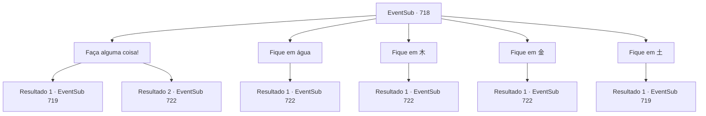

# Eventos secundários · 718

[Índice da tabela](index.md) · [Índice geral](../index.md)

ID: `pt:EventSub:718` · Fonte: `EventSub4` · Versão: 1.2.47.

Mapeamento estático dos arquivos; a disponibilidade e a execução dependem do estado da run.

## Texto do evento

*Sem texto no arquivo.*

## Dados de entrada

```json
{
  "id": 718,
  "grade": 1,
  "subEvent": "",
  "required": ""
}
```

## Mapa das escolhas



## Escolhas e resultados

### Escolha 1

Faça alguma coisa!

Requisitos e outros campos da escolha:

```json
{
  "required": ""
}
```

#### Resultado 1.1

Reconhecendo o quão desesperado você soa, Lei apressa-se em agarrar seu pulso e puxa você. Vocês dois ficam no círculo com a letra '土' nele. Uma barreira feita de solo e terra os cerca. Ao mesmo tempo, um raio feroz de chamas é disparado da estátua do Dragão Amarelo. Somente depois que o raio de fogo desaparece é que a barreira some. Estranhamente, não parecia quente de jeito nenhum. 

 "O fogo e a barreira devem ter sido falsos. Afinal, este é um teste de elementos! Está tentando testar nosso entendimento deles. O sopro do dragão era fogo, então o enfrentamos com terra. Devemos ser capazes de resolver o próximo da mesma forma."

 Mesmo antes de Lei terminar, a orbe da estátua do dragão começa a brilhar novamente. Desta vez, sua cor é azul, e você nota gotas de água se reunindo ao redor dela.

Continuação registrada: [Evento 719](0719.md) na mesma tabela.

```json
{
  "required": "",
  "chance": "1",
  "nextEvent": 719,
  "type": 2,
  "reward": ""
}
```

#### Resultado 1.2

Reconhecendo o quão desesperado você soa, Lei apressadamente agarra seu pulso e puxa você. Vocês dois ficam no círculo com a letra '水' nele. Ao mesmo tempo, um feroz raio de chamas é disparado da estátua do Dragão Amarelo. Você e Lei são engolfados pelo fogo, mas estranhamente, você não sente calor algum. Logo o fogo desaparece, e vocês dois estão em algum lugar no meio de uma montanha nevada. 

 "Aquele fogo deve ter sido falso. Aquilo foi... algum tipo de teste, presumo, que infelizmente não passamos."


Continuação registrada: [Evento 722](0722.md) na mesma tabela.

```json
{
  "required": "",
  "chance": "1",
  "nextEvent": 722,
  "type": 2,
  "reward": "5_744_1"
}
```

### Escolha 2

Fique em água

Requisitos e outros campos da escolha:

```json
{
  "required": ""
}
```

#### Resultado 2.1

Você e Lei se movem dentro do círculo com a letra '水' nele. Uma barreira de água envolve vocês dois. Ao mesmo tempo, um raio feroz de chamas é disparado da estátua do Dragão Amarelo. Você e Lei são engolfados pelo fogo, mas estranhamente, vocês não sentem calor algum. Logo o fogo desaparece, e vocês dois estão em algum lugar no meio de uma montanha nevada. 

 "Aquele fogo deve ter sido falso. Aquilo foi... algum tipo de teste, presumo, que infelizmente não passamos."


Continuação registrada: [Evento 722](0722.md) na mesma tabela.

```json
{
  "required": "",
  "chance": "1",
  "nextEvent": 722,
  "type": 2,
  "reward": "5_744_1"
}
```

### Escolha 3

Fique em 木

Requisitos e outros campos da escolha:

```json
{
  "required": ""
}
```

#### Resultado 3.1

Você e Lei se movem dentro do círculo com a letra '木' nele. Ao mesmo tempo, um feroz raio de chamas é disparado da estátua do Dragão Amarelo. Você e Lei são engolfados pelo fogo, mas estranhamente, vocês não sentem calor algum. Logo o fogo desaparece, e vocês dois estão em algum lugar no meio de uma montanha nevada. 

 "Aquele fogo deve ter sido falso. Aquilo foi... algum tipo de teste, presumo, que infelizmente não passamos."


Continuação registrada: [Evento 722](0722.md) na mesma tabela.

```json
{
  "required": "",
  "chance": "1",
  "nextEvent": 722,
  "type": 2,
  "reward": "5_744_1"
}
```

### Escolha 4

Fique em 金

Requisitos e outros campos da escolha:

```json
{
  "required": ""
}
```

#### Resultado 4.1

Você e Lei se movem dentro do círculo com a letra '金' nele. Ao mesmo tempo, um feroz raio de chamas é disparado da estátua do Dragão Amarelo. Você e Lei são engolfados pelo fogo, mas estranhamente, vocês não sentem calor algum. Logo o fogo desaparece, e vocês dois estão em algum lugar no meio de uma montanha nevada. 

 "Aquele fogo deve ter sido falso. Aquilo foi... algum tipo de teste, presumo, que infelizmente não passamos."


Continuação registrada: [Evento 722](0722.md) na mesma tabela.

```json
{
  "required": "",
  "chance": "1",
  "nextEvent": 722,
  "type": 2,
  "reward": "5_744_1"
}
```

### Escolha 5

Fique em 土

Requisitos e outros campos da escolha:

```json
{
  "required": ""
}
```

#### Resultado 5.1

Você e Lei se movem dentro do círculo com a letra '土' nele. Uma barreira feita de solo e terra os cerca. Ao mesmo tempo, um raio feroz de chamas é disparado da estátua do Dragão Amarelo. Somente depois que o raio de fogo desaparece é que a barreira some. Estranhamente, não parecia quente de forma alguma. 

 "O fogo e a barreira devem ter sido falsos. Afinal, este é um teste de elementos! Está tentando testar nosso entendimento deles. O sopro do dragão era fogo, então o enfrentamos com terra. Devemos ser capazes de resolver o próximo da mesma forma."


Continuação registrada: [Evento 719](0719.md) na mesma tabela.

```json
{
  "required": "",
  "chance": "1",
  "nextEvent": 719,
  "type": 2,
  "reward": ""
}
```

## Referências que chegam a este evento

- [Evento 717 · escolha 2 · resultado 1](0717.md#escolha-2)
