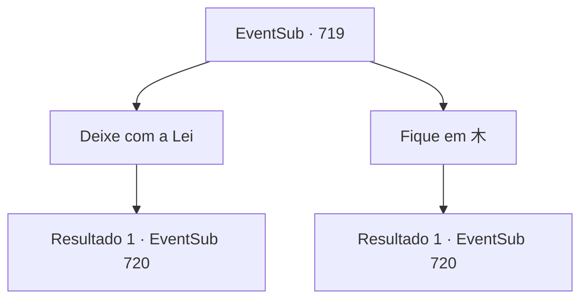

# Eventos secundários · 719

[Índice da tabela](index.md) · [Índice geral](../index.md)

ID: `pt:EventSub:719` · Fonte: `EventSub4` · Versão: 1.2.47.

Mapeamento estático dos arquivos; a disponibilidade e a execução dependem do estado da run.

## Texto do evento

*Sem texto no arquivo.*

## Dados de entrada

```json
{
  "id": 719,
  "grade": 1,
  "subEvent": "",
  "required": ""
}
```

## Mapa das escolhas



## Escolhas e resultados

### Escolha 1

Deixe com a Lei

Requisitos e outros campos da escolha:

```json
{
  "required": ""
}
```

#### Resultado 1.1

Lei leva você para dentro do círculo com a letra '木' nele. Desta vez, a estátua do Dragão Amarelo dispara um sopro de água e gelo. Então, um crescimento repentino de árvores surge ao seu redor e de Lei, absorvendo o sopro frio, e depois desaparece. Lei testemunha tudo e então acena com satisfação. 

 "Claro. O mestre deixou a questão sobre os Cinco Elementos e suas relações."

 Você e Lei continuam a repelir o sopro imaginário mais três vezes. Finalmente, a estátua começa a se mover para cima, revelando uma passagem secreta escondida sob a barriga do Dragão Amarelo. 

 "...Vamos entrar, Sohyeop."


Continuação registrada: [Evento 720](0720.md) na mesma tabela.

```json
{
  "required": "",
  "chance": "1",
  "nextEvent": 720,
  "type": 2,
  "reward": ""
}
```

### Escolha 2

Fique em 木

Requisitos e outros campos da escolha:

```json
{
  "required": "1_7_14"
}
```

#### Resultado 2.1

Você leva Lei para dentro do círculo com a letra '木' nele. Desta vez, a estátua do Dragão Amarelo dispara um sopro de água e gelo. Então, um crescimento repentino de árvores surge ao seu redor e de Lei, absorvendo o sopro frio, e depois desaparece. Lei testemunha tudo e então acena com satisfação. 

 "Claro. O mestre deixou a questão sobre os Cinco Elementos e suas relações."

 Você e Lei continuam a repelir o sopro imaginário mais três vezes. Finalmente, a estátua começa a se mover para cima, revelando uma passagem secreta escondida sob a barriga do Dragão Amarelo. 

 "...Vamos entrar, Sohyeop."


Continuação registrada: [Evento 720](0720.md) na mesma tabela.

```json
{
  "required": "",
  "chance": "1",
  "nextEvent": 720,
  "type": 2,
  "reward": ""
}
```

## Referências que chegam a este evento

- [Evento 718 · escolha 1 · resultado 1](0718.md#escolha-1)
- [Evento 718 · escolha 5 · resultado 1](0718.md#escolha-5)
