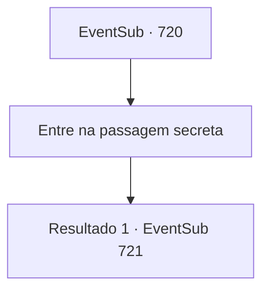

# Eventos secundários · 720

[Índice da tabela](index.md) · [Índice geral](../index.md)

ID: `pt:EventSub:720` · Fonte: `EventSub4` · Versão: 1.2.47.

Mapeamento estático dos arquivos; a disponibilidade e a execução dependem do estado da run.

## Texto do evento

*Sem texto no arquivo.*

## Dados de entrada

```json
{
  "id": 720,
  "grade": 1,
  "subEvent": "",
  "required": ""
}
```

## Mapa das escolhas



## Escolhas e resultados

### Escolha 1

Entre na passagem secreta

Requisitos e outros campos da escolha:

```json
{
  "required": ""
}
```

#### Resultado 1.1

Você e Lei entram na passagem subterrânea. Depois de descer a escada em espiral, vocês acabam em uma sala, cujas paredes estão cheias de algum tipo de escrita. Lei começa a decifrar as letras na parede e então grita animadamente. 

 "Sohyeop, dê uma olhada! Este é o Manual do Mestre Long bem aqui!"

 Você não tem ideia do que o manual trata, já que não consegue ler os caracteres da língua oriental. Lei imediatamente percebe a confusão em sua expressão e começa a explicar. 

 "Vou te ajudar com a tradução. Vamos nos ajudar e dominá-lo juntos."


Continuação registrada: [Evento 721](0721.md) na mesma tabela.

```json
{
  "required": "",
  "chance": "1",
  "nextEvent": 721,
  "type": 2,
  "reward": "5_743_1"
}
```

## Referências que chegam a este evento

- [Evento 719 · escolha 1 · resultado 1](0719.md#escolha-1)
- [Evento 719 · escolha 2 · resultado 1](0719.md#escolha-2)
