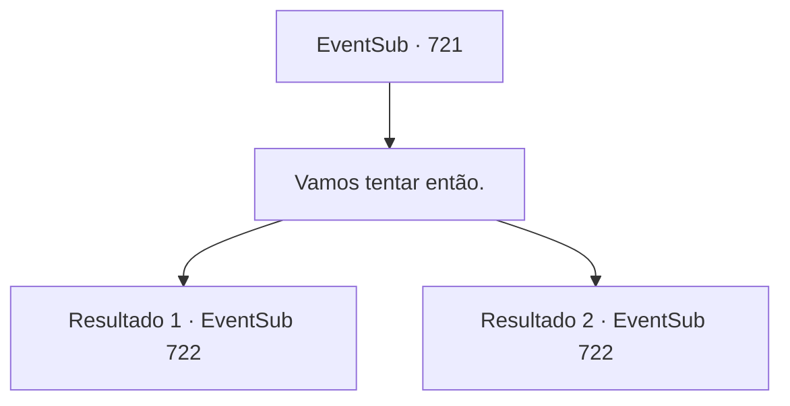

# Eventos secundários · 721

[Índice da tabela](index.md) · [Índice geral](../index.md)

ID: `pt:EventSub:721` · Fonte: `EventSub4` · Versão: 1.2.47.

Mapeamento estático dos arquivos; a disponibilidade e a execução dependem do estado da run.

## Texto do evento

*Sem texto no arquivo.*

## Dados de entrada

```json
{
  "id": 721,
  "grade": 1,
  "subEvent": "",
  "required": ""
}
```

## Mapa das escolhas



## Escolhas e resultados

### Escolha 1

Vamos tentar então.

Requisitos e outros campos da escolha:

```json
{
  "required": ""
}
```

#### Resultado 1.1

Lei faz o seu melhor para transmitir as informações escritas no texto nas paredes para você. Graças ao seu esforço, você consegue pelo menos parcialmente entender o legado do Mestre Long, dominando parte dele como seu. O Manual tinha um amplo espectro de conhecimento valioso, como métodos para gerenciar e usar 'Ki', treinar seu corpo e maneiras de se defender contra vários tipos de armas. Você e Lei se ajudam mutuamente a dominar as habilidades de Long. Acontece que você é talentoso nisso. Até Lei pareceu surpreso. 

 O que parece ser dias se passam, e o treinamento finalmente chega ao fim. Lei faz a saudação ao estilo oriental, para mostrar sua gratidão. 

 "Não posso agradecer o suficiente por sua assistência. Eu não teria conseguido realmente obter o Manual sozinho. Vou me lembrar de retribuir essa dívida um dia, Sohyeop."

 Você e Lei saem por um pequeno caminho lateral perto do túmulo. Depois de cerca de uma hora de caminhada, o vento frio avisa que você está perto da saída. Vocês dois rapidamente se movem para fora, finalmente livres do ar da caverna. A julgar pela paisagem, você acha que ainda está na Cordilheira da Lâmina, mas não é a mesma entrada da caverna que você entrou antes. 

 "A formação deve ter nos desviado do curso."


Continuação registrada: [Evento 722](0722.md) na mesma tabela.

```json
{
  "required": "",
  "chance": "1|0_6_1|0_7_1",
  "nextEvent": 722,
  "type": 0,
  "reward": "0_2_1|22_106_1"
}
```

#### Resultado 1.2

Lei faz o seu melhor para transmitir a informação escrita no texto nas paredes para você. Mas você não tem a aptidão para aprender adequadamente. Infelizmente, você assume o único papel possível que resta para você - basicamente ser o alvo de prática de Lei. 

 O que parece dias se passam, e o treinamento finalmente chega ao fim. Lei faz a saudação ao estilo oriental, para mostrar sua gratidão. 

 "Não posso agradecer o suficiente por sua assistência. Eu não teria sido capaz de realmente obter o Manual sozinho. Vou lembrar de retribuir essa dívida um dia, Sohyeop."

 Você e Lei saem por um pequeno caminho lateral perto do túmulo. Depois de cerca de uma hora de caminhada, o vento frio avisa que você está perto da saída. Vocês dois rapidamente se movem para fora, finalmente livres do ar da caverna. Julgando pela paisagem, você acha que ainda está na Cordilheira da Lâmina, mas não é a mesma entrada da caverna que você entrou antes. 

 "A formação deve ter nos desviado do curso."


Continuação registrada: [Evento 722](0722.md) na mesma tabela.

```json
{
  "required": "",
  "chance": "20",
  "nextEvent": 722,
  "type": 1,
  "reward": "0_2_1|0_13_1|0_0_1"
}
```

## Referências que chegam a este evento

- [Evento 720 · escolha 1 · resultado 1](0720.md#escolha-1)
