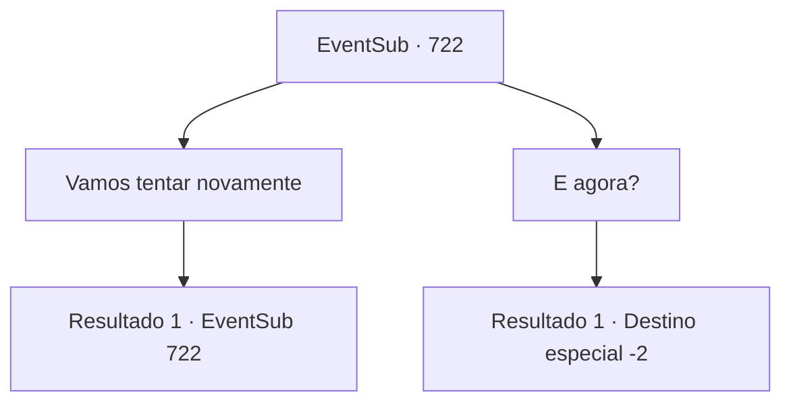

# Eventos secundários · 722

[Índice da tabela](index.md) · [Índice geral](../index.md)

ID: `pt:EventSub:722` · Fonte: `EventSub4` · Versão: 1.2.47.

Mapeamento estático dos arquivos; a disponibilidade e a execução dependem do estado da run.

## Texto do evento

*Sem texto no arquivo.*

## Dados de entrada

```json
{
  "id": 722,
  "grade": 1,
  "subEvent": "",
  "required": ""
}
```

## Mapa das escolhas



## Escolhas e resultados

### Escolha 1

Vamos tentar novamente

Requisitos e outros campos da escolha:

```json
{
  "required": "5_744_1"
}
```

#### Resultado 1.1

Você insiste com Lei que não pode terminar assim, sugerindo procurar a entrada novamente. Lei também parece insatisfeito, enquanto concorda com você. Você ajuda a procurar a entrada da caverna, mas ela não está em lugar nenhum. É como se o lugar tivesse desaparecido magicamente. 

 "Huh... A entrada da caverna parece ter simplesmente desaparecido."


Continuação registrada: [Evento 722](0722.md) na mesma tabela.

```json
{
  "required": "",
  "chance": "1",
  "nextEvent": 722,
  "type": 2,
  "reward": "5_744_2"
}
```

### Escolha 2

E agora?

Requisitos e outros campos da escolha:

```json
{
  "required": "18_744_1"
}
```

#### Resultado 2.1


 "Estou planejando entrar no torneio, como mencionei antes. Se você também estiver interessado, vá para Gladio. É para lá que estou indo. Se o destino assim escolher, talvez nos vejamos novamente."

 Lei faz a já familiar saudação oriental e se inclina.  

 "Devo me desculpar agora. Peço desculpas novamente por envolvê-lo nos assuntos da minha família. Ah, e obrigado novamente pela sua ajuda."

 Com isso, Lei se despede de você e se afasta.

Continuação registrada: [Destino especial `-2`](../destinos-especiais.md).

```json
{
  "required": "",
  "chance": "1",
  "nextEvent": -2,
  "type": 2,
  "reward": "12_11_3"
}
```

## Referências que chegam a este evento

- [Evento 715 · escolha 2 · resultado 1](0715.md#escolha-2)
- [Evento 715 · escolha 3 · resultado 1](0715.md#escolha-3)
- [Evento 715 · escolha 5 · resultado 1](0715.md#escolha-5)
- [Evento 716 · escolha 1 · resultado 1](0716.md#escolha-1)
- [Evento 716 · escolha 3 · resultado 1](0716.md#escolha-3)
- [Evento 716 · escolha 4 · resultado 1](0716.md#escolha-4)
- [Evento 718 · escolha 1 · resultado 2](0718.md#escolha-1)
- [Evento 718 · escolha 2 · resultado 1](0718.md#escolha-2)
- [Evento 718 · escolha 3 · resultado 1](0718.md#escolha-3)
- [Evento 718 · escolha 4 · resultado 1](0718.md#escolha-4)
- [Evento 721 · escolha 1 · resultado 1](0721.md#escolha-1)
- [Evento 721 · escolha 1 · resultado 2](0721.md#escolha-1)
- [Evento 722 · escolha 1 · resultado 1](0722.md#escolha-1)
- [Evento 724 · escolha 2 · resultado 1](0724.md#escolha-2)
- [Evento 724 · escolha 3 · resultado 1](0724.md#escolha-3)
