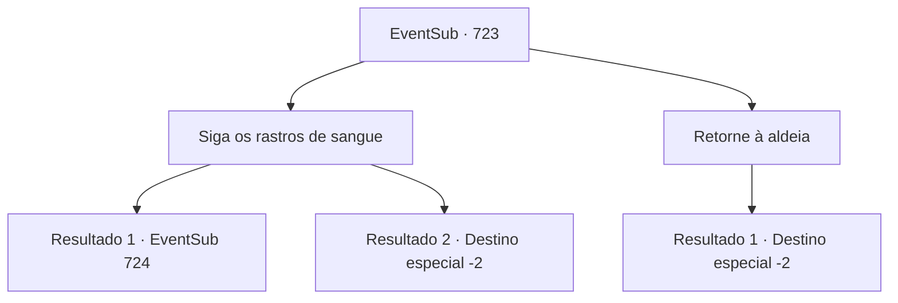

# Eventos secundários · 723

[Índice da tabela](index.md) · [Índice geral](../index.md)

ID: `pt:EventSub:723` · Fonte: `EventSub4` · Versão: 1.2.47.

Mapeamento estático dos arquivos; a disponibilidade e a execução dependem do estado da run.

## Texto do evento

*Sem texto no arquivo.*

## Dados de entrada

```json
{
  "id": 723,
  "grade": 1,
  "subEvent": "",
  "required": ""
}
```

## Mapa das escolhas



## Escolhas e resultados

### Escolha 1

Siga os rastros de sangue

Requisitos e outros campos da escolha:

```json
{
  "required": ""
}
```

#### Resultado 1.1

A julgar pela força do cheiro de sangue, a trilha não está lá há muito tempo. Você segue apressadamente a trilha de sangue. Ela leva você a um riacho que flui entre os penhascos. Ao se aproximar do campo de cascalho perto do riacho, o cheiro de sangue se torna mais forte. Lá, você encontra Lei, gravemente ferido. 

 "*tosse* *tosse*...! Ugh.. ack...! S- Sohyeop...! *tosse*"

 Ele não está apenas ferido, ele está à beira da morte. Seria impossível salvá-lo como da última vez, simplesmente enfaixando seus ferimentos ou dando-lhe uma poção comum. Como se preparando para sua morte, Lei levanta sua mão trêmula em sua direção.

Continuação registrada: [Evento 724](0724.md) na mesma tabela.

```json
{
  "required": "",
  "chance": "1|0_14_1|0_7_1",
  "nextEvent": 724,
  "type": 0,
  "reward": ""
}
```

#### Resultado 1.2

A julgar pela força do cheiro de sangue, o rastro não está lá há muito tempo. Mas o ambiente acidentado do Monte Tragia torna o rastreamento muito mais difícil do que o normal. A neve eventualmente cobre todo o sangue, apagando o rastro. Infelizmente, você desiste de seguir o rastro de sangue e desce para a vila abaixo. 

 "Um oriental? Não me lembro de ter visto um."

 Você questiona os aldeões locais sobre Lei e Shao, mas eles não estão em lugar nenhum. Você faz o mesmo nos dias seguintes, permanecendo na vila, mas o resultado é o mesmo. Infelizmente, não há nada que você possa fazer, exceto desistir da busca.

Continuação registrada: [Destino especial `-2`](../destinos-especiais.md).

```json
{
  "required": "",
  "chance": "15",
  "nextEvent": -2,
  "type": 1,
  "reward": "12_11_-1"
}
```

### Escolha 2

Retorne à aldeia

Requisitos e outros campos da escolha:

```json
{
  "required": ""
}
```

#### Resultado 2.1

Você retorna à vila abaixo da montanha e questiona os moradores locais sobre Lei e Shao. 

 "Um oriental? Não me lembro de ter visto um."

 Mas você não consegue encontrar nenhuma testemunha, muito menos rumores. Você faz o mesmo nos dias seguintes, permanecendo na vila, mas o resultado é o mesmo. Infelizmente, não há nada que você possa fazer, exceto desistir da busca.

Continuação registrada: [Destino especial `-2`](../destinos-especiais.md).

```json
{
  "required": "",
  "chance": "1",
  "nextEvent": -2,
  "type": 2,
  "reward": "12_11_-1"
}
```

## Referências que chegam a este evento

- [Evento 711 · escolha 2 · resultado 1](0711.md#escolha-2)
