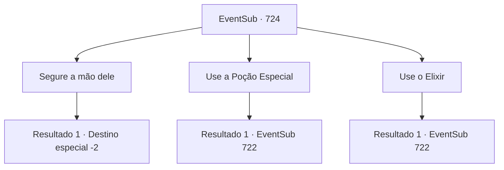

# Eventos secundários · 724

[Índice da tabela](index.md) · [Índice geral](../index.md)

ID: `pt:EventSub:724` · Fonte: `EventSub4` · Versão: 1.2.47.

Mapeamento estático dos arquivos; a disponibilidade e a execução dependem do estado da run.

## Texto do evento

*Sem texto no arquivo.*

## Dados de entrada

```json
{
  "id": 724,
  "grade": 1,
  "subEvent": "",
  "required": ""
}
```

## Mapa das escolhas



## Escolhas e resultados

### Escolha 1

Segure a mão dele

Requisitos e outros campos da escolha:

```json
{
  "required": ""
}
```

#### Resultado 1.1

Você se aproxima dele e segura firmemente sua mão. Ele sussurra algo em seus ouvidos. Mas você não faz ideia do que significava, porque é uma língua que você não reconhece. Com isso, Lei cai sem vida. Você fecha seus olhos pela última vez e vai embora.

Continuação registrada: [Destino especial `-2`](../destinos-especiais.md).

```json
{
  "required": "",
  "chance": "1",
  "nextEvent": -2,
  "type": 2,
  "reward": "12_11_-1"
}
```

### Escolha 2

Use a Poção Especial

Requisitos e outros campos da escolha:

```json
{
  "required": "8_130_1"
}
```

#### Resultado 2.1

Você destampa a Poção Especial da Guilda dos Aventureiros e a despeja na boca de Lei. Com a garrafa vazia, Lei começa a se recuperar. O sangramento, os cortes, feridas menores - todos desapareceram. Lei consegue se levantar, percebe o que aconteceu e então olha ao redor. Quando ele te avista, seus olhos começam a tremer. 

 "...É você, Sohyeop. C- como devo retribuir essa gentileza...?"

 Você balança a cabeça e o questiona. Você merecia saber o que aconteceu após o duelo dele com Shao. Lei solta um suspiro profundo e então explica. 

 "Depois que você desmaiou, Sohyeop, eu continuei minha luta contra Shao. Mas meus ferimentos levaram a melhor sobre mim. Eu mal consegui escapar, mas meus ferimentos começaram a piorar. Eu estava morrendo, antes de você intervir."

 Parece que você teve um timing perfeito, de acordo com ele.

Continuação registrada: [Evento 722](0722.md) na mesma tabela.

```json
{
  "required": "",
  "chance": "1",
  "nextEvent": 722,
  "type": 2,
  "reward": "0_3_3|4_130_1"
}
```

### Escolha 3

Use o Elixir

Requisitos e outros campos da escolha:

```json
{
  "required": "8_297_1"
}
```

#### Resultado 3.1

Você destampa o Elixir e o despeja na boca de Lei. Com a garrafa vazia, Lei começa a se recuperar. O sangramento, os cortes, feridas menores - estão todos desaparecidos. Lei consegue se levantar, percebe o que aconteceu, então olha ao redor. Quando ele te avista, seus olhos começam a tremer. 

 "...É você, Sohyeop. C- como devo retribuir essa gentileza...?"

 Você balança a cabeça e o questiona. Você merecia saber o que aconteceu após o duelo dele com Shao. Lei solta um suspiro profundo, então explica. 

 "Depois que você desmaiou, Sohyeop, eu continuei minha luta contra Shao. Mas meus ferimentos levaram a melhor sobre mim. Eu mal consegui escapar, mas meus ferimentos começaram a piorar. Eu estava morrendo, antes de você intervir."

 Parece que você teve um timing perfeito, de acordo com ele.

Continuação registrada: [Evento 722](0722.md) na mesma tabela.

```json
{
  "required": "",
  "chance": "1",
  "nextEvent": 722,
  "type": 2,
  "reward": "0_3_3|4_297_1"
}
```

## Referências que chegam a este evento

- [Evento 723 · escolha 1 · resultado 1](0723.md#escolha-1)
