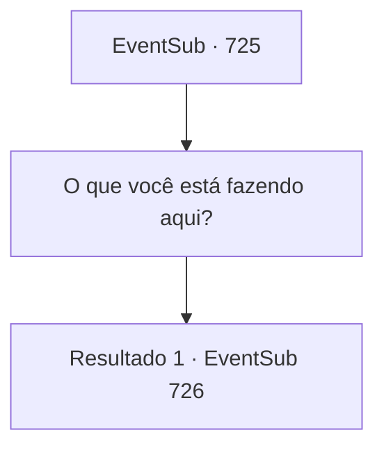

# Eventos secundários · 725

[Índice da tabela](index.md) · [Índice geral](../index.md)

ID: `pt:EventSub:725` · Fonte: `EventSub4` · Versão: 1.2.47.

Mapeamento estático dos arquivos; a disponibilidade e a execução dependem do estado da run.

## Texto do evento

Você para em uma cidade chamada Tunaas, localizada onde o Grande Deserto começa. A cidade marca o fim das planícies verdes e o início dos campos de areia. Seu estilo arquitetônico é semelhante ao de outros assentamentos no Grande Deserto. Tendas coloridas cobrem as ruas, com pequenas barracas e cabines espalhadas aqui e ali, servindo como pequenas lojas. Enquanto você está passeando pelo lugar, alguém lhe dá um tapinha no ombro. 

 "Sohyeop! Nos encontramos novamente."

 É Lei, com sua saudação oriental, que lhe dá as boas-vindas animadamente.

## Dados de entrada

```json
{
  "id": 725,
  "grade": 1,
  "subEvent": "",
  "required": "12_11_3|1_2_35"
}
```

## Mapa das escolhas



## Escolhas e resultados

### Escolha 1

O que você está fazendo aqui?

Requisitos e outros campos da escolha:

```json
{
  "required": ""
}
```

#### Resultado 1.1

Sua pergunta deixa Lei confuso. 

 "Bem, este é o caminho para Gladio, não é? Eu estava indo para lá. Pensei em parar aqui para fazer uma pausa. Não foi o mesmo para você também, Sohyeop?"


Continuação registrada: [Evento 726](0726.md) na mesma tabela.

```json
{
  "required": "",
  "chance": "1",
  "nextEvent": 726,
  "type": 2,
  "reward": ""
}
```

## Referências que chegam a este evento

Nenhum `nextEvent` positivo da mesma tabela aponta para este nó. Isso não prova que seja inacessível: sorteio e estado de história podem selecioná-lo.

