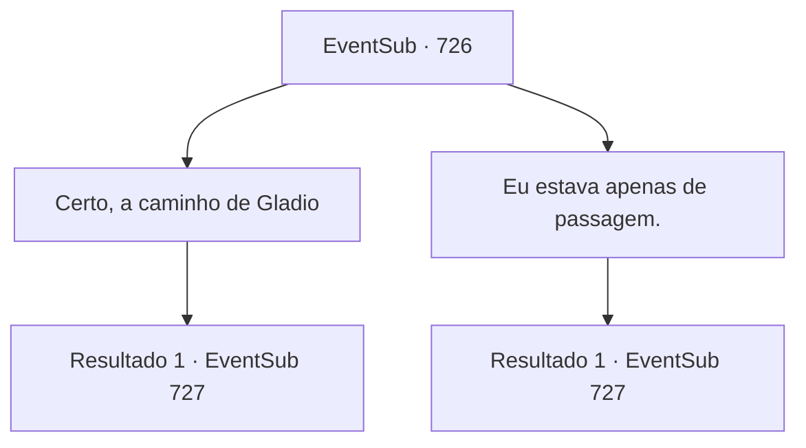

# Eventos secundários · 726

[Índice da tabela](index.md) · [Índice geral](../index.md)

ID: `pt:EventSub:726` · Fonte: `EventSub4` · Versão: 1.2.47.

Mapeamento estático dos arquivos; a disponibilidade e a execução dependem do estado da run.

## Texto do evento

*Sem texto no arquivo.*

## Dados de entrada

```json
{
  "id": 726,
  "grade": 1,
  "subEvent": "",
  "required": ""
}
```

## Mapa das escolhas



## Escolhas e resultados

### Escolha 1

Certo, a caminho de Gladio

Requisitos e outros campos da escolha:

```json
{
  "required": ""
}
```

#### Resultado 1.1

Lei responde com um sorriso. 

 "Tenho certeza de que você se sairá bem, Sohyeop, mas não vou facilitar para você."

 Ele se oferece para pagar desta vez, em troca da ajuda da última vez. 

 "Há um lugar legal por aqui. Venha - o almoço é por minha conta."

 Antes que você pudesse recusar, Lei agarra seu braço e o leva ao restaurante. O lugar deve ser popular na região - mesmo sem uma placa, está lotado de clientes. Lei levanta a mão para sinalizar o garçom, então faz o pedido. 

 "O... masala? Marsila...? Enfim, esse é o melhor do cardápio, ouvi dizer."


Continuação registrada: [Evento 727](0727.md) na mesma tabela.

```json
{
  "required": "",
  "chance": "1",
  "nextEvent": 727,
  "type": 2,
  "reward": ""
}
```

### Escolha 2

Eu estava apenas de passagem.

Requisitos e outros campos da escolha:

```json
{
  "required": ""
}
```

#### Resultado 2.1

Lei responde com um sorriso. 

 "Ahá. Então, deve ter sido obra do destino que nos encontramos aqui."

 Ele se oferece para pagar desta vez, em troca da ajuda da última vez. 

 "Há um lugar legal por aqui. Venha - o almoço é por minha conta."

 Antes que você pudesse recusar, Lei agarra seu braço e te arrasta para o restaurante. O lugar deve ser popular localmente - mesmo sem uma placa, está lotado de clientes. Lei levanta a mão para sinalizar o garçom, então faz o pedido. 

 "O... masala? Marsila...? Enfim, esse é o melhor do cardápio, ouvi dizer."


Continuação registrada: [Evento 727](0727.md) na mesma tabela.

```json
{
  "required": "",
  "chance": "1",
  "nextEvent": 727,
  "type": 2,
  "reward": ""
}
```

## Referências que chegam a este evento

- [Evento 725 · escolha 1 · resultado 1](0725.md#escolha-1)
