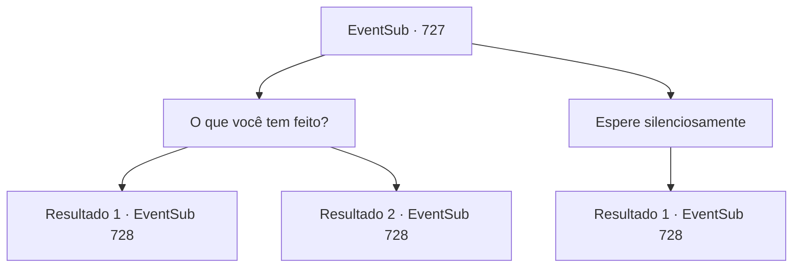

# Eventos secundários · 727

[Índice da tabela](index.md) · [Índice geral](../index.md)

ID: `pt:EventSub:727` · Fonte: `EventSub4` · Versão: 1.2.47.

Mapeamento estático dos arquivos; a disponibilidade e a execução dependem do estado da run.

## Texto do evento

*Sem texto no arquivo.*

## Dados de entrada

```json
{
  "id": 727,
  "grade": 1,
  "subEvent": "",
  "required": ""
}
```

## Mapa das escolhas



## Escolhas e resultados

### Escolha 1

O que você tem feito?

Requisitos e outros campos da escolha:

```json
{
  "required": ""
}
```

#### Resultado 1.1

Enquanto você espera a comida chegar, decide se atualizar sobre as coisas com Lei. Ele responde, enchendo os copos na mesa com água. 

 "Eu caminhei desde a Cordilheira da Montanha da Lâmina até aqui. Passei por treinamento e meditação sempre que tive a chance. Quase encontrei os homens de Shao uma vez. Felizmente, eu os avistei primeiro e consegui evitar derramamento de sangue."

 A comida é servida enquanto você ouve as histórias de Lei. Colocado no prato está um pedaço de frango, coberto com molho amarelo avermelhado. 

 Você e Lei terminam uma refeição satisfatória e saem. Enquanto vocês passeiam pelas ruas, Lei sussurra, bem perto do seu ouvido. 

 "Sohyeop. Estamos sendo seguidos. Deve ser... os Dragões Vermelhos."


Continuação registrada: [Evento 728](0728.md) na mesma tabela.

```json
{
  "required": "18_743_1",
  "chance": "1",
  "nextEvent": 728,
  "type": 2,
  "reward": "0_0_1"
}
```

#### Resultado 1.2

Enquanto você espera a comida chegar, decide se atualizar sobre as coisas com Lei. Ele responde, enchendo os copos na mesa com água. 

 "Eu caminhei desde a Cordilheira da Montanha da Lâmina até aqui. Passei por treinamento e meditação sempre que tive a chance. Quase encontrei os homens de Shao uma vez. Felizmente, eu os avistei primeiro e consegui evitar derramamento de sangue."

 A comida é servida enquanto você ouve as histórias de Lei. Colocado no prato está um pedaço de frango, coberto com molho amarelo avermelhado. 

 Você e Lei terminam uma refeição satisfatória e saem. Enquanto vocês passeiam pelas ruas, Lei sussurra, bem perto do seu ouvido. 

 "Sohyeop. Estamos sendo seguidos. Deve ser... os Dragões Vermelhos."


Continuação registrada: [Evento 728](0728.md) na mesma tabela.

```json
{
  "required": "5_743_1",
  "chance": "1",
  "nextEvent": 728,
  "type": 2,
  "reward": "0_0_1"
}
```

### Escolha 2

Espere silenciosamente

Requisitos e outros campos da escolha:

```json
{
  "required": ""
}
```

#### Resultado 2.1

Você espera silenciosamente que a comida seja servida. Lei enche os copos na mesa com água e bebe do seu. Logo, o garçom chega com os pratos. Colocado no prato está um pedaço de frango, coberto com um molho amarelo avermelhado. 

 Você e Lei terminam uma refeição satisfatória e saem. Enquanto vocês estão passeando pelas ruas, Lei sussurra, bem perto do seu ouvido. 

 "Sohyeop. Estamos sendo seguidos. Deve ser... os Dragões Vermelhos."


Continuação registrada: [Evento 728](0728.md) na mesma tabela.

```json
{
  "required": "",
  "chance": "1",
  "nextEvent": 728,
  "type": 2,
  "reward": "0_0_1"
}
```

## Referências que chegam a este evento

- [Evento 726 · escolha 1 · resultado 1](0726.md#escolha-1)
- [Evento 726 · escolha 2 · resultado 1](0726.md#escolha-2)
