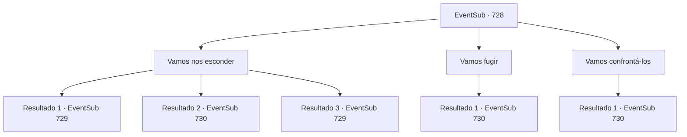

# Eventos secundários · 728

[Índice da tabela](index.md) · [Índice geral](../index.md)

ID: `pt:EventSub:728` · Fonte: `EventSub4` · Versão: 1.2.47.

Mapeamento estático dos arquivos; a disponibilidade e a execução dependem do estado da run.

## Texto do evento

*Sem texto no arquivo.*

## Dados de entrada

```json
{
  "id": 728,
  "grade": 1,
  "subEvent": "",
  "required": ""
}
```

## Mapa das escolhas



## Escolhas e resultados

### Escolha 1

Vamos nos esconder

Requisitos e outros campos da escolha:

```json
{
  "required": ""
}
```

#### Resultado 1.1

Você e Lei escapam para um beco próximo, para se afastar do perseguidor misterioso. Lá, vocês se escondem atrás de um carrinho de mão estacionado. Logo, você reconhece a presença dos perseguidores. 

 "Hã...? Para onde eles foram?"

 Depois de não conseguir encontrá-los, eles começam a trocar alguns sinais com as mãos e depois se separam. Um dos Red Drakes se posiciona bem na sua frente, com as costas expostas. Ele está completamente alheio à existência sua e de Lei. Lei olha para você por um segundo, então sinaliza que ele vai emboscar o Red Drake.

Continuação registrada: [Evento 729](0729.md) na mesma tabela.

```json
{
  "required": "21_5_4",
  "chance": "1|0_6_1",
  "nextEvent": 729,
  "type": 0,
  "reward": ""
}
```

#### Resultado 1.2

Você e Lei escapam para um beco próximo, para se afastar do perseguidor misterioso. Lá, vocês tentam se esconder atrás de um carrinho de mão estacionado. Mas eles são mais rápidos - você e Lei são avistados. 

 "Ei! Parem aí mesmo!"

 Um dos Dragões Vermelhos lança uma adaga de seus bolsos. Lei a desvia com sua espada e grita. 

 "Cuidado, Sohyeop! Acho que é hora de lutar agora!"


Continuação registrada: [Evento 730](0730.md) na mesma tabela.

```json
{
  "required": "21_5_4",
  "chance": "14",
  "nextEvent": 730,
  "type": 1,
  "reward": "6_3_179",
  "place": 4
}
```

#### Resultado 1.3

Você e Lei escapam para um beco próximo, para se afastar do perseguidor misterioso. Lá, vocês se escondem atrás de um carrinho de mão estacionado. Logo, você reconhece a presença dos perseguidores. 

 "Hã...? Para onde eles foram?"

 Depois de não conseguir encontrá-los, eles começam a trocar alguns sinais com as mãos e depois se separam. Um dos Red Drakes se posiciona bem na sua frente, com as costas expostas. Ele está completamente alheio à existência sua e de Lei. Lei olha para você por um segundo, então sinaliza que ele vai emboscar o Red Drake.

Continuação registrada: [Evento 729](0729.md) na mesma tabela.

```json
{
  "required": "20_5_4",
  "chance": "1",
  "nextEvent": 729,
  "type": 2,
  "reward": ""
}
```

### Escolha 2

Vamos fugir

Requisitos e outros campos da escolha:

```json
{
  "required": ""
}
```

#### Resultado 2.1

Você sugere começar a fugir, ao que Lei concorda. 

 "Concordo. Por aqui, Sohyeop."

 Você e Lei correm pela multidão agitada. No entanto, vocês não vão muito longe. Red Drakes já os cercaram, bloqueando o caminho em todas as direções. Você rapidamente se vira, mas há inimigos lá também. 

 "Heh, para onde você acha que está indo?"

 Um dos Red Drakes lança uma adaga de seus bolsos. Lei a desvia com sua espada e grita. 

 "Cuidado, Sohyeop! Acho que é hora de lutar agora!"


Continuação registrada: [Evento 730](0730.md) na mesma tabela.

```json
{
  "required": "",
  "chance": "1",
  "nextEvent": 730,
  "type": 2,
  "reward": "6_3_179",
  "place": 4
}
```

### Escolha 3

Vamos confrontá-los

Requisitos e outros campos da escolha:

```json
{
  "required": ""
}
```

#### Resultado 3.1

Você diz a Lei que enfrentá-los de frente seria a melhor coisa a fazer. Lei hesita no início, mas logo parece cheia de determinação. 

 "Entendi. Eu devo lidar com eles aqui mesmo e ir encontrar Shao eu mesma."

 Enquanto vocês conversam, os Drakes Vermelhos aparecem e os cercam. 

 "Vamos não tornar isso muito difícil um para o outro, hm?"

 Um dos Drakes Vermelhos lança uma adaga de seus bolsos. Lei a deflete com sua espada e grita. 

 "Cuidado, Sohyeop!"


Continuação registrada: [Evento 730](0730.md) na mesma tabela.

```json
{
  "required": "",
  "chance": "1",
  "nextEvent": 730,
  "type": 2,
  "reward": "6_3_179",
  "place": 4
}
```

## Referências que chegam a este evento

- [Evento 727 · escolha 1 · resultado 1](0727.md#escolha-1)
- [Evento 727 · escolha 1 · resultado 2](0727.md#escolha-1)
- [Evento 727 · escolha 2 · resultado 1](0727.md#escolha-2)
