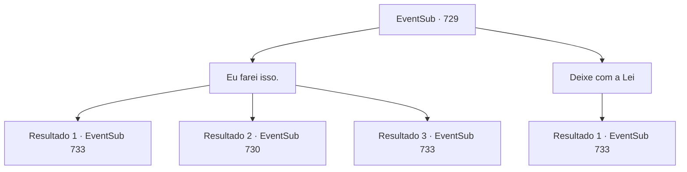

# Eventos secundários · 729

[Índice da tabela](index.md) · [Índice geral](../index.md)

ID: `pt:EventSub:729` · Fonte: `EventSub4` · Versão: 1.2.47.

Mapeamento estático dos arquivos; a disponibilidade e a execução dependem do estado da run.

## Texto do evento

*Sem texto no arquivo.*

## Dados de entrada

```json
{
  "id": 729,
  "grade": 1,
  "subEvent": "",
  "required": ""
}
```

## Mapa das escolhas



## Escolhas e resultados

### Escolha 1

Eu farei isso.

Requisitos e outros campos da escolha:

```json
{
  "required": ""
}
```

#### Resultado 1.1

Você sinaliza para Lei parar, indo atrás do Red Drake sozinho. Você se aproxima rapidamente do guerreiro e o nocauteia com um único golpe. Quando o Red Drake desaba, Lei agarra e esconde o corpo em um canto sombrio. 

 "Vamos levar algum tempo aqui. Quando esse cara acordar, quero questioná-lo sobre o paradeiro de Shao."

 Algum tempo passa, e o Red Drake recobra a consciência. Assustado, ele olha para você e Lei. Lei aponta sua espada para a garganta dele e pergunta. 

 "Onde está Shao? Por que ela está atrás de mim?"

 O Red Drake sorri amargamente e responde. 

 "*risada*... Você nunca será um Chefe de Clã. Você não tem o direito. Não manche o futuro da Srta. Shao com sua ganância imunda!"

 Ao ouvir a resposta, os olhos de Lei se arregalam, surpresos. 

 "O quê...? O que você...? Por que eu iria querer manchar o futuro de Shao? Não tenho intenção de me tornar um Chefe de Clã! Como - ... Isso é tudo um grande mal-entendido. Preciso falar com Shao eu mesmo."

 Mas o Red Drake sorri e se recusa a falar mais.

Continuação registrada: [Evento 733](0733.md) na mesma tabela.

```json
{
  "required": "21_5_4",
  "chance": "1|0_6_1",
  "nextEvent": 733,
  "type": 0,
  "reward": ""
}
```

#### Resultado 1.2

Você sinaliza para Lei parar, indo atrás do Dragão Vermelho sozinho. Mas o guerreiro percebe sua aproximação e rapidamente puxa sua espada. 

 "AQUI!"

 Ao ouvir sua voz, os outros Dragões Vermelhos voltam para o beco. Lei faz uma expressão preocupada, relutantemente alcançando sua espada. 

 "Parece que não temos outra escolha. Prepare-se para lutar."


Continuação registrada: [Evento 730](0730.md) na mesma tabela.

```json
{
  "required": "21_5_4",
  "chance": "22",
  "nextEvent": 730,
  "type": 1,
  "reward": "6_3_179",
  "place": 4
}
```

#### Resultado 1.3

Você sinaliza para Lei parar, indo atrás do Red Drake sozinho. Você se aproxima rapidamente do guerreiro e o nocauteia com um único golpe. Quando o Red Drake desaba, Lei agarra e esconde o corpo em um canto sombrio. 

 "Vamos levar algum tempo aqui. Quando esse cara acordar, quero questioná-lo sobre o paradeiro de Shao."

 Algum tempo passa, e o Red Drake recobra a consciência. Assustado, ele olha para você e Lei. Lei aponta sua espada para a garganta dele e pergunta. 

 "Onde está Shao? Por que ela está atrás de mim?"

 O Red Drake sorri amargamente e responde. 

 "*risada*... Você nunca será um Chefe de Clã. Você não tem o direito. Não manche o futuro da Srta. Shao com sua ganância imunda!"

 Ao ouvir a resposta, os olhos de Lei se arregalam, surpresos. 

 "O quê...? O que você...? Por que eu iria querer manchar o futuro de Shao? Não tenho intenção de me tornar um Chefe de Clã! Como - ... Isso é tudo um grande mal-entendido. Preciso falar com Shao eu mesmo."

 Mas o Red Drake sorri e se recusa a falar mais.

Continuação registrada: [Evento 733](0733.md) na mesma tabela.

```json
{
  "required": "20_5_4",
  "chance": "1",
  "nextEvent": 733,
  "type": 2,
  "reward": ""
}
```

### Escolha 2

Deixe com a Lei

Requisitos e outros campos da escolha:

```json
{
  "required": ""
}
```

#### Resultado 2.1

Lei se aproxima rapidamente do guerreiro e o nocauteia com um único golpe. Quando o Dragão Vermelho desaba, Lei agarra e esconde o corpo em um canto sombrio. 

 "Vamos levar algum tempo aqui. Quando esse cara acordar, quero questioná-lo sobre o paradeiro de Shao."

 Algum tempo se passa, e o Dragão Vermelho recobra a consciência. Assustado, ele olha para você e Lei. Lei aponta sua espada para a garganta dele e pergunta. 

 "Onde está Shao? Por que ela está atrás de mim?"

 O Dragão Vermelho sorri amargamente e responde. 

 "*risada*... Você nunca será um Chefe de Clã. Você não tem o direito. Não manche o futuro da Srta. Shao com sua ganância imunda!"

 Ao ouvir a resposta, os olhos de Lei se arregalam, surpresos. 

 "O quê...? O que você...? Por que eu iria querer manchar o futuro de Shao? Não tenho intenção de me tornar um Chefe de Clã! Como - ... Isso é tudo um grande mal-entendido. Preciso falar com Shao pessoalmente."

 Mas o Dragão Vermelho sorri e se recusa a falar mais.

Continuação registrada: [Evento 733](0733.md) na mesma tabela.

```json
{
  "required": "",
  "chance": "1",
  "nextEvent": 733,
  "type": 2,
  "reward": ""
}
```

## Referências que chegam a este evento

- [Evento 728 · escolha 1 · resultado 1](0728.md#escolha-1)
- [Evento 728 · escolha 1 · resultado 3](0728.md#escolha-1)
