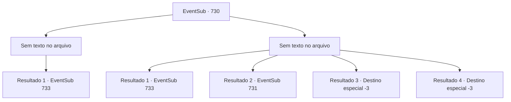

# Eventos secundários · 730

[Índice da tabela](index.md) · [Índice geral](../index.md)

ID: `pt:EventSub:730` · Fonte: `EventSub4` · Versão: 1.2.47.

Mapeamento estático dos arquivos; a disponibilidade e a execução dependem do estado da run.

## Texto do evento

*Sem texto no arquivo.*

## Dados de entrada

```json
{
  "id": 730,
  "grade": 1,
  "subEvent": "",
  "required": ""
}
```

## Mapa das escolhas



## Escolhas e resultados

### Escolha 1

*Sem texto no arquivo; o papel dessa opção depende da interface do jogo.*

Requisitos e outros campos da escolha:

```json
{
  "required": ""
}
```

#### Resultado 1.1

Você e Lei derrotam os Red Drakes, então procedem a interrogar um deles. 

 "Onde está Shao? Por que ela está atrás de mim?"

 O Red Drake sorri amargamente e responde. 

 "*risada*... Você nunca será um Chefe de Clã. Você não tem o direito. Não manche o futuro da Srta. Shao com sua ganância imunda!"

 Ao ouvir a resposta, os olhos de Lei se arregalam, surpresos. 

 "O quê...? O que você está...? Por que eu iria querer manchar o futuro de Shao? Não tenho intenção de me tornar um Chefe de Clã! Como - ... Isso é tudo um grande mal-entendido. Preciso falar com Shao eu mesmo."

 Mas o Red Drake sorri e se recusa a falar mais.

Continuação registrada: [Evento 733](0733.md) na mesma tabela.

```json
{
  "required": "",
  "chance": "1",
  "nextEvent": 733,
  "type": 2,
  "reward": ""
}
```

### Escolha 2

*Sem texto no arquivo; o papel dessa opção depende da interface do jogo.*

Requisitos e outros campos da escolha:

```json
{
  "required": ""
}
```

#### Resultado 2.1

Você é forçado a se ajoelhar enquanto uma adaga lançada se crava em você. Lei consegue tanto te proteger quanto lutar contra os Red Drakes, eventualmente nocauteando todos eles. Lei então agarra um dos Red Drakes e começa a interrogá-lo. 

 "Onde está Shao? Por que ela está atrás de mim?"

 O Red Drake sorri amargamente e responde. 

 "*risada*... Você nunca será um Chefe de Clã. Você não tem o direito. Não manche o futuro da Srta. Shao com sua ganância imunda!"

 Ao ouvir a resposta, os olhos de Lei se arregalam, surpreso. 

 "O quê...? O que você...? Por que eu iria querer manchar o futuro de Shao? Eu não tenho intenção de me tornar um Chefe de Clã! Como - ... Isso é tudo um grande mal-entendido. Eu preciso falar com Shao pessoalmente."

 Mas o Red Drake sorri e se recusa a falar mais.

Continuação registrada: [Evento 733](0733.md) na mesma tabela.

```json
{
  "required": "5_743_1",
  "chance": "1",
  "nextEvent": 733,
  "type": 2,
  "reward": ""
}
```

#### Resultado 2.2

Você é forçado a se ajoelhar enquanto uma adaga lançada se crava em você. Lei tenta tanto te proteger quanto lutar contra os Red Drakes, mas com o passar do tempo ele começa a ficar sobrecarregado. 

 "Uck... Fuja, Sohyeop. Sou eu que eles querem. Eles não vão te perseguir mais."

 Um dos Red Drakes fala, rindo. 

 "Isso mesmo, bruto. Como alguém tão incivilizado como você poderia entender a honra de um verdadeiro guerreiro, hein? Se você realmente deseja sobreviver, deite-se no chão e implore por misericórdia. Vamos generosamente poupar sua pele."


Continuação registrada: [Evento 731](0731.md) na mesma tabela.

```json
{
  "required": "18_743_1|1_0_2|1_1_2",
  "chance": "1",
  "nextEvent": 731,
  "type": 2,
  "reward": "0_0_-1|0_1_-1"
}
```

#### Resultado 2.3

Você é forçado a se ajoelhar enquanto uma adaga lançada se crava em você. Sangue quente jorra da ferida. Uma dor excruciante se espalha pelo seu corpo. A última coisa que você vê é Lei enfrentando os Red Drakes sozinho. Sua visão escurece. 

 "S- Sohyeop!"

 Sua consciência se desvanece, enquanto a voz de Lei o embala até o fim.

Continuação registrada: [Destino especial `-3`](../destinos-especiais.md).

```json
{
  "required": "18_743_1|2_0_2",
  "chance": "1",
  "nextEvent": -3,
  "type": 2,
  "reward": "0_0_-1|0_1_-1"
}
```

#### Resultado 2.4

Você é forçado a se ajoelhar enquanto uma adaga lançada se crava em você. Sangue quente jorra da ferida. Uma dor excruciante se espalha pelo seu corpo. A última coisa que você vê é Lei enfrentando os Red Drakes sozinho. Sua visão escurece. 

 "S- Sohyeop!"

 Sua consciência se desvanece, enquanto a voz de Lei o embala até o fim.

Continuação registrada: [Destino especial `-3`](../destinos-especiais.md).

```json
{
  "required": "18_743_1|2_1_2",
  "chance": "1",
  "nextEvent": -3,
  "type": 2,
  "reward": "0_0_-1|0_1_-1"
}
```

## Referências que chegam a este evento

- [Evento 728 · escolha 1 · resultado 2](0728.md#escolha-1)
- [Evento 728 · escolha 2 · resultado 1](0728.md#escolha-2)
- [Evento 728 · escolha 3 · resultado 1](0728.md#escolha-3)
- [Evento 729 · escolha 1 · resultado 2](0729.md#escolha-1)
