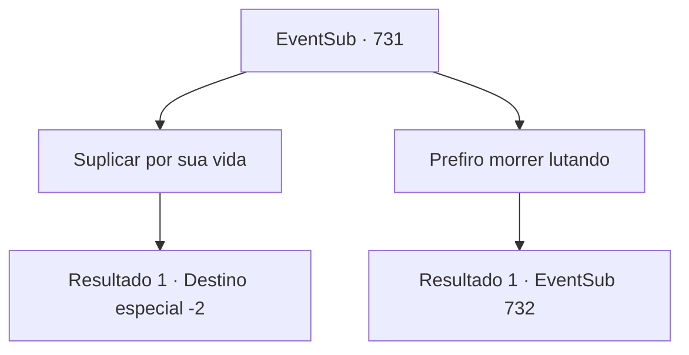

# Eventos secundários · 731

[Índice da tabela](index.md) · [Índice geral](../index.md)

ID: `pt:EventSub:731` · Fonte: `EventSub4` · Versão: 1.2.47.

Mapeamento estático dos arquivos; a disponibilidade e a execução dependem do estado da run.

## Texto do evento

*Sem texto no arquivo.*

## Dados de entrada

```json
{
  "id": 731,
  "grade": 1,
  "subEvent": "",
  "required": ""
}
```

## Mapa das escolhas



## Escolhas e resultados

### Escolha 1

Suplicar por sua vida

Requisitos e outros campos da escolha:

```json
{
  "required": ""
}
```

#### Resultado 1.1

Você imediatamente se joga no chão, enfia o rosto na terra e implora por misericórdia. Logo, você é coberto por algum tipo de pó branco. Você o inala e desmaia imediatamente. 

 Quando finalmente acorda, está deitado em uma cama. Ao seu lado está sentado um homem muito velho, verificando sua saúde. 

 "Tomei a liberdade de... aplicar alguma cura rudimentar."

 Você pergunta a ele o que aconteceu com Lei. O velho responde balançando a cabeça. 

 "Seu companheiro... sinto muito, mas aquele estava além de qualquer ajuda."

 Você agradece ao velho pela ajuda e vai embora.

Continuação registrada: [Destino especial `-2`](../destinos-especiais.md).

```json
{
  "required": "",
  "chance": "1",
  "nextEvent": -2,
  "type": 2,
  "reward": "12_11_-1"
}
```

### Escolha 2

Prefiro morrer lutando

Requisitos e outros campos da escolha:

```json
{
  "required": ""
}
```

#### Resultado 2.1

Você decide manter sua dignidade. O Dragão Vermelho parece surpreso ao ouvir sua resposta. 

 "Ho... Você não é completamente insuportável. Tudo bem. Você também morrerá aqui."

 A luta recomeça.

Continuação registrada: [Evento 732](0732.md) na mesma tabela.

```json
{
  "required": "",
  "chance": "1",
  "nextEvent": 732,
  "type": 2,
  "reward": "6_0_179",
  "place": 4
}
```

## Referências que chegam a este evento

- [Evento 730 · escolha 2 · resultado 2](0730.md#escolha-2)
