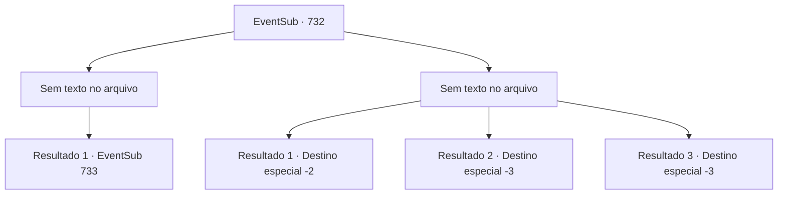

# Eventos secundários · 732

[Índice da tabela](index.md) · [Índice geral](../index.md)

ID: `pt:EventSub:732` · Fonte: `EventSub4` · Versão: 1.2.47.

Mapeamento estático dos arquivos; a disponibilidade e a execução dependem do estado da run.

## Texto do evento

*Sem texto no arquivo.*

## Dados de entrada

```json
{
  "id": 732,
  "grade": 1,
  "subEvent": "",
  "required": ""
}
```

## Mapa das escolhas



## Escolhas e resultados

### Escolha 1

*Sem texto no arquivo; o papel dessa opção depende da interface do jogo.*

Requisitos e outros campos da escolha:

```json
{
  "required": ""
}
```

#### Resultado 1.1

Você e Lei conseguem derrotar todos os Dracos Vermelhos. Você se encosta em uma parede próxima para recuperar o fôlego. Lei agarra um dos Dracos Vermelhos e começa a interrogá-lo. 

 "Onde está Shao? Por que ela está atrás de mim?"

 O Draco Vermelho sorri amargamente e responde. 

 "*risada*... Você nunca será um Chefe de Clã. Você não tem o direito. Não manche o futuro da Srta. Shao com sua ganância imunda!"

 Ao ouvir a resposta, os olhos de Lei se arregalam, surpreso. 

 "O quê...? O que você...? Por que eu iria querer manchar o futuro de Shao? Não tenho intenção de me tornar um Chefe de Clã! Como - ... Isso é tudo um grande mal-entendido. Preciso falar com Shao pessoalmente."

 Mas o Draco Vermelho sorri e se recusa a falar mais.

Continuação registrada: [Evento 733](0733.md) na mesma tabela.

```json
{
  "required": "",
  "chance": "1",
  "nextEvent": 733,
  "type": 2,
  "reward": ""
}
```

### Escolha 2

*Sem texto no arquivo; o papel dessa opção depende da interface do jogo.*

Requisitos e outros campos da escolha:

```json
{
  "required": ""
}
```

#### Resultado 2.1

Você luta mais uma vez, mas apenas confiança não foi suficiente para derrotá-los. Infelizmente, você e Lei caem para os Red Drakes, cortados violentamente por suas espadas. Então, os guardas locais avistam a confusão. 

 "O que está acontecendo ali?!"

 Os Red Drakes fogem rapidamente. Exausto, você desmaia. 

 Quando finalmente acorda, você está deitado em uma cama. Ao seu lado está um homem muito velho, verificando sua saúde. 

 "Tomei a liberdade de... aplicar alguma cura rudimentar. Evite se esforçar demais por um tempo."

 Você pergunta a ele o que aconteceu com Lei. O velho responde balançando a cabeça. 

 "Seu companheiro... sinto muito, mas aquele estava além de qualquer ajuda."

 Você agradece ao velho pela ajuda e vai embora.

Continuação registrada: [Destino especial `-2`](../destinos-especiais.md).

```json
{
  "required": "1_0_2|1_1_2",
  "chance": "1",
  "nextEvent": -2,
  "type": 2,
  "reward": "0_0_-1|0_1_-1|12_11_-1"
}
```

#### Resultado 2.2

Você luta mais uma vez, mas apenas confiança não foi suficiente para derrotá-los. Infelizmente, você e Lei caem para os Dragões Vermelhos, cortados violentamente por suas espadas.

Continuação registrada: [Destino especial `-3`](../destinos-especiais.md).

```json
{
  "required": "2_0_2",
  "chance": "1",
  "nextEvent": -3,
  "type": 2,
  "reward": "0_0_-1|0_1_-1"
}
```

#### Resultado 2.3

Você luta mais uma vez, mas apenas confiança não foi suficiente para derrotá-los. Infelizmente, você e Lei caem para os Dragões Vermelhos, cortados violentamente por suas espadas.

Continuação registrada: [Destino especial `-3`](../destinos-especiais.md).

```json
{
  "required": "2_1_2",
  "chance": "1",
  "nextEvent": -3,
  "type": 2,
  "reward": "0_0_-1|0_1_-1"
}
```

## Referências que chegam a este evento

- [Evento 731 · escolha 2 · resultado 1](0731.md#escolha-2)
