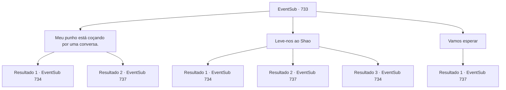

# Eventos secundários · 733

[Índice da tabela](index.md) · [Índice geral](../index.md)

ID: `pt:EventSub:733` · Fonte: `EventSub4` · Versão: 1.2.47.

Mapeamento estático dos arquivos; a disponibilidade e a execução dependem do estado da run.

## Texto do evento

*Sem texto no arquivo.*

## Dados de entrada

```json
{
  "id": 733,
  "grade": 1,
  "subEvent": "",
  "required": ""
}
```

## Mapa das escolhas



## Escolhas e resultados

### Escolha 1

Meu punho está coçando por uma conversa.

Requisitos e outros campos da escolha:

```json
{
  "required": ""
}
```

#### Resultado 1.1

Seu punho acaba sendo um grande interrogador. 

 "P- por favor... Pare... Eu vou falar."

 Tremendo, o Red Drake espancado agarra seu pulso para parar a violência iminente. Mas você decide ensiná-lo um pouco mais de respeito. Você o soca mais algumas vezes. Finalmente, o Red Drake começa a falar, tentando não te irritar novamente. 

 "U- ugh... Eu vou contar tudo, sim..."

 Segundo ele, Shao está hospedado em uma pousada luxuosa, localizada na área mais desenvolvida da cidade. Você ordena que o homem leve vocês dois até a pousada mencionada. 

 'A Maçã Dourada', a pousada onde dizem que Shao está hospedado, foi encontrada no coração do Distrito de Entretenimento. As paredes de arenito áspero e o telhado de tijolos vermelho-carmesim chamam sua atenção. Decorando as paredes estão representações cuidadosamente esculpidas de animais e plantas encontrados no Oriente. Dois espadachins, vestidos com trajes orientais, guardam a entrada. Assim que veem você e Lei, eles puxam suas espadas.

Continuação registrada: [Evento 734](0734.md) na mesma tabela.

```json
{
  "required": "",
  "chance": "1|0_5_1",
  "nextEvent": 734,
  "type": 0,
  "reward": ""
}
```

#### Resultado 1.2

Você tenta abrir a boca do Red Drake com um soco. Mas o guerreiro permanece resoluto até o fim, não revelando o paradeiro de Shao. Lei finalmente põe fim ao seu interrogatório sem sentido. 

 "Sohyeop. Pensando bem, se Shao realmente está me perseguindo tanto, realmente não precisamos saber onde ela está."

 Lei ajuda o Red Drake machucado a se levantar e fala. 

 "Vá e diga a Shao que estarei esperando no lago fora da cidade. Diga a ela para vir pessoalmente."

 O Red Drake se afasta mancando. Lei observa o Red Drake se afastando por alguns segundos antes de voltar seu olhar para você. 

 "Eu... Eu sei que você também quer se vingar de Shao, Sohyeop, mas eu quero falar com ela primeiro. Mesmo que uma luta se torne inevitável, quero ser eu a acabar com isso."


Continuação registrada: [Evento 737](0737.md) na mesma tabela.

```json
{
  "required": "",
  "chance": "14",
  "nextEvent": 737,
  "type": 1,
  "reward": ""
}
```

### Escolha 2

Leve-nos ao Shao

Requisitos e outros campos da escolha:

```json
{
  "required": ""
}
```

#### Resultado 2.1

O Dragão Vermelho executa sua ordem obedientemente. Ele gagueja, tentando não te irritar. 

 "E-eu vou falar. Eu vou falar."

 Segundo ele, Shao está hospedado em uma pousada luxuosa, localizada na área mais desenvolvida da cidade. Você ordena ao homem que leve vocês dois até a pousada mencionada. 

 'A Maçã Dourada', a pousada onde dizem que Shao está hospedado, foi encontrada no coração do Distrito de Entretenimento. As paredes de arenito áspero e o telhado de tijolos vermelho-carmesim chamam sua atenção. Decorando as paredes estão representações cuidadosamente esculpidas de animais e plantas encontrados no Oriente. Dois espadachins, vestidos com trajes orientais, guardam a entrada. Assim que veem você e Lei, eles sacam suas espadas.

Continuação registrada: [Evento 734](0734.md) na mesma tabela.

```json
{
  "required": "21_1_4",
  "chance": "1|0_12_1",
  "nextEvent": 734,
  "type": 0,
  "reward": ""
}
```

#### Resultado 2.2

Você agarra o Red Drake pela gola e sacode. Mas o guerreiro permanece resoluto até o fim, não revelando o paradeiro de Shao. Lei finalmente põe um fim ao seu interrogatório sem sentido. 

 "Sohyeop. Pensando bem, se Shao realmente está me perseguindo tanto, realmente não precisamos saber onde ela está."

 Lei ajuda o Red Drake machucado a se levantar e fala. 

 "Vá e diga a Shao que estarei esperando no lago fora da cidade. Diga a ela para vir pessoalmente."

 O Red Drake se afasta mancando. Lei observa o Red Drake se afastando por alguns segundos antes de voltar seu olhar para você. 

 "Eu... Eu sei que você também quer se vingar de Shao, Sohyeop, mas eu quero falar com ela primeiro. Mesmo que uma luta se torne inevitável, eu quero ser o único a pôr um fim nisso."


Continuação registrada: [Evento 737](0737.md) na mesma tabela.

```json
{
  "required": "21_1_4",
  "chance": "20",
  "nextEvent": 737,
  "type": 1,
  "reward": ""
}
```

#### Resultado 2.3

O Dragão Vermelho cumpre sua ordem obedientemente. Ele gagueja, tentando não te irritar. 

 "E-eu vou falar. Eu vou falar."

 Segundo ele, Shao está hospedado em uma pousada luxuosa, localizada na área mais desenvolvida da cidade. Você ordena ao homem que leve vocês dois até a pousada mencionada. 

 'A Maçã Dourada', a pousada onde Shao supostamente está hospedado, foi encontrada no coração do Distrito de Entretenimento. As paredes de arenito áspero e o telhado de tijolos vermelho-carmesim chamam sua atenção. Decorando as paredes estão representações cuidadosamente esculpidas de animais e plantas encontrados no Oriente. Dois espadachins, vestidos com trajes orientais, guardam a entrada. Assim que veem você e Lei, eles sacam suas espadas.

Continuação registrada: [Evento 734](0734.md) na mesma tabela.

```json
{
  "required": "20_1_4",
  "chance": "1",
  "nextEvent": 734,
  "type": 2,
  "reward": ""
}
```

### Escolha 3

Vamos esperar

Requisitos e outros campos da escolha:

```json
{
  "required": "1_14_15"
}
```

#### Resultado 3.1

Você percebe que realmente não há necessidade de ir atrás de Shao você mesmo. Ela tem enviado pessoas atrás de Lei há um bom tempo. Envie este de volta, e Shao virá procurar Lei ela mesma. Lei concorda com um aceno de cabeça após ouvir sua explicação. Lei ajuda o Red Drake machucado a se levantar e fala. 

 "Vá e diga a Shao que estarei esperando no lago fora da cidade. Diga a ela para vir pessoalmente."

 O Red Drake se afasta mancando. Lei observa o Red Drake se afastando por alguns segundos antes de voltar seu olhar para você. 

 "Eu... Eu sei que você também quer se vingar de Shao, Sohyeop, mas eu quero falar com ela primeiro. Mesmo que uma luta se torne inevitável, eu quero ser o único a acabar com isso."


Continuação registrada: [Evento 737](0737.md) na mesma tabela.

```json
{
  "required": "",
  "chance": "1",
  "nextEvent": 737,
  "type": 2,
  "reward": ""
}
```

## Referências que chegam a este evento

- [Evento 729 · escolha 1 · resultado 1](0729.md#escolha-1)
- [Evento 729 · escolha 1 · resultado 3](0729.md#escolha-1)
- [Evento 729 · escolha 2 · resultado 1](0729.md#escolha-2)
- [Evento 730 · escolha 1 · resultado 1](0730.md#escolha-1)
- [Evento 730 · escolha 2 · resultado 1](0730.md#escolha-2)
- [Evento 732 · escolha 1 · resultado 1](0732.md#escolha-1)
