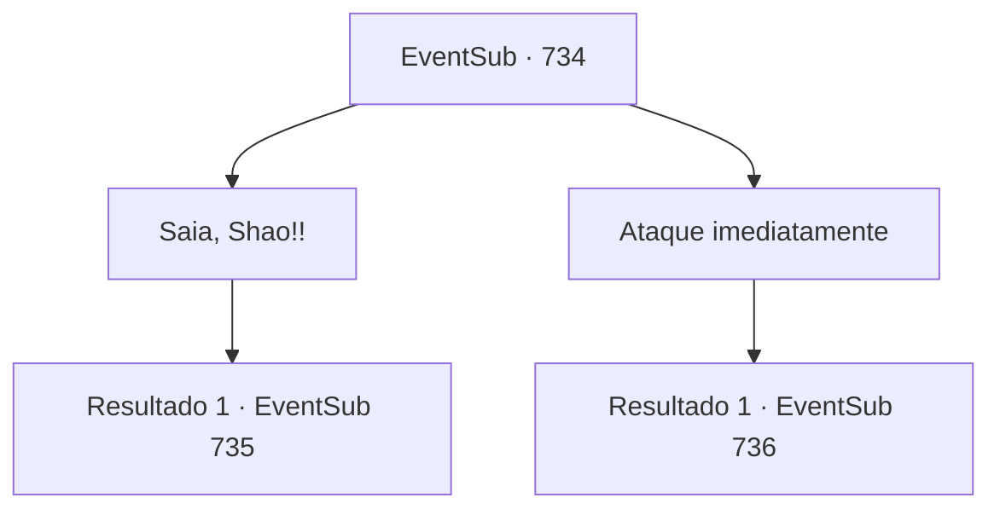

# Eventos secundários · 734

[Índice da tabela](index.md) · [Índice geral](../index.md)

ID: `pt:EventSub:734` · Fonte: `EventSub4` · Versão: 1.2.47.

Mapeamento estático dos arquivos; a disponibilidade e a execução dependem do estado da run.

## Texto do evento

*Sem texto no arquivo.*

## Dados de entrada

```json
{
  "id": 734,
  "grade": 1,
  "subEvent": "",
  "required": ""
}
```

## Mapa das escolhas



## Escolhas e resultados

### Escolha 1

Saia, Shao!!

Requisitos e outros campos da escolha:

```json
{
  "required": ""
}
```

#### Resultado 1.1

Você avança confiante, gritando o nome de Shao. Então, a porta da frente da estalagem se abre, revelando um grande número de guerreiros Red Drake. Todos parecem visivelmente surpresos ao ver que você e Lei chegaram aqui primeiro. Lei avança, gritando. 

 "Esperem! Eu, Ryu Lei, não desejo lutar com vocês. Por favor, deixem-nos passar! Eu só quero falar com Shao!"

 Mas parece que eles não têm intenção de fazer isso.

Continuação registrada: [Evento 735](0735.md) na mesma tabela.

```json
{
  "required": "",
  "chance": "1",
  "nextEvent": 735,
  "type": 2,
  "reward": ""
}
```

### Escolha 2

Ataque imediatamente

Requisitos e outros campos da escolha:

```json
{
  "required": ""
}
```

#### Resultado 2.1

Antes que alguém possa intervir, você ataca os guardas Red Drake imediatamente. Então, a porta da frente da estalagem se abre, revelando um grande número de guerreiros Red Drake. Atrás deles está Shao, observando a cena se desenrolar. Infelizmente, Lei também pega sua espada, ajudando você a lutar contra os Red Drakes.

Continuação registrada: [Evento 736](0736.md) na mesma tabela.

```json
{
  "required": "",
  "chance": "1",
  "nextEvent": 736,
  "type": 2,
  "reward": "6_0_179",
  "place": 4
}
```

## Referências que chegam a este evento

- [Evento 733 · escolha 1 · resultado 1](0733.md#escolha-1)
- [Evento 733 · escolha 2 · resultado 1](0733.md#escolha-2)
- [Evento 733 · escolha 2 · resultado 3](0733.md#escolha-2)
