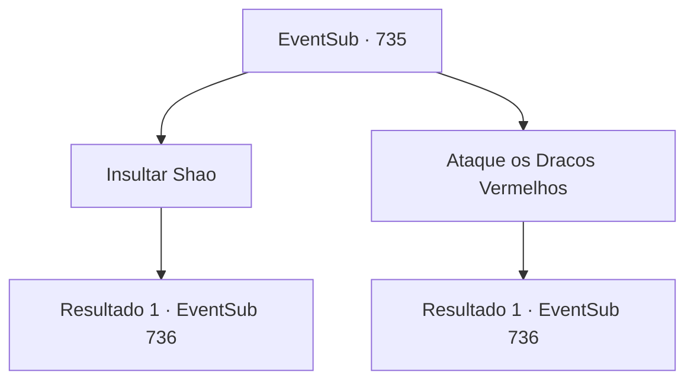

# Eventos secundários · 735

[Índice da tabela](index.md) · [Índice geral](../index.md)

ID: `pt:EventSub:735` · Fonte: `EventSub4` · Versão: 1.2.47.

Mapeamento estático dos arquivos; a disponibilidade e a execução dependem do estado da run.

## Texto do evento

*Sem texto no arquivo.*

## Dados de entrada

```json
{
  "id": 735,
  "grade": 1,
  "subEvent": "",
  "required": ""
}
```

## Mapa das escolhas



## Escolhas e resultados

### Escolha 1

Insultar Shao

Requisitos e outros campos da escolha:

```json
{
  "required": ""
}
```

#### Resultado 1.1

Você insulta Shao em voz alta, zombando de sua covardia, para que toda a cidade possa ouvir. Surpreso, Lei olha para você. 

 "E- espere! Sohyeop...!"

 Você cobre a boca de Lei com as mãos, continuando a provocação ainda mais alto. Logo, a própria Shao aparece diante de você. Seu rosto já está vermelho. Ela abre a boca, olhando para você com desdém. 

 "Você tem bastante coragem. Zombar de mim é zombar do meu clã. Dragões Vermelhos! Calem suas bocas para sempre!"

 Os Dragões Vermelhos obedecem fielmente à sua ordem, avançando contra você com suas armas erguidas.

Continuação registrada: [Evento 736](0736.md) na mesma tabela.

```json
{
  "required": "",
  "chance": "1",
  "nextEvent": 736,
  "type": 2,
  "reward": "6_0_179",
  "place": 4
}
```

### Escolha 2

Ataque os Dracos Vermelhos

Requisitos e outros campos da escolha:

```json
{
  "required": ""
}
```

#### Resultado 2.1

Antes que alguém possa intervir, você ataca imediatamente os guardas do Dragão Vermelho. Lei logo segue o exemplo, embora relutantemente, ajudando você a lutar contra os guerreiros.

Continuação registrada: [Evento 736](0736.md) na mesma tabela.

```json
{
  "required": "",
  "chance": "1",
  "nextEvent": 736,
  "type": 2,
  "reward": "6_0_179",
  "place": 4
}
```

## Referências que chegam a este evento

- [Evento 734 · escolha 1 · resultado 1](0734.md#escolha-1)
