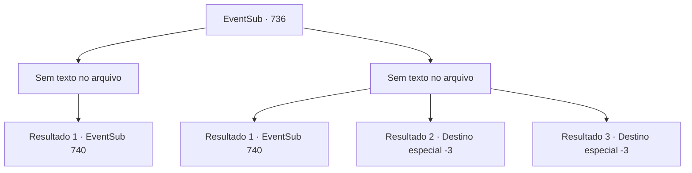

# Eventos secundários · 736

[Índice da tabela](index.md) · [Índice geral](../index.md)

ID: `pt:EventSub:736` · Fonte: `EventSub4` · Versão: 1.2.47.

Mapeamento estático dos arquivos; a disponibilidade e a execução dependem do estado da run.

## Texto do evento

*Sem texto no arquivo.*

## Dados de entrada

```json
{
  "id": 736,
  "grade": 1,
  "subEvent": "",
  "required": ""
}
```

## Mapa das escolhas



## Escolhas e resultados

### Escolha 1

*Sem texto no arquivo; o papel dessa opção depende da interface do jogo.*

Requisitos e outros campos da escolha:

```json
{
  "required": ""
}
```

#### Resultado 1.1

Você e Lei juntos derrotam os guarda-costas de Shao. Eles lutam bastante, mas não são páreo para vocês. Vasos de plantas, paredes e portas estão todos quebrados graças a vocês e aos corpos jogados por toda parte. De repente, Shao grita uma ordem, interrompendo a luta. 

 "PAREM! TODOS VOCÊS!"

 Enquanto sua voz ecoa pelo lugar, os Dragões Vermelhos param e se viram para Shao. Shao parece furiosa. Sua testa já ficou vermelha como carmim. 

 "Estou terrivelmente desapontada com você, Lei. Arrastar um estranho para assuntos de família! Você realmente é uma desgraça para o nosso clã."

 Desta vez, Lei responde por conta própria. 

 "Se você não tivesse usado os Dragões Vermelhos para me atacar em primeiro lugar, Sohyeop não teria se envolvido nessa confusão!"

 Shao deve ter odiado a resposta de Lei, porque isso fica ainda mais evidente em seu rosto. Ela puxa sua própria espada e grita. 

 "Venha! Vamos terminar isso, você e eu!"

 Mas Lei embainha sua espada em vez disso. Ele olha para o recepcionista da pousada atrás de Shao, tremendo de medo, e então fala. 

 "Tudo bem. Mas vamos levar a luta para fora. Venha me encontrar no lago, logo fora da cidade."


Continuação registrada: [Evento 740](0740.md) na mesma tabela.

```json
{
  "required": "",
  "chance": "1",
  "nextEvent": 740,
  "type": 2,
  "reward": "5_745_1"
}
```

### Escolha 2

*Sem texto no arquivo; o papel dessa opção depende da interface do jogo.*

Requisitos e outros campos da escolha:

```json
{
  "required": ""
}
```

#### Resultado 2.1

Você e Lei lutam contra os guarda-costas de Shao. Eles tinham a vantagem em números, mas também eram apenas humanos, afinal. O cansaço lentamente cobra seu preço de ambos os lados, enquanto a luta chega a um impasse. Então, Lei avista Shao em meio ao caos e grita. 

 "Shao Ryu! Eu te desafio para um duelo um a um! Enfrente-me se ainda tiver alguma honra!"

 Shao sorri em resposta. 

 "Pah! Não tenho obrigação de cruzar espadas com você!"

 Lei levanta sua espada, aponta para Shao e a provoca. 

 "Você deve estar com medo de me enfrentar!"

 O comentário de Lei fere o ego de Shao com sucesso. Com os olhos ardendo de ira, Shao se levanta. 

 "...Você não terá misericórdia de mim. Prepare-se."

 Mas Lei embainha sua espada. Ele olha para o recepcionista da pousada atrás de Shao, tremendo de medo, e então fala. 

 "Tudo bem. Mas vamos levar a luta para fora. Venha me encontrar no lago, logo fora da cidade."


Continuação registrada: [Evento 740](0740.md) na mesma tabela.

```json
{
  "required": "1_0_2|1_1_2",
  "chance": "1",
  "nextEvent": 740,
  "type": 2,
  "reward": "0_0_-1|0_1_-1"
}
```

#### Resultado 2.2

Você e Lei lutam contra os guarda-costas de Shao. Mas então, uma adaga lançada perfura seu pescoço. 

 "*suspiro*...! SOHYEOP!"

 Lei se aproxima para verificar você, assustado, mas não há nada que ele possa fazer. Sangue jorra da sua garganta. Infelizmente, sua visão escurece e logo se desvanece em nada.

Continuação registrada: [Destino especial `-3`](../destinos-especiais.md).

```json
{
  "required": "2_0_2",
  "chance": "1",
  "nextEvent": -3,
  "type": 2,
  "reward": "0_0_-1|0_1_-1"
}
```

#### Resultado 2.3

Você e Lei lutam contra os guarda-costas de Shao. Mas então, uma adaga lançada perfura seu pescoço. 

 "*suspiro*...! SOHYEOP!"

 Lei se aproxima para verificar você, assustado, mas não há nada que ele possa fazer. O sangue jorra da sua garganta. Infelizmente, sua visão escurece e logo se desvanece em nada.

Continuação registrada: [Destino especial `-3`](../destinos-especiais.md).

```json
{
  "required": "2_1_2",
  "chance": "1",
  "nextEvent": -3,
  "type": 2,
  "reward": "0_0_-1|0_1_-1"
}
```

## Referências que chegam a este evento

- [Evento 734 · escolha 2 · resultado 1](0734.md#escolha-2)
- [Evento 735 · escolha 1 · resultado 1](0735.md#escolha-1)
- [Evento 735 · escolha 2 · resultado 1](0735.md#escolha-2)
