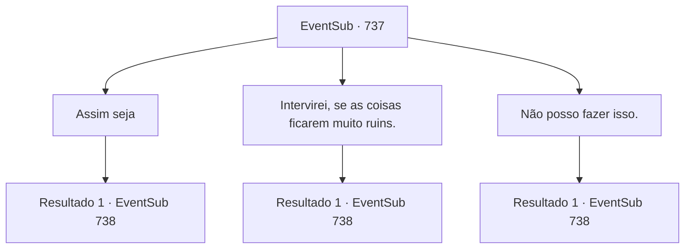

# Eventos secundários · 737

[Índice da tabela](index.md) · [Índice geral](../index.md)

ID: `pt:EventSub:737` · Fonte: `EventSub4` · Versão: 1.2.47.

Mapeamento estático dos arquivos; a disponibilidade e a execução dependem do estado da run.

## Texto do evento

*Sem texto no arquivo.*

## Dados de entrada

```json
{
  "id": 737,
  "grade": 1,
  "subEvent": "",
  "required": ""
}
```

## Mapa das escolhas



## Escolhas e resultados

### Escolha 1

Assim seja

Requisitos e outros campos da escolha:

```json
{
  "required": ""
}
```

#### Resultado 1.1

Lei coloca um sorriso satisfeito após ouvir sua resposta. 

 "Obrigado, Sohyeop."

 Você segue Lei até o lago fora da cidade. Localizado entre dunas de areia, o lago reflete serenamente o sol poente. 

 "O sol está prestes a se pôr."

 As palavras de Lei são verdadeiras. O céu estava começando a escurecer. Após um breve silêncio, ele fala novamente. 

 "Sohyeop. Como membro do meu clã, eu simplesmente quero ajudar. Lutar contra Shao não é algo que eu quero fazer. É tão difícil conseguir os dois ao mesmo tempo? *suspiro*... O que devo fazer?"


Continuação registrada: [Evento 738](0738.md) na mesma tabela.

```json
{
  "required": "",
  "chance": "1",
  "nextEvent": 738,
  "type": 2,
  "reward": ""
}
```

### Escolha 2

Intervirei, se as coisas ficarem muito ruins.

Requisitos e outros campos da escolha:

```json
{
  "required": ""
}
```

#### Resultado 2.1

Lei coloca um sorriso satisfeito após ouvir sua resposta. 

 "Obrigado, Sohyeop."

 Você segue Lei até o lago fora da cidade. Localizado entre dunas de areia, o lago reflete serenamente o sol poente. 

 "O sol está prestes a se pôr."

 As palavras de Lei são verdadeiras. O céu estava começando a escurecer. Após um breve silêncio, ele fala novamente. 

 "Sohyeop. Como membro do meu clã, eu simplesmente quero ajudar. Lutar contra Shao não é algo que eu quero fazer. É pedir demais? Conseguir ambos? *suspiro*... O que devo fazer?"


Continuação registrada: [Evento 738](0738.md) na mesma tabela.

```json
{
  "required": "",
  "chance": "1",
  "nextEvent": 738,
  "type": 2,
  "reward": ""
}
```

### Escolha 3

Não posso fazer isso.

Requisitos e outros campos da escolha:

```json
{
  "required": ""
}
```

#### Resultado 3.1

Lei fica em silêncio. Você segue Lei até o lago fora da cidade. Localizado entre dunas de areia, o lago reflete serenamente o sol poente. 

 "O sol está prestes a se pôr."

 As palavras de Lei são verdadeiras. O céu estava começando a escurecer. Vocês dois ficam em silêncio, sem conversa.

Continuação registrada: [Evento 738](0738.md) na mesma tabela.

```json
{
  "required": "",
  "chance": "1",
  "nextEvent": 738,
  "type": 2,
  "reward": ""
}
```

## Referências que chegam a este evento

- [Evento 733 · escolha 1 · resultado 2](0733.md#escolha-1)
- [Evento 733 · escolha 2 · resultado 2](0733.md#escolha-2)
- [Evento 733 · escolha 3 · resultado 1](0733.md#escolha-3)
