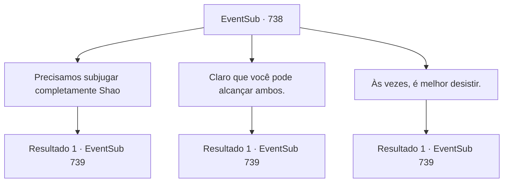

# Eventos secundários · 738

[Índice da tabela](index.md) · [Índice geral](../index.md)

ID: `pt:EventSub:738` · Fonte: `EventSub4` · Versão: 1.2.47.

Mapeamento estático dos arquivos; a disponibilidade e a execução dependem do estado da run.

## Texto do evento

*Sem texto no arquivo.*

## Dados de entrada

```json
{
  "id": 738,
  "grade": 1,
  "subEvent": "",
  "required": ""
}
```

## Mapa das escolhas



## Escolhas e resultados

### Escolha 1

Precisamos subjugar completamente Shao

Requisitos e outros campos da escolha:

```json
{
  "required": ""
}
```

#### Resultado 1.1

Você diz a Lei que Shao deve ser completamente subjugada. Somente após aniquilar Shao e sua facção, Lei poderá provar-se como o verdadeiro herdeiro do Clã Ryu e pôr fim a esta disputa. Os olhos de Lei se arregalam de surpresa. 

 "S- Sohyeop! I- isso é um destino que eu nem mereço nem quero!"

 Então, Shao e seu bando de Dracos Vermelhos aparecem do topo das dunas de areia próximas. Eles se aproximam de você e Lei. Observando a cena se desenrolar, Lei fala primeiro. 

 "Espere, Shao. Eu desejo conversar."

 Mas Shao responde sacando sua espada. 

 "Dracos Vermelhos! Destruam-nos!"

 Obedecendo suas ordens, os guerreiros imediatamente começam seu ataque.

Continuação registrada: [Evento 739](0739.md) na mesma tabela.

```json
{
  "required": "",
  "chance": "1",
  "nextEvent": 739,
  "type": 2,
  "reward": "6_0_179|5_746_1",
  "place": 4
}
```

### Escolha 2

Claro que você pode alcançar ambos.

Requisitos e outros campos da escolha:

```json
{
  "required": ""
}
```

#### Resultado 2.1

Você faz o seu melhor para confortar Lei, dizendo que um dia, Shao terá que admiti-lo como um legítimo Ryu. Lei sorri amargamente e responde. 

 "Certo...? Com certeza um dia, poderei trocar pacificamente copos de licor com Shao. Obrigado, Sohyeop. Suas palavras me dão coragem."

 Então, Shao e seu bando de Drakes Vermelhos aparecem do topo das dunas de areia próximas. Eles se aproximam de você e Lei. Observando a cena se desenrolar, Lei fala primeiro. 

 "Espere, Shao. Eu desejo conversar."

 Mas Shao responde sacando sua espada. 

 "Drakes Vermelhos! Destruam-nos!"

 Obedecendo suas ordens, os guerreiros imediatamente começam seu ataque.

Continuação registrada: [Evento 739](0739.md) na mesma tabela.

```json
{
  "required": "",
  "chance": "1",
  "nextEvent": 739,
  "type": 2,
  "reward": "6_0_179",
  "place": 4
}
```

### Escolha 3

Às vezes, é melhor desistir.

Requisitos e outros campos da escolha:

```json
{
  "required": ""
}
```

#### Resultado 3.1

Você aconselha Lei a abandonar suas ambições. A melhor maneira de evitar mais conflitos com Shao seria começar uma vida totalmente nova em outro lugar, você acrescenta. Lei então solta um longo suspiro. 

 "Bem... Eu ainda gostaria de dar o meu melhor. Se tudo falhar... então não vejo outra opção. Mas ainda assim."

 Então, Shao e seu bando de Drakes Vermelhos aparecem do topo das dunas de areia próximas. Eles se aproximam de você e Lei. Observando a cena se desenrolar, Lei fala primeiro. 

 "Espere, Shao. Eu desejo conversar."

 Mas Shao responde sacando sua espada. 

 "Drakes Vermelhos! Destruam-nos!"

 Obedecendo suas ordens, os guerreiros imediatamente começam seu ataque.

Continuação registrada: [Evento 739](0739.md) na mesma tabela.

```json
{
  "required": "",
  "chance": "1",
  "nextEvent": 739,
  "type": 2,
  "reward": "6_0_179|5_747_1",
  "place": 4
}
```

## Referências que chegam a este evento

- [Evento 737 · escolha 1 · resultado 1](0737.md#escolha-1)
- [Evento 737 · escolha 2 · resultado 1](0737.md#escolha-2)
- [Evento 737 · escolha 3 · resultado 1](0737.md#escolha-3)
