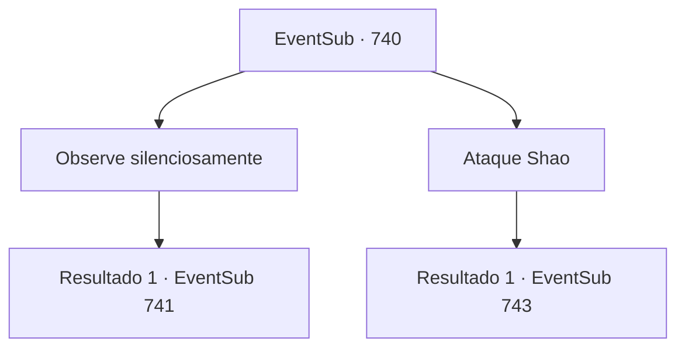

# Eventos secundários · 740

[Índice da tabela](index.md) · [Índice geral](../index.md)

ID: `pt:EventSub:740` · Fonte: `EventSub4` · Versão: 1.2.47.

Mapeamento estático dos arquivos; a disponibilidade e a execução dependem do estado da run.

## Texto do evento

*Sem texto no arquivo.*

## Dados de entrada

```json
{
  "id": 740,
  "grade": 1,
  "subEvent": "",
  "required": ""
}
```

## Mapa das escolhas



## Escolhas e resultados

### Escolha 1

Observe silenciosamente

Requisitos e outros campos da escolha:

```json
{
  "required": ""
}
```

#### Resultado 1.1

|drawing_duelLake|   O duelo começou no lago.   É um espetáculo e tanto de se assistir, e também extraordinariamente perigoso.   Lâminas prateadas nas gargantas uma da outra, os dois duelistas preenchem o ambiente com o som do aço se chocando.   

 Sob a arena iluminada pela lua, o duelo finalmente chega ao fim com o vigésimo golpe de Lei.   A espada de Shao é arrancada de sua mão, enquanto a de Lei segura a garganta de Shao na ponta.   No entanto, Lei se recusa a mover a lâmina mais adiante.   

 "...Sempre soube que você me odiava, Shao. Mas... ir atrás das gargantas um do outro assim?! Por quê? Por que você está tentando me matar?"

   Shao se recusa a responder sua pergunta.   Em vez disso, Shao rapidamente puxa uma adaga escondida de seus bolsos e tenta esfaquear Lei com ela.   Lei reage facilmente, tornando inútil o último recurso de Shao.   Afastando a adaga, Lei pergunta a mesma coisa mais uma vez, com sua espada bem ao lado do pescoço de Shao.   

 "Shao. Responda-me."

   Shao responde com uma risada.   

 "Heh. Pare de fingir ser inocente, verme. Ridículo, agindo como se fosse algum tipo de santo... Apenas me mate logo."


Continuação registrada: [Evento 741](0741.md) na mesma tabela.

```json
{
  "required": "",
  "chance": "1",
  "nextEvent": 741,
  "type": 2,
  "reward": ""
}
```

### Escolha 2

Ataque Shao

Requisitos e outros campos da escolha:

```json
{
  "required": "5_745_1"
}
```

#### Resultado 2.1

Sentindo o ímpeto da batalha, você aproveita a oportunidade e ataca Shao. Shao é pega de surpresa pelo seu golpe, mas consegue sacar sua espada e bloqueá-lo. Lei também fica surpreso, permanecendo no lugar sem saber o que fazer.

Continuação registrada: [Evento 743](0743.md) na mesma tabela.

```json
{
  "required": "",
  "chance": "1",
  "nextEvent": 743,
  "type": 2,
  "reward": "6_0_178",
  "place": 4
}
```

## Referências que chegam a este evento

- [Evento 736 · escolha 1 · resultado 1](0736.md#escolha-1)
- [Evento 736 · escolha 2 · resultado 1](0736.md#escolha-2)
- [Evento 739 · escolha 1 · resultado 1](0739.md#escolha-1)
- [Evento 739 · escolha 2 · resultado 1](0739.md#escolha-2)
