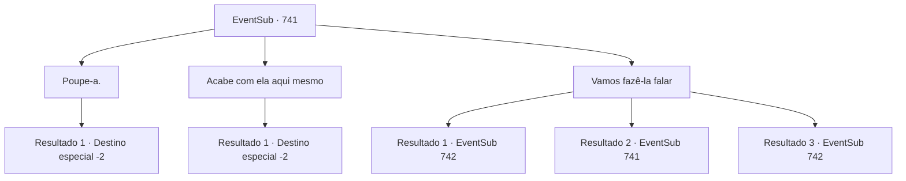

# Eventos secundários · 741

[Índice da tabela](index.md) · [Índice geral](../index.md)

ID: `pt:EventSub:741` · Fonte: `EventSub4` · Versão: 1.2.47.

Mapeamento estático dos arquivos; a disponibilidade e a execução dependem do estado da run.

## Texto do evento

*Sem texto no arquivo.*

## Dados de entrada

```json
{
  "id": 741,
  "grade": 1,
  "subEvent": "",
  "required": ""
}
```

## Mapa das escolhas



## Escolhas e resultados

### Escolha 1

Poupe-a.

Requisitos e outros campos da escolha:

```json
{
  "required": "18_746_1"
}
```

#### Resultado 1.1

Lei te ouve, solta um longo suspiro e embainha sua espada. Ele decidiu não matar Shao. Shao franze a testa em resposta, gritando. 

 "Você espera que eu peça desculpas ou algo assim? Não se arrependa depois e termine o trabalho!"

 Shao quase soa desesperado agora. Mas Lei se recusa a puxar sua espada. Em vez disso, ele olha calmamente para Shao e transmite seus pensamentos. 

 "A grandeza começa pela misericórdia. Nosso lema do clã. Estou simplesmente honrando-o."

 Shao grita para ele parar com as bobagens, mas Lei se afasta, ignorando-a. 

 "Se você ainda guarda rancor contra mim, vamos resolver isso no Torneio Battra. Estarei lá, sem dúvida. Estou cansado de fugir."

 Você e Lei deixam Shao lá e se afastam da área. Lei não esquece de te agradecer. 

 "Mil agradecimentos, Sohyeop. As palavras do meu pai... Elas vieram à minha mente, depois de ouvir o que você me disse. Estou indo para Gladio agora. Se você também planeja competir no torneio, nos veremos mais uma vez."

 Lei te agradece uma última vez antes de se despedir e se afastar animadamente.

Continuação registrada: [Destino especial `-2`](../destinos-especiais.md).

```json
{
  "required": "",
  "chance": "1",
  "nextEvent": -2,
  "type": 2,
  "reward": "12_11_4"
}
```

### Escolha 2

Acabe com ela aqui mesmo

Requisitos e outros campos da escolha:

```json
{
  "required": "18_747_1"
}
```

#### Resultado 2.1

Você aconselha Lei que esta é sua chance de acabar com tudo. Com um senso de determinação, Lei balança sua espada. 

 "Ack...! *gorgolejo*"

 Sangue espirra por todo o lago enquanto o corpo sem vida de Shao desmorona. Mesmo após a morte, os olhos de Shao estão fixos em Lei. Lei olha fixamente para seu trabalho sombrio antes de se afastar. De alguma forma, mesmo com sua vingança completa, Lei não parece nada feliz. Lei lança um último olhar para o cadáver de Shao antes de partir com uma expressão triste.

Continuação registrada: [Destino especial `-2`](../destinos-especiais.md).

```json
{
  "required": "",
  "chance": "1",
  "nextEvent": -2,
  "type": 2,
  "reward": "12_11_7"
}
```

### Escolha 3

Vamos fazê-la falar

Requisitos e outros campos da escolha:

```json
{
  "required": "5_748_0"
}
```

#### Resultado 3.1

Você se aproxima de Shao e pergunta por que ela está tão determinada a matar Lei. Você acrescenta que, caso as circunstâncias se mostrem favoráveis, está até disposto a cooperar. Claro, você está fingindo essa última parte, mas Shao cai nessa. 

 "...Tudo bem, eu vou te contar. Lei sempre foi um incômodo. Todo dia, aquela pirralha sentava no colo do Chefe do Clã e ria enquanto ele a alimentava com iguarias! E o que eu ganhei? Eu treinei e treinei e treinei, só para que ele me olhasse uma vez! Eu sempre me perguntei quando eu veria ele sorrir para mim. Quando - se - ele me daria um tapinha na cabeça e me alimentaria com petiscos."

 Segundo ela, seu pai favorecia muito Lei. Muito. Mas Shao diz que há mais na história. 

 "Eu me odeio por admitir isso, mas Lei era de fato melhor com espadas do que eu. Ha! Uma plebeia, com tais habilidades... Acontece que é o sangue do Chefe do Clã naquela criança, afinal. Então, uma crise veio ao nosso clã. Algumas pessoas começaram a afirmar que Lei deveria se tornar a Chefe do Clã, em vez de mim, dizendo que a posição de herdeiro deveria ir para quem tivesse a maior destreza. E então aquele idiota imediatamente anuncia que vai competir no Torneio Battra, para 'provar a si mesmo'!"

 Shao acrescenta, olhando maliciosamente para Lei. 

 "Obviamente, isso é um plano para tomar a posição de Chefe do Clã! E ainda assim Lei age como se fosse a vítima aqui, fingindo ser inocente!"

 Após ouvir o monólogo de Shao, Lei explode em uma risada sem emoção. 

 "Ha... Haha..."


Continuação registrada: [Evento 742](0742.md) na mesma tabela.

```json
{
  "required": "",
  "chance": "1|0_12_1",
  "nextEvent": 742,
  "type": 0,
  "reward": ""
}
```

#### Resultado 3.2

Você se aproxima de Shao e pergunta por que ela está tão determinada a matar Lei. Você acrescenta que, caso as circunstâncias se mostrem favoráveis, está até disposto a cooperar. Shao não acredita em uma palavra disso. 

 "Nem uma criança de cinco anos cairia em uma atuação tão ruim. Não tenho intenção de conversar, então se esse é o seu plano, esqueça."


Continuação registrada: [Evento 741](0741.md) na mesma tabela.

```json
{
  "required": "",
  "chance": "16",
  "nextEvent": 741,
  "type": 1,
  "reward": "5_748_1"
}
```

#### Resultado 3.3

Você se aproxima de Shao, explorando sua mente com sua magia. De repente, Shao começa a falar, com olhos sonhadores. 

 "...Tudo bem, eu vou te contar. Lei sempre foi um incômodo. Todo dia, aquela pirralha sentava no colo do Chefe do Clã e ria enquanto ele a alimentava com iguarias! E o que eu ganhava? Eu treinava e treinava e treinava, só para que ele me olhasse uma vez! Eu sempre me perguntava quando eu veria ele sorrir para mim. Quando - se - ele algum dia me daria um tapinha na cabeça e me alimentaria com petiscos."

 Segundo ela, seu pai favorecia Lei em relação a ela. Muito. Mas Shao diz que há mais na história. 

 "Então, uma crise veio ao nosso clã. Algumas pessoas começaram a afirmar que Lei deveria se tornar a Chefe do Clã, em vez de mim, dizendo que a posição de herdeiro deveria ir para quem tivesse a maior habilidade. E então aquele idiota imediatamente anuncia que vai competir no Torneio Battra, para 'provar a si mesmo'!"

 Quando seu feitiço termina, os olhos de Shao voltam ao normal. Ela parece surpresa a princípio, mas logo suspira e continua. 

 "Droga... Seus truques imundos...! Tudo bem, sim. Eu acreditava que Lei estava tramando para tomar a posição de Chefe do Clã. Então eu fiz o que fiz. Isso é resposta suficiente?"

 Após ouvir o monólogo de Shao, Lei explode em uma risada sem emoção. 

 "Ha... Haha..."


Continuação registrada: [Evento 742](0742.md) na mesma tabela.

```json
{
  "required": "20_0_2|1_1_2",
  "chance": "1",
  "nextEvent": 742,
  "type": 2,
  "reward": "0_1_-1"
}
```

## Referências que chegam a este evento

- [Evento 740 · escolha 1 · resultado 1](0740.md#escolha-1)
- [Evento 741 · escolha 3 · resultado 2](0741.md#escolha-3)
- [Evento 743 · escolha 1 · resultado 1](0743.md#escolha-1)
