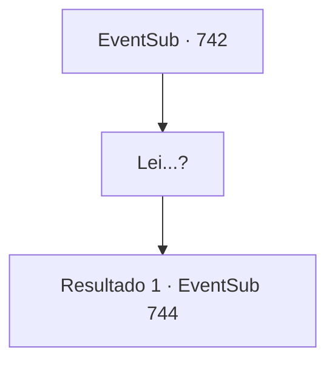

# Eventos secundários · 742

[Índice da tabela](index.md) · [Índice geral](../index.md)

ID: `pt:EventSub:742` · Fonte: `EventSub4` · Versão: 1.2.47.

Mapeamento estático dos arquivos; a disponibilidade e a execução dependem do estado da run.

## Texto do evento

*Sem texto no arquivo.*

## Dados de entrada

```json
{
  "id": 742,
  "grade": 1,
  "subEvent": "",
  "required": ""
}
```

## Mapa das escolhas



## Escolhas e resultados

### Escolha 1

Lei...?

Requisitos e outros campos da escolha:

```json
{
  "required": ""
}
```

#### Resultado 1.1

Lei enxuga as lágrimas dos olhos e fala. 

 "Isso... isso é tudo uma comédia, a situação em que estamos agora. Sabe de uma coisa? Eu nunca tive a chance de praticar, muito menos aprender, a esgrima única do nosso clã. Por quê? Porque o Chefe do Clã proibiu. Aparentemente, ele queria me criar apenas como uma 'filha'. Ele não esperava nada de mim. E eu estava tão... com ciúmes de você! Eu sempre sonhei em praticar esgrima com minhas irmãs e irmãos. Mas tudo o que eu podia fazer era espiar por cima das cercas durante o dia e praticar secretamente, quando todos estavam dormindo à noite."

 Shao parece visivelmente perplexa agora. 

 "A razão pela qual estou competindo no Torneio Battra é... porque quero que meu clã e o Chefe do Clã me reconheçam oficialmente como um 'guerreiro'. Shao? Ao contrário de mim, você tem o apoio e a expectativa de todos por trás de você. Você tem tanto o direito quanto as capacidades necessárias para se tornar Chefe do Clã. Eu realmente penso assim."

 Quando Lei termina de falar, Shao começa a balançar a cabeça, como se seu mundo tivesse sido destruído. 

 "I- isso não pode ser..."

 Lei abaixa sua postura e fixa os olhos em Shao. 

 "Olhe nos meus olhos, Shao. Você realmente acha que estou mentindo?"

 Shao encara os olhos de Lei por um momento, então solta um longo suspiro. 

 "*uff*... Tudo bem. Eu sinceramente espero que você esteja dizendo a verdade."

 Shao limpa a sujeira dos joelhos e se levanta novamente. Ela então reúne seu grupo de Dracos Vermelhos e vai embora.

Continuação registrada: [Evento 744](0744.md) na mesma tabela.

```json
{
  "required": "",
  "chance": "1",
  "nextEvent": 744,
  "type": 2,
  "reward": "5_749_1"
}
```

## Referências que chegam a este evento

- [Evento 741 · escolha 3 · resultado 1](0741.md#escolha-3)
- [Evento 741 · escolha 3 · resultado 3](0741.md#escolha-3)
- [Evento 848 · escolha 2 · resultado 1](0848.md#escolha-2)
