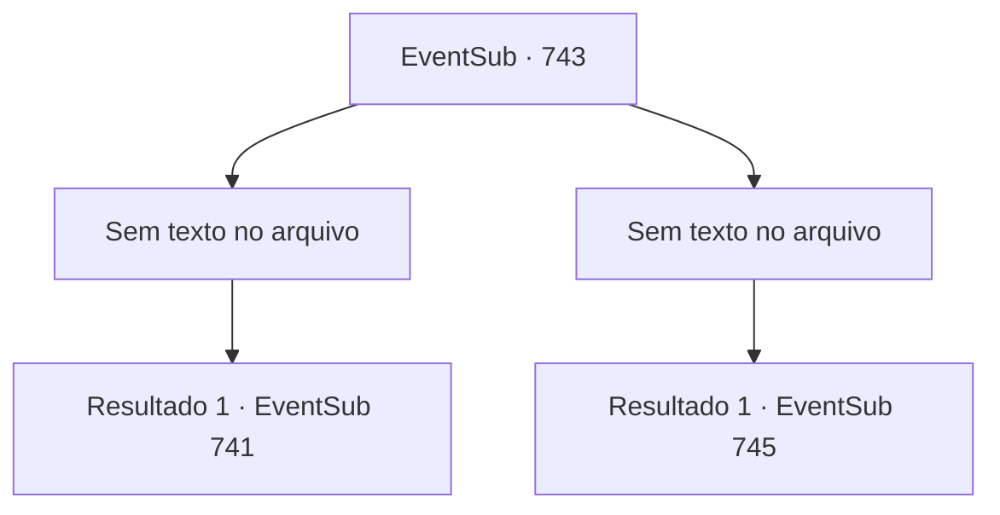

# Eventos secundários · 743

[Índice da tabela](index.md) · [Índice geral](../index.md)

ID: `pt:EventSub:743` · Fonte: `EventSub4` · Versão: 1.2.47.

Mapeamento estático dos arquivos; a disponibilidade e a execução dependem do estado da run.

## Texto do evento

*Sem texto no arquivo.*

## Dados de entrada

```json
{
  "id": 743,
  "grade": 1,
  "subEvent": "",
  "required": ""
}
```

## Mapa das escolhas



## Escolhas e resultados

### Escolha 1

*Sem texto no arquivo; o papel dessa opção depende da interface do jogo.*

Requisitos e outros campos da escolha:

```json
{
  "required": ""
}
```

#### Resultado 1.1

Você é um aventureiro experiente. Isso faz de Shao um oponente fácil. Ela te encara sem expressão, recusando-se a acreditar no que aconteceu. 

 "I- impossível..."

 Shao range os dentes tão forte que você pode ouvir as rachaduras, então usa sua espada como apoio para se levantar novamente. Então, Lei se aproxima de Shao e fala. 

 "...Sempre soube que você me odiava, Shao. Mas... chegar a esse ponto de querer se matar?! Por quê? Por que você está tentando me matar?"

 Shao se recusa a responder à pergunta dele. Em vez disso, Shao tenta apunhalar Lei com sua arma. Lei reage facilmente, tornando a última tentativa de Shao inútil. Afastando a espada, Lei pergunta a mesma coisa mais uma vez, com sua espada bem próxima ao pescoço de Shao. 

 "Shao. Responda-me."

 Shao responde com uma risada. 

 "Heh. Pare de fingir ser inocente, verme. Ridículo, agindo como se fosse algum tipo de santo... Apenas me mate logo."


Continuação registrada: [Evento 741](0741.md) na mesma tabela.

```json
{
  "required": "",
  "chance": "1",
  "nextEvent": 741,
  "type": 2,
  "reward": ""
}
```

### Escolha 2

*Sem texto no arquivo; o papel dessa opção depende da interface do jogo.*

Requisitos e outros campos da escolha:

```json
{
  "required": ""
}
```

#### Resultado 2.1

Você não consegue vencer Shao na batalha. Shao vai para sua garganta, mas Lei bloqueia o ataque e fala. 

 "Espere, Shao. Este não é lugar para uma luta adequada. Vamos nos mover."

 Shao então olha em sua direção. 

 "Bruto desonrado."

 Os dois saem, e você fica sob a vigilância dos Dragões Vermelhos. Alguns dos guerreiros nocauteados estão recobrando a consciência. A recepcionista da pousada está escondida debaixo de sua mesa, tremendo de medo. Você se senta em uma cadeira, em condição relativamente boa comparada às outras, e espera Lei voltar. 

 Passa algum tempo, e Lei retorna sozinho. Ele então se volta para os Dragões Vermelhos e fala. 

 "Shao está no lago. Levem-na."

 Ao ouvir Lei, os Dragões Vermelhos rapidamente deixam a pousada e se dirigem ao lago.

Continuação registrada: [Evento 745](0745.md) na mesma tabela.

```json
{
  "required": "",
  "chance": "1",
  "nextEvent": 745,
  "type": 2,
  "reward": ""
}
```

## Referências que chegam a este evento

- [Evento 740 · escolha 2 · resultado 1](0740.md#escolha-2)
