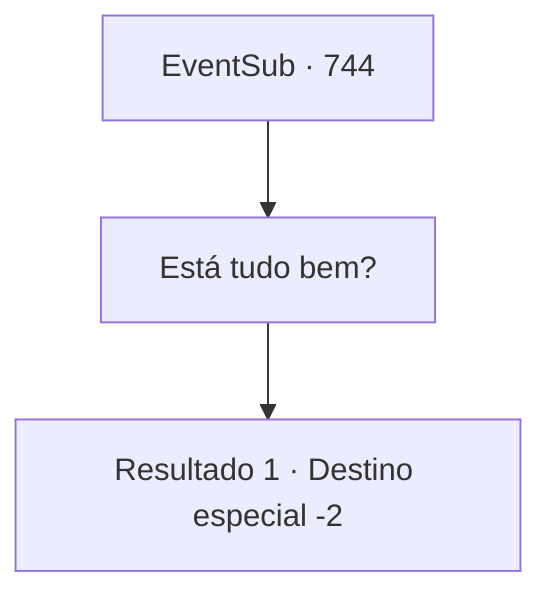

# Eventos secundários · 744

[Índice da tabela](index.md) · [Índice geral](../index.md)

ID: `pt:EventSub:744` · Fonte: `EventSub4` · Versão: 1.2.47.

Mapeamento estático dos arquivos; a disponibilidade e a execução dependem do estado da run.

## Texto do evento

*Sem texto no arquivo.*

## Dados de entrada

```json
{
  "id": 744,
  "grade": 1,
  "subEvent": "",
  "required": ""
}
```

## Mapa das escolhas



## Escolhas e resultados

### Escolha 1

Está tudo bem?

Requisitos e outros campos da escolha:

```json
{
  "required": ""
}
```

#### Resultado 1.1

Lei responde com um aceno de cabeça. 

 "Acho que... Shao não me tratará mais com hostilidade."

 Após um breve silêncio, ele continuou. 

 "Não posso te agradecer o suficiente, Sohyeop. Se ao menos eu tivesse conseguido ter essa conversa com Shao antes...! Foi tudo um grande mal-entendido. Sem você, Sohyeop, nada disso teria acontecido! Estou eternamente grato por me dar essa oportunidade preciosa."

 Lei se curva para mostrar sua gratidão. 

 "Haha... Isso tira um grande peso da minha mente. Estou indo para Gladio agora. Só depois de me provar no torneio poderei voltar para minha cidade natal com honra. Eu realmente apreciaria sua companhia se você tiver tempo, Sohyeop. Agora, com licença."

 Lei se curva uma última vez antes de partir.

Continuação registrada: [Destino especial `-2`](../destinos-especiais.md).

```json
{
  "required": "",
  "chance": "1",
  "nextEvent": -2,
  "type": 2,
  "reward": "12_11_4|5_749_1"
}
```

## Referências que chegam a este evento

- [Evento 742 · escolha 1 · resultado 1](0742.md#escolha-1)
