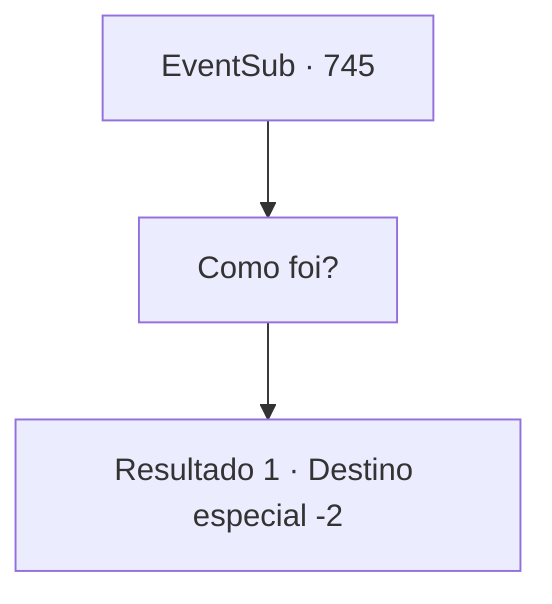

# Eventos secundários · 745

[Índice da tabela](index.md) · [Índice geral](../index.md)

ID: `pt:EventSub:745` · Fonte: `EventSub4` · Versão: 1.2.47.

Mapeamento estático dos arquivos; a disponibilidade e a execução dependem do estado da run.

## Texto do evento

*Sem texto no arquivo.*

## Dados de entrada

```json
{
  "id": 745,
  "grade": 1,
  "subEvent": "",
  "required": ""
}
```

## Mapa das escolhas



## Escolhas e resultados

### Escolha 1

Como foi?

Requisitos e outros campos da escolha:

```json
{
  "required": ""
}
```

#### Resultado 1.1

Lei responde com um suspiro. 

 "...Acabamos brigando, afinal. Eu a derrotei no duelo, mas foi só isso. Eu simplesmente... não consegui matar Shao com minhas próprias mãos. Então eu apenas disse para ela ir embora. Perguntei por que ela estava tão determinada a me matar, mas não obtive resposta..."

 Ele suspira novamente, então continua. 

 "Este... foi um dia exaustivo. Estou indo para Gladio agora. Só depois de me provar no torneio poderei retornar à minha cidade natal com honra. Eu realmente apreciaria sua companhia se você tiver tempo, Sohyeop. Agora, se me der licença."

 Lei se inclina uma última vez antes de partir.

Continuação registrada: [Destino especial `-2`](../destinos-especiais.md).

```json
{
  "required": "",
  "chance": "1",
  "nextEvent": -2,
  "type": 2,
  "reward": "12_11_4"
}
```

## Referências que chegam a este evento

- [Evento 743 · escolha 2 · resultado 1](0743.md#escolha-2)
