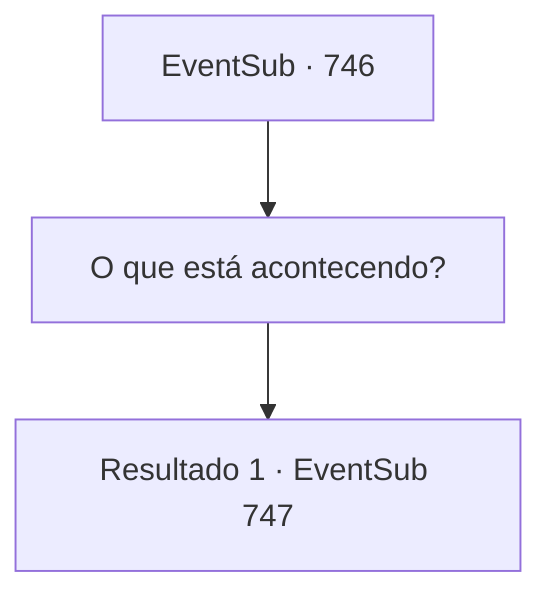

# Eventos secundários · 746

[Índice da tabela](index.md) · [Índice geral](../index.md)

ID: `pt:EventSub:746` · Fonte: `EventSub4` · Versão: 1.2.47.

Mapeamento estático dos arquivos; a disponibilidade e a execução dependem do estado da run.

## Texto do evento

|drawing_Gladio| Você finalmente chega a Gladio, a cidade localizada no extremo sul do Grande Deserto. O lugar já está em clima festivo, provavelmente por causa do torneio que está prestes a acontecer. Os comerciantes de caravanas montaram barracas temporárias como lojas. Os cidadãos locais já estão aproveitando as festividades, se deliciando com bebidas e música. Pousadas e tavernas estão ocupadas atraindo novos clientes. 

 "...Sohyeop! Você está aqui!"

 Você ouve uma voz familiar. Quando olha para trás, você encontra Lei caminhando em sua direção, desta vez vestida com uma vestimenta oriental com um dragão acolchoado. 

 "Acabei de terminar meus testes! Seria uma pena não participar depois de vir até aqui, certo, Sohyeop?"

 Antes mesmo de perceber, você está a caminho da arena, seguindo Lei. O coliseu circular ressoa com os ecos da batalha.

## Dados de entrada

```json
{
  "id": 746,
  "grade": 1,
  "subEvent": "",
  "required": "12_11_4"
}
```

## Mapa das escolhas



## Escolhas e resultados

### Escolha 1

O que está acontecendo?

Requisitos e outros campos da escolha:

```json
{
  "required": ""
}
```

#### Resultado 1.1

Lei responde à sua pergunta apontando para o seu entorno. 

 "Os participantes estão se provando primeiro nas seletivas. Você tem que derrotar o Golem Battra para poder entrar nas partidas reais."

 Então, com um barulho alto, o corpo de um aventureiro é jogado para fora do palco. Ele mal consegue se afastar com a ajuda de um atendente. Observando a cena se desenrolar, Lei acrescenta. 

 "Aparentemente, é assim que eles filtram os participantes para que apenas os melhores permaneçam. Aquele homem está definitivamente fora deste torneio."

 Quem parece ser o recepcionista se aproxima de você e fala. 

 "Olá! Você está aqui para se inscrever no torneio?"


Continuação registrada: [Evento 747](0747.md) na mesma tabela.

```json
{
  "required": "",
  "chance": "1",
  "nextEvent": 747,
  "type": 2,
  "reward": ""
}
```

## Referências que chegam a este evento

Nenhum `nextEvent` positivo da mesma tabela aponta para este nó. Isso não prova que seja inacessível: sorteio e estado de história podem selecioná-lo.

