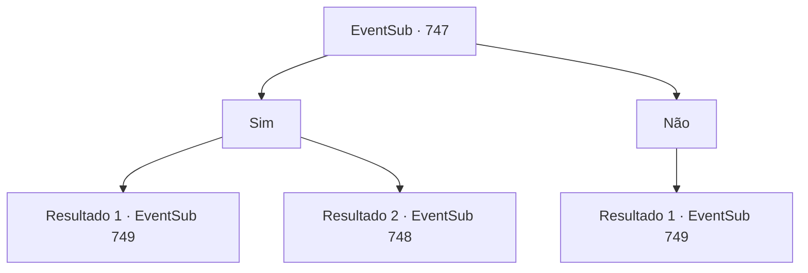

# Eventos secundários · 747

[Índice da tabela](index.md) · [Índice geral](../index.md)

ID: `pt:EventSub:747` · Fonte: `EventSub4` · Versão: 1.2.47.

Mapeamento estático dos arquivos; a disponibilidade e a execução dependem do estado da run.

## Texto do evento

*Sem texto no arquivo.*

## Dados de entrada

```json
{
  "id": 747,
  "grade": 1,
  "subEvent": "",
  "required": ""
}
```

## Mapa das escolhas



## Escolhas e resultados

### Escolha 1

Sim

Requisitos e outros campos da escolha:

```json
{
  "required": ""
}
```

#### Resultado 1.1

Você responde sim. Então, a recepcionista olha mais de perto para o seu rosto e sorri. 

 "Ah. Você deve ser {1}. Ouvimos muito sobre você. Para você, já fizemos os arranjos necessários! Você passa automaticamente na seleção."

 Lei olha para você admirado. 

 "Muito bem, Sohyeop. Agora, como ainda há algum tempo antes das partidas começarem, por que não treinamos juntos?"


Continuação registrada: [Evento 749](0749.md) na mesma tabela.

```json
{
  "required": "1_2_60",
  "chance": "1",
  "nextEvent": 749,
  "type": 2,
  "reward": ""
}
```

#### Resultado 1.2

Você responde sim. A recepcionista te leva ao palco. 

 "O infame Golem Battra. Derrote-o, e você estará qualificado para as partidas reais. Agora, boa sorte. Você vai precisar."

 Muitos outros aventureiros estão fazendo o seu melhor para mostrar que são capazes, enquanto o público os observa com olhos curiosos. Os olhos do golem brilham, e logo ele começa a se mover.

Continuação registrada: [Evento 748](0748.md) na mesma tabela.

```json
{
  "required": "2_2_60",
  "chance": "1",
  "nextEvent": 748,
  "type": 2,
  "reward": "6_0_15",
  "place": 11
}
```

### Escolha 2

Não

Requisitos e outros campos da escolha:

```json
{
  "required": ""
}
```

#### Resultado 2.1

Você responde não. Lei faz o seu melhor, mas não consegue esconder a decepção. 

 "Bem, uh... Já que ainda falta algum tempo antes das partidas começarem, posso te pedir para me ajudar com meu treinamento?"


Continuação registrada: [Evento 749](0749.md) na mesma tabela.

```json
{
  "required": "",
  "chance": "1",
  "nextEvent": 749,
  "type": 2,
  "reward": "5_763_1"
}
```

## Referências que chegam a este evento

- [Evento 746 · escolha 1 · resultado 1](0746.md#escolha-1)
