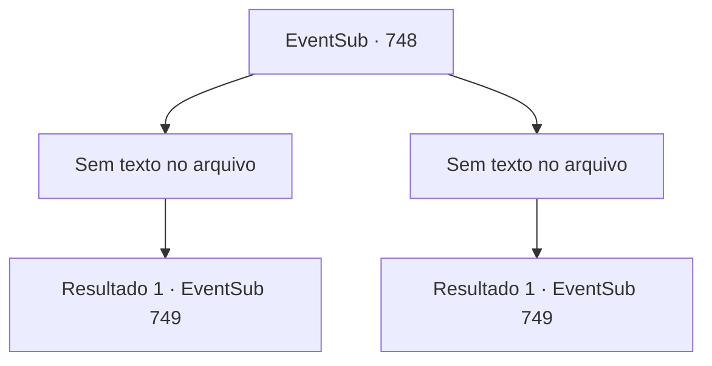

# Eventos secundários · 748

[Índice da tabela](index.md) · [Índice geral](../index.md)

ID: `pt:EventSub:748` · Fonte: `EventSub4` · Versão: 1.2.47.

Mapeamento estático dos arquivos; a disponibilidade e a execução dependem do estado da run.

## Texto do evento

*Sem texto no arquivo.*

## Dados de entrada

```json
{
  "id": 748,
  "grade": 1,
  "subEvent": "",
  "required": ""
}
```

## Mapa das escolhas



## Escolhas e resultados

### Escolha 1

*Sem texto no arquivo; o papel dessa opção depende da interface do jogo.*

Requisitos e outros campos da escolha:

```json
{
  "required": ""
}
```

#### Resultado 1.1

Você prova valentemente sua habilidade e ganha seu ingresso para o evento principal. Lei olha para você admirada. 

 "Muito bem, Sohyeop. Agora, como ainda há algum tempo antes das partidas começarem, por que não treinamos juntos?"


Continuação registrada: [Evento 749](0749.md) na mesma tabela.

```json
{
  "required": "",
  "chance": "1",
  "nextEvent": 749,
  "type": 2,
  "reward": ""
}
```

### Escolha 2

*Sem texto no arquivo; o papel dessa opção depende da interface do jogo.*

Requisitos e outros campos da escolha:

```json
{
  "required": ""
}
```

#### Resultado 2.1

O punho do golem voa em sua direção e te joga para fora do palco. Lei faz o seu melhor, mas não consegue esconder a decepção. 

 "Bem, uh... Como ainda há algum tempo antes das partidas começarem, posso pedir que me ajude com meu treinamento?"


Continuação registrada: [Evento 749](0749.md) na mesma tabela.

```json
{
  "required": "",
  "chance": "1",
  "nextEvent": 749,
  "type": 2,
  "reward": "5_763_1"
}
```

## Referências que chegam a este evento

- [Evento 747 · escolha 1 · resultado 2](0747.md#escolha-1)
