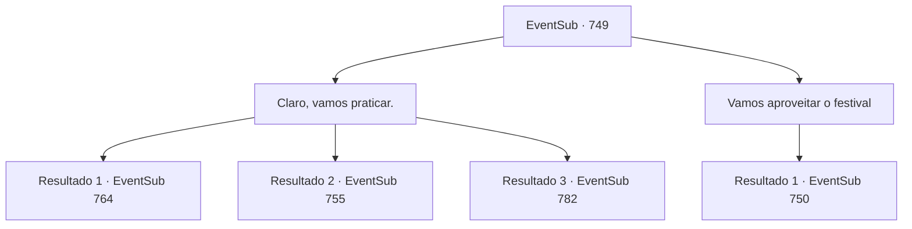

# Eventos secundários · 749

[Índice da tabela](index.md) · [Índice geral](../index.md)

ID: `pt:EventSub:749` · Fonte: `EventSub4` · Versão: 1.2.47.

Mapeamento estático dos arquivos; a disponibilidade e a execução dependem do estado da run.

## Texto do evento

*Sem texto no arquivo.*

## Dados de entrada

```json
{
  "id": 749,
  "grade": 1,
  "subEvent": "",
  "required": ""
}
```

## Mapa das escolhas



## Escolhas e resultados

### Escolha 1

Claro, vamos praticar.

Requisitos e outros campos da escolha:

```json
{
  "required": ""
}
```

#### Resultado 1.1

Você aceita o pedido de Lei e decide treinar para o torneio. Vocês dois passam o dia inteiro lutando. Finalmente, o dia do torneio chega. 

 "Boa sorte, Sohyeop. Vamos dar o nosso melhor!"

 Lei torce por você, depois vai para as câmaras dos competidores. 

 Poucos momentos depois, você finaliza suas preparações e entra na arena. Todos os assentos estão ocupados por espectadores ansiosos. Com o som de aplausos e gritos como combustível, você se prepara para a batalha. Seu primeiro oponente é um cavaleiro vestido com armadura completa. 

 "O nome é Sparkles, companheiro aventureiro! Venho do grande Reino de Lothar. Vamos ter uma luta honrada e justa."

 Aplausos e gritos altos enchem a arena enquanto a batalha começa.

Continuação registrada: [Evento 764](0764.md) na mesma tabela.

```json
{
  "required": "5_749_1|18_763_1",
  "chance": "1",
  "nextEvent": 764,
  "type": 2,
  "reward": "6_0_180",
  "place": 11
}
```

#### Resultado 1.2

Você aceita o pedido de Lei e decide treinar para o torneio. Enquanto você faz uma pausa na sombra após um treino intenso, alguém se aproxima de você. Você o reconhece como um dos Red Drakes. Mostrando que suas mãos estão vazias, o Red Drake revela que não tem intenção de lutar com você. Ele então se aproxima de Lei, ajoelha-se e tira a máscara. 

 "Por favor, pare a Senhorita Shao. Eu imploro."

 Lei responde com uma expressão perplexa. 

 "...Bem, isso é certamente inesperado. O que está acontecendo?"


Continuação registrada: [Evento 755](0755.md) na mesma tabela.

```json
{
  "required": "18_749_1",
  "chance": "1",
  "nextEvent": 755,
  "type": 2,
  "reward": ""
}
```

#### Resultado 1.3

Você aceita o pedido de Lei e decide treinar para o torneio. Vocês dois passam o dia inteiro lutando. Finalmente, o dia do torneio chega. 

 "Obrigado pela ajuda, Sohyeop. Desejo profundamente vê-lo na plateia."

 Lei se dirige para as câmaras dos competidores. Você sai para tomar seu assento. O lugar está lotado de espectadores ansiosos, que aguardam excitados pela próxima luta. 

 À medida que a noite chega, a maioria das lutas chega ao fim, e a luta final está prestes a começar. 

 "Lei Ryu do Clã Ryu! E Shao Ryu, do mesmo Clã Ryu!"

 Os dois competidores no palco sacam suas espadas e assumem uma postura semelhante. Eles parecem estar conversando sobre algo, mas você não consegue entender nada da conversa deles, principalmente devido ao barulho da multidão. Logo, a luta começa e um elegante e violento confronto de aço se segue.

Continuação registrada: [Evento 782](0782.md) na mesma tabela.

```json
{
  "required": "5_749_1|5_763_1",
  "chance": "1",
  "nextEvent": 782,
  "type": 2,
  "reward": ""
}
```

### Escolha 2

Vamos aproveitar o festival

Requisitos e outros campos da escolha:

```json
{
  "required": ""
}
```

#### Resultado 2.1

Você convence Lei a aproveitar o festival. Lei parece estar se sentindo culpada, mas você consegue convencê-la. 

 "C- claro... Afinal, fazer uma pausa também é necessário."

 Você arrasta Lei para o recinto do festival. O lugar está lotado de pessoas vestidas com trajes exóticos decorados com ouro e joias dançando. Atrás de uma fila delas, há um enorme elefante em armadura. Outro grupo de artistas está em cima do elefante, jogando pétalas com sorrisos nos rostos. |drawing_elephantFestival| Os olhos de Lei se arregalam de empolgação. 

 "Uau... Nunca vi nada assim, Sohyeop."

 Depois de passar pelo desfile, Lei desvia o olhar e observa as barracas de rua. Lá você encontra muitas iguarias exóticas, como espetos de lagarto assado, frutas que você não reconhece e grãos de arroz sendo fritos em areia aquecida.

Continuação registrada: [Evento 750](0750.md) na mesma tabela.

```json
{
  "required": "",
  "chance": "1",
  "nextEvent": 750,
  "type": 2,
  "reward": ""
}
```

## Referências que chegam a este evento

- [Evento 747 · escolha 1 · resultado 1](0747.md#escolha-1)
- [Evento 747 · escolha 2 · resultado 1](0747.md#escolha-2)
- [Evento 748 · escolha 1 · resultado 1](0748.md#escolha-1)
- [Evento 748 · escolha 2 · resultado 1](0748.md#escolha-2)
