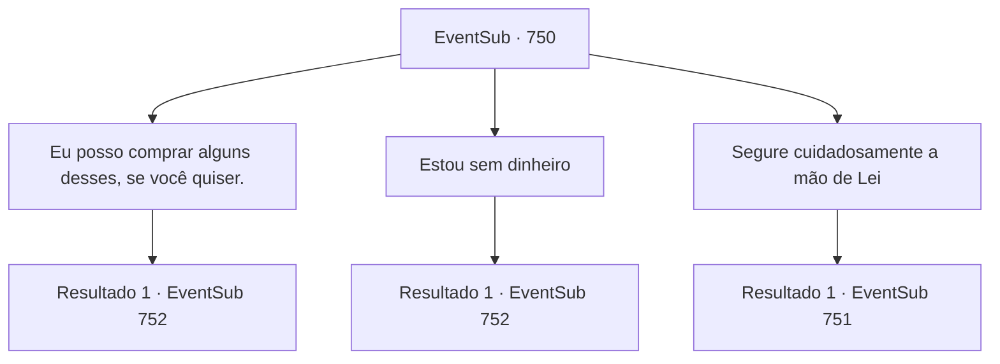

# Eventos secundários · 750

[Índice da tabela](index.md) · [Índice geral](../index.md)

ID: `pt:EventSub:750` · Fonte: `EventSub4` · Versão: 1.2.47.

Mapeamento estático dos arquivos; a disponibilidade e a execução dependem do estado da run.

## Texto do evento

*Sem texto no arquivo.*

## Dados de entrada

```json
{
  "id": 750,
  "grade": 1,
  "subEvent": "",
  "required": ""
}
```

## Mapa das escolhas



## Escolhas e resultados

### Escolha 1

Eu posso comprar alguns desses, se você quiser.

Requisitos e outros campos da escolha:

```json
{
  "required": "1_4_50"
}
```

#### Resultado 1.1

Percebendo que os olhos de Lei estão brilhando de expectativa, você tira um punhado de ouro dos seus bolsos. Lei te arrasta pelas barracas, animado. Ele vai experimentando a culinária local, enchendo-se com uma quantidade absurda de comida. Você não tem ideia de como tanta comida pode caber em um corpo tão pequeno. 

 Algumas horas depois, o sol começa a se pôr. O festival também chega lentamente ao fim. Você e Lei entram em uma pousada tranquila nos arredores da cidade. 

 "Não me lembro da última vez que comi tão bem. Obrigado. A bebida é por minha conta."

 Ele sorri, sentando-se e ocupando uma mesa próxima. Em seguida, ele chama o garçom e pede a bebida mais vendida do cardápio. O garçom traz uma jarra de licor de coco. Lei enche seu copo primeiro, depois serve um copo para si mesmo também.

Continuação registrada: [Evento 752](0752.md) na mesma tabela.

```json
{
  "required": "",
  "chance": "1",
  "nextEvent": 752,
  "type": 2,
  "reward": "0_4_-50|0_0_1"
}
```

### Escolha 2

Estou sem dinheiro

Requisitos e outros campos da escolha:

```json
{
  "required": ""
}
```

#### Resultado 2.1

Lei parece um pouco decepcionado com sua resposta. 

 "Oh... Uh, bem, ainda podemos apreciá-los com nossos olhos, pelo menos."

 Você e Lei passeiam pelo terreno do festival, dando uma olhada nas várias barracas e comerciantes. Vocês até veem mais artistas e crianças locais se divertindo. 

 Algumas horas depois, o sol começa a se pôr. O festival também chega lentamente ao fim. Você e Lei entram em uma pousada tranquila nos arredores da cidade. 

 "A bebida é por minha conta."

 Ele sorri, sentando-se e ocupando uma mesa próxima. Ele então chama o garçom e pede a bebida mais vendida do cardápio. O garçom traz uma jarra de licor de coco. Lei enche seu copo primeiro, depois serve um copo para si mesmo também.

Continuação registrada: [Evento 752](0752.md) na mesma tabela.

```json
{
  "required": "",
  "chance": "1",
  "nextEvent": 752,
  "type": 2,
  "reward": ""
}
```

### Escolha 3

Segure cuidadosamente a mão de Lei

Requisitos e outros campos da escolha:

```json
{
  "required": "24_1_1"
}
```

#### Resultado 3.1

Enquanto Lei está ocupado observando as barracas, você se aproxima dele silenciosamente e segura sua mão. Ainda encantado com as festividades, ele não percebe. Então, quando ele está prestes a levantar o braço para apontar algo, descobre sua mão na dele. 

 "Q- QUE ISSO!"

 Lei age como se tivesse acabado de ver um fantasma. Ele afasta sua mão da sua, tenta alcançá-la novamente, mas acaba se impedindo de fazê-lo. 

 "Hum... S- Sohyeop. De onde eu venho, segurar as mãos... é... uh... Significa muito! V- você não deveria sair por aí segurando as mãos de pessoas aleatórias assim."


Continuação registrada: [Evento 751](0751.md) na mesma tabela.

```json
{
  "required": "",
  "chance": "1",
  "nextEvent": 751,
  "type": 2,
  "reward": ""
}
```

## Referências que chegam a este evento

- [Evento 749 · escolha 2 · resultado 1](0749.md#escolha-2)
