# Eventos secundários · 751

[Índice da tabela](index.md) · [Índice geral](../index.md)

ID: `pt:EventSub:751` · Fonte: `EventSub4` · Versão: 1.2.47.

Mapeamento estático dos arquivos; a disponibilidade e a execução dependem do estado da run.

## Texto do evento

*Sem texto no arquivo.*

## Dados de entrada

```json
{
  "id": 751,
  "grade": 1,
  "subEvent": "",
  "required": ""
}
```

## Mapa das escolhas

```mermaid
flowchart TD
  E["EventSub · 751"]
  C0["O que você quer dizer com &#x27;pessoas aleatórias&#x27;?"]
  E --> C0
  R0_0["Resultado 1 · EventSub 763"]
  C0 --> R0_0
  C1["Foi um engano, eu não quis dizer nada."]
  E --> C1
  R1_0["Resultado 1 · EventSub 752"]
  C1 --> R1_0
```



## Escolhas e resultados

### Escolha 1

O que você quer dizer com 'pessoas aleatórias'?

Requisitos e outros campos da escolha:

```json
{
  "required": ""
}
```

#### Resultado 1.1

Você responde dizendo que Lei não é uma 'pessoa qualquer' para você. Você pega a mão dele mais uma vez. Desta vez, as bochechas de Lei ficam tão vermelhas que por um momento você teme que elas fossem estourar. A mudança se espalha para o pescoço e as orelhas dele, que também ficam vermelhas. 

 "E- Eu- ah... DESCULPA!!"

 Lei solta sua mão da dele e de repente começa a correr. Você tenta ir atrás dele, mas logo perde o rastro. Infelizmente, você é forçado a aproveitar o festival sozinho.

Continuação registrada: [Evento 763](0763.md) na mesma tabela.

```json
{
  "required": "",
  "chance": "1",
  "nextEvent": 763,
  "type": 2,
  "reward": "5_750_1"
}
```

### Escolha 2

Foi um engano, eu não quis dizer nada.

Requisitos e outros campos da escolha:

```json
{
  "required": ""
}
```

#### Resultado 2.1

Você diz a Lei que foi um engano. Por um breve momento, você sente o que parece ser decepção na expressão de Lei. 

 "Oh- haha... Sim, claro. Obviamente..."

 Ele ri de forma constrangida e diz que ainda há partes do festival para explorar. Você e Lei percorrem o terreno do festival, dando uma olhada nas várias barracas e comerciantes. Você até vê mais artistas e crianças locais se divertindo. 

 Algumas horas depois, o sol começa a se pôr. O festival também lentamente chega ao fim. Você e Lei entram em uma pousada tranquila nos arredores da cidade. 

 "A bebida é por minha conta."

 Ele sorri, sentando-se e ocupando uma mesa próxima. Ele então chama o garçom e pede a bebida mais vendida do cardápio. O garçom traz uma jarra de licor de coco. Lei enche seu copo primeiro, depois serve um copo para si mesmo também.

Continuação registrada: [Evento 752](0752.md) na mesma tabela.

```json
{
  "required": "",
  "chance": "1",
  "nextEvent": 752,
  "type": 2,
  "reward": ""
}
```

## Referências que chegam a este evento

- [Evento 750 · escolha 3 · resultado 1](0750.md#escolha-3)
