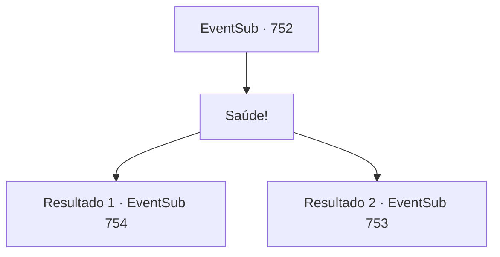

# Eventos secundários · 752

[Índice da tabela](index.md) · [Índice geral](../index.md)

ID: `pt:EventSub:752` · Fonte: `EventSub4` · Versão: 1.2.47.

Mapeamento estático dos arquivos; a disponibilidade e a execução dependem do estado da run.

## Texto do evento

*Sem texto no arquivo.*

## Dados de entrada

```json
{
  "id": 752,
  "grade": 1,
  "subEvent": "",
  "required": ""
}
```

## Mapa das escolhas



## Escolhas e resultados

### Escolha 1

Saúde!

Requisitos e outros campos da escolha:

```json
{
  "required": ""
}
```

#### Resultado 1.1

Você levanta seu copo e bebe com Lei.   O licor, emanando uma fragrância saborosa, desce facilmente pela sua garganta.   

 Depois de compartilhar mais alguns copos, você percebe que o rosto de Lei ficou vermelho.   Ele te encara por um momento antes de explodir em risadas.   

 "Para ser honesto... Se não fosse por você, Sohyeop, eu provavelmente estaria lutando com Shao agora. E eu realmente quero dizer isso. Só um pensamento que me veio à mente...   Você não faz ideia de quão grato eu sou por ter recebido sua ajuda, Sohyeop."


Continuação registrada: [Evento 754](0754.md) na mesma tabela.

```json
{
  "required": "5_749_1",
  "chance": "1",
  "nextEvent": 754,
  "type": 2,
  "reward": ""
}
```

#### Resultado 1.2

Você levanta seu copo e bebe com Lei.   O licor, emanando uma fragrância saborosa, desce suavemente pela sua garganta.     

 Depois de brindarem mais algumas vezes, você percebe que o rosto de Lei ficou vermelho.   No entanto, Lei mantém uma postura reta e rígida.   Lei olha silenciosamente para o copo por alguns segundos, então fala.   

 "Sohyeop... O que você acha que Shao está fazendo agora?"


Continuação registrada: [Evento 753](0753.md) na mesma tabela.

```json
{
  "required": "18_749_1",
  "chance": "1",
  "nextEvent": 753,
  "type": 2,
  "reward": ""
}
```

## Referências que chegam a este evento

- [Evento 750 · escolha 1 · resultado 1](0750.md#escolha-1)
- [Evento 750 · escolha 2 · resultado 1](0750.md#escolha-2)
- [Evento 751 · escolha 2 · resultado 1](0751.md#escolha-2)
