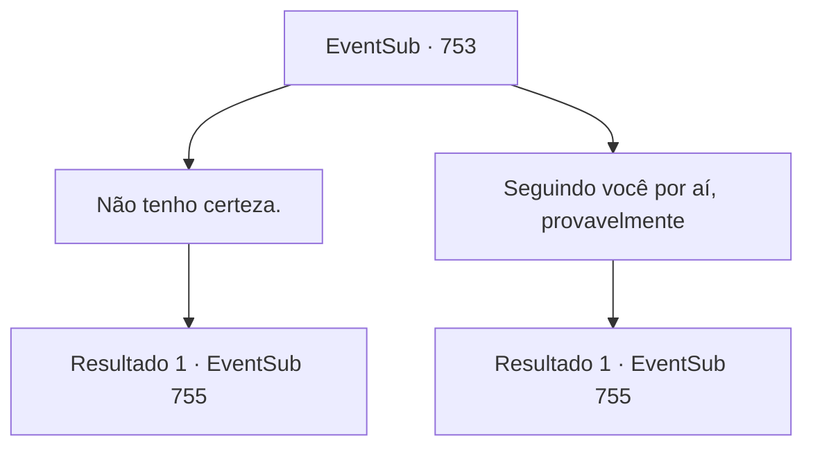

# Eventos secundários · 753

[Índice da tabela](index.md) · [Índice geral](../index.md)

ID: `pt:EventSub:753` · Fonte: `EventSub4` · Versão: 1.2.47.

Mapeamento estático dos arquivos; a disponibilidade e a execução dependem do estado da run.

## Texto do evento

*Sem texto no arquivo.*

## Dados de entrada

```json
{
  "id": 753,
  "grade": 1,
  "subEvent": "",
  "required": ""
}
```

## Mapa das escolhas



## Escolhas e resultados

### Escolha 1

Não tenho certeza.

Requisitos e outros campos da escolha:

```json
{
  "required": ""
}
```

#### Resultado 1.1

Você responde indiferentemente. Então, Lei suspira e vira o olhar para as janelas. Um breve silêncio preenche o ar. Lei coloca seu copo na mesa e fala. 

 "...Bem, ela está nos espionando agora."

 Lei gesticula para fora com os olhos. Há um homem lá fora - você o reconhece como um dos Red Drakes. Mostrando que suas mãos estão vazias, o Red Drake revela que não tem intenção de lutar com você. Ele então se aproxima de Lei, ajoelha-se e tira a máscara. 

 "Por favor, pare a Senhorita Shao. Eu imploro."

 Lei responde com uma expressão perplexa. 

 "...Bem, isso é certamente inesperado. O que está acontecendo?"


Continuação registrada: [Evento 755](0755.md) na mesma tabela.

```json
{
  "required": "",
  "chance": "1",
  "nextEvent": 755,
  "type": 2,
  "reward": ""
}
```

### Escolha 2

Seguindo você por aí, provavelmente

Requisitos e outros campos da escolha:

```json
{
  "required": ""
}
```

#### Resultado 2.1

Lei coloca seu copo na mesa e fala. 

 "Incrível, Sohyeop. Você está certo."

 Lei gesticula para fora com os olhos. Há um homem lá fora - você o reconhece como um dos Red Drakes. Mostrando que suas mãos estão vazias, o Red Drake revela que não tem intenção de lutar com você. Ele então se aproxima de Lei, ajoelha-se e tira a máscara. 

 "Por favor, pare a Senhorita Shao. Eu imploro."

 Lei responde com uma expressão perplexa. 

 "...Bem, isso é certamente inesperado. O que está acontecendo?"


Continuação registrada: [Evento 755](0755.md) na mesma tabela.

```json
{
  "required": "",
  "chance": "1",
  "nextEvent": 755,
  "type": 2,
  "reward": ""
}
```

## Referências que chegam a este evento

- [Evento 752 · escolha 1 · resultado 2](0752.md#escolha-1)
