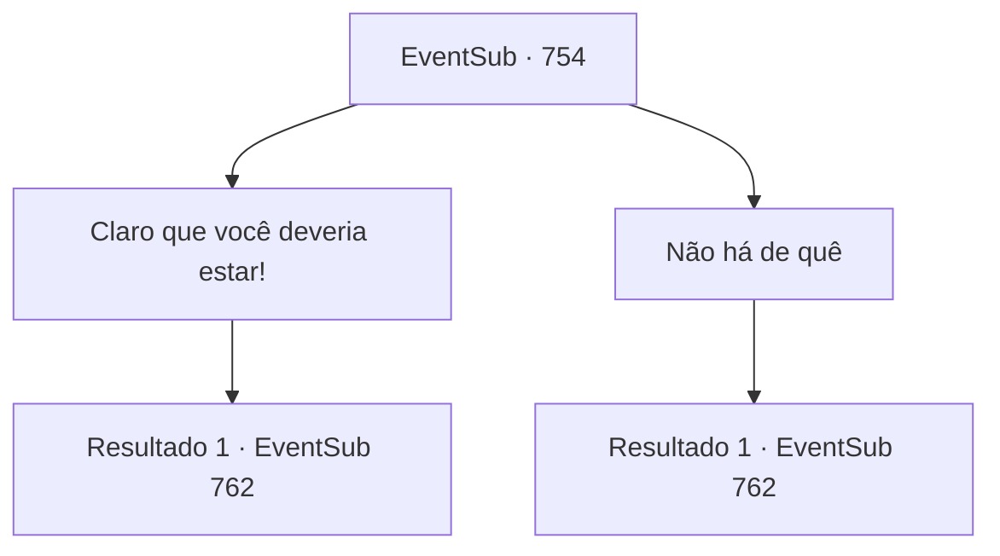

# Eventos secundários · 754

[Índice da tabela](index.md) · [Índice geral](../index.md)

ID: `pt:EventSub:754` · Fonte: `EventSub4` · Versão: 1.2.47.

Mapeamento estático dos arquivos; a disponibilidade e a execução dependem do estado da run.

## Texto do evento

*Sem texto no arquivo.*

## Dados de entrada

```json
{
  "id": 754,
  "grade": 1,
  "subEvent": "",
  "required": ""
}
```

## Mapa das escolhas



## Escolhas e resultados

### Escolha 1

Claro que você deveria estar!

Requisitos e outros campos da escolha:

```json
{
  "required": ""
}
```

#### Resultado 1.1

Lei ri em resposta à sua resposta confiante. 

 "Haha... Você está certo. Foi uma coisa boba de se dizer. Aqui - tome mais um pouco."

 Você e Lei passam as próximas horas bebendo mais. No dia seguinte, você acorda com uma dor de cabeça terrível. Você olha ao redor e consegue se lembrar de que ainda está na mesma pousada de ontem. Ao tentar se levantar e descer da cama velha, você acaba tendo uma experiência surreal de o chão de madeira saltar para o seu rosto. Você se machuca aqui e ali. Quando o som se dissipa, Lei abre a porta e entra. 

 "Ah, você está acordado. Aqui, tome um pouco de água com mel. Vai aliviar a dor."

 Você pega a tigela de porcelana e bebe. Lei te ajuda a ficar de pé enquanto você coloca a tigela vazia na mesa. 

 "A partida vai começar em breve. Vamos nos apressar."


Continuação registrada: [Evento 762](0762.md) na mesma tabela.

```json
{
  "required": "",
  "chance": "1",
  "nextEvent": 762,
  "type": 2,
  "reward": ""
}
```

### Escolha 2

Não há de quê

Requisitos e outros campos da escolha:

```json
{
  "required": ""
}
```

#### Resultado 2.1

Lei explode em risadas em resposta à sua resposta humilde. 

 "Ahahaha!... Você realmente soou como alguém do Leste, agora mesmo. Aqui - tome mais um pouco."

 Você e Lei passam as próximas horas bebendo mais. No dia seguinte, você acorda com uma dor de cabeça terrível. Você olha ao redor e consegue se lembrar de que ainda está na mesma pousada de ontem. Ao tentar se levantar e descer da cama velha, você acaba tendo uma experiência surreal de o chão de madeira saltar para o seu rosto. Você se machuca aqui e ali. Quando o som se dissipa, Lei abre a porta e entra. 

 "Ah, você está acordado. Aqui, tome um pouco de água com mel. Vai aliviar a dor."

 Você pega a tigela de porcelana e bebe. Lei ajuda você a se levantar enquanto você coloca a tigela vazia na mesa. 

 "A luta vai começar em breve. Vamos nos apressar."


Continuação registrada: [Evento 762](0762.md) na mesma tabela.

```json
{
  "required": "",
  "chance": "1",
  "nextEvent": 762,
  "type": 2,
  "reward": ""
}
```

## Referências que chegam a este evento

- [Evento 752 · escolha 1 · resultado 1](0752.md#escolha-1)
