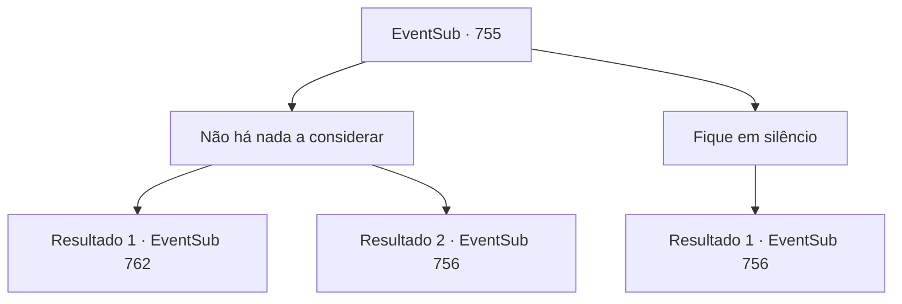

# Eventos secundários · 755

[Índice da tabela](index.md) · [Índice geral](../index.md)

ID: `pt:EventSub:755` · Fonte: `EventSub4` · Versão: 1.2.47.

Mapeamento estático dos arquivos; a disponibilidade e a execução dependem do estado da run.

## Texto do evento

*Sem texto no arquivo.*

## Dados de entrada

```json
{
  "id": 755,
  "grade": 1,
  "subEvent": "",
  "required": ""
}
```

## Mapa das escolhas



## Escolhas e resultados

### Escolha 1

Não há nada a considerar

Requisitos e outros campos da escolha:

```json
{
  "required": ""
}
```

#### Resultado 1.1

Você grita para ele que não há nada para vocês dois ouvirem. Lei parece estar pensando a mesma coisa, pois concorda com sua decisão. O Dragão Vermelho verifica sua expressão uma última vez, solta um suspiro e vai embora. 

 "...Vou seguir meu caminho, então. Fiquem seguros, vocês dois."

 Ele faz a saudação oriental e se afasta. Lei ainda parece preocupado com algo, mas balança a cabeça como se não fosse nada. 

 "Ah, bem. Não pode ser nada muito sério. Aqui - tome mais um pouco."

 Você e Lei passam as próximas horas bebendo mais. No dia seguinte, você acorda com uma dor de cabeça terrível. Você olha ao redor e consegue se lembrar de que ainda está na mesma pousada de ontem. Ao tentar se levantar e descer da cama velha, você acaba tendo uma experiência surreal de o chão de madeira saltar para o seu rosto. Você se machuca aqui e ali. Quando o som se dissipa, Lei abre a porta e entra. 

 "Ah, você está acordado. Aqui, tome um pouco de água com mel. Vai aliviar a dor."

 Você pega a tigela de porcelana e bebe. Lei ajuda você a se levantar enquanto coloca a tigela vazia na mesa. 

 "A luta vai começar em breve. Vamos nos apressar."


Continuação registrada: [Evento 762](0762.md) na mesma tabela.

```json
{
  "required": "",
  "chance": "1|0_12_1",
  "nextEvent": 762,
  "type": 0,
  "reward": ""
}
```

#### Resultado 1.2

Você grita com ele que não há nada para vocês dois ouvirem. Mas Lei parece ter uma ideia diferente, pois diz ao homem que seus ouvidos estão abertos. O Dragão Vermelho, ajoelhado, fala. 

 "Meu nome é Yangjin. O atual Chefe do Clã graciosamente me acolheu como um guerreiro do Clã Ryu. Minha habilidade está longe de ser perfeita... mas ele me concedeu a honra de servir e proteger a herdeira. Mas... a última ordem da Srta. Shao que me foi dada... não tenho certeza se devo segui-la."

 Lei pergunta a Yangjin qual foi a ordem de Shao. 

 "A Srta. Shao declarou para nós que ela deve vencer o torneio, custe o que custar. Ela me confiou a tarefa de envenená-lo com isto. Os outros Dragões Vermelhos devem ferir, ou até mesmo matar, outros participantes da competição."

 Ele tira um saquinho de seda do bolso e revela seu conteúdo - um punhado de pó branco como a neve. 

 "Ópio. Remédio quando bem usado, veneno caso contrário."

 Yangjin acrescenta que nunca duvidou de sua lealdade a Shao, mas sua lealdade está primeiro com o Clã Ryu, e que trapaças como essa não são algo que um Ryu deveria fazer. 

 "Nosso clã tem uma reputação a manter no Oriente! Isso... isso não é a coisa certa a fazer. Então, por favor, ponha um fim aos esquemas da Srta. Shao."

 Assim que ele termina, ele se levanta novamente.

Continuação registrada: [Evento 756](0756.md) na mesma tabela.

```json
{
  "required": "",
  "chance": "16",
  "nextEvent": 756,
  "type": 1,
  "reward": ""
}
```

### Escolha 2

Fique em silêncio

Requisitos e outros campos da escolha:

```json
{
  "required": ""
}
```

#### Resultado 2.1

Lei diz ao homem que seus ouvidos estão abertos. O Dragão Vermelho, ajoelhado, fala. 

 "Meu nome é Yangjin. O atual Chefe do Clã graciosamente me acolheu como um guerreiro do Clã Ryu. Minha habilidade está longe de ser perfeita... mas ele me concedeu a honra de servir e proteger a herdeira. Mas... a última ordem da Srta. Shao que me foi atribuída... não tenho certeza se devo segui-la."

 Lei pergunta a Yangjin qual foi a ordem de Shao. 

 "A Srta. Shao declarou para nós que ela deve vencer o torneio, custe o que custar. Ela me confiou a tarefa de envenená-lo com isto. Os outros Dragões Vermelhos devem ferir, ou até mesmo matar, outros participantes da competição."

 Ele tira um saquinho de seda do bolso e revela seu conteúdo - um punhado de pó branco como a neve. 

 "Ópio. Remédio quando bem usado, veneno caso contrário."

 Yangjin acrescenta que nunca duvidou de sua lealdade a Shao, mas sua lealdade está primeiro com o Clã Ryu, e que artimanhas como essa não são algo que um Ryu deveria fazer. 

 "Nosso clã tem uma reputação a manter no Oriente! Isso... isso não é a coisa certa a fazer. Então, por favor, ponha um fim aos esquemas da Srta. Shao."

 Assim que ele termina, ele se levanta novamente.

Continuação registrada: [Evento 756](0756.md) na mesma tabela.

```json
{
  "required": "",
  "chance": "1",
  "nextEvent": 756,
  "type": 2,
  "reward": ""
}
```

## Referências que chegam a este evento

- [Evento 749 · escolha 1 · resultado 2](0749.md#escolha-1)
- [Evento 753 · escolha 1 · resultado 1](0753.md#escolha-1)
- [Evento 753 · escolha 2 · resultado 1](0753.md#escolha-2)
