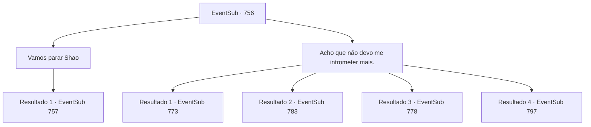

# Eventos secundários · 756

[Índice da tabela](index.md) · [Índice geral](../index.md)

ID: `pt:EventSub:756` · Fonte: `EventSub4` · Versão: 1.2.47.

Mapeamento estático dos arquivos; a disponibilidade e a execução dependem do estado da run.

## Texto do evento

*Sem texto no arquivo.*

## Dados de entrada

```json
{
  "id": 756,
  "grade": 1,
  "subEvent": "",
  "required": ""
}
```

## Mapa das escolhas



## Escolhas e resultados

### Escolha 1

Vamos parar Shao

Requisitos e outros campos da escolha:

```json
{
  "required": ""
}
```

#### Resultado 1.1

Você decide ajudar Lei a frustrar o esquema de Shao. 

 "Significa muito ter você do meu lado, Sohyeop. Obrigado."

 "Eu também agradeço."

 Tanto Lei quanto Yangjin mostram sua gratidão. Yangjin começa a explicar quem está sendo alvo de Shao. 

 "Atualmente, os Dragões Vermelhos estão atrás de participantes capazes - aqueles que têm mais chances de chegar e sair vitoriosos nas finais. Nosso objetivo era ou matá-los ou incapacitar para que não possam competir no dia da partida."

 Segundo ele, os dois alvos mais procurados são um aventureiro chamado 'Sanson' e 'Kyle', o caçador de recompensas.

Continuação registrada: [Evento 757](0757.md) na mesma tabela.

```json
{
  "required": "",
  "chance": "1",
  "nextEvent": 757,
  "type": 2,
  "reward": ""
}
```

### Escolha 2

Acho que não devo me intrometer mais.

Requisitos e outros campos da escolha:

```json
{
  "required": ""
}
```

#### Resultado 2.1

Você diz a Lei para não se envolver. No entanto, Lei insiste e segue Yangjin para fora da pousada, apesar de suas tentativas de detê-lo. 

 "Eu... devo ir agora. Com licença."

 Os dois saem, e você fica sozinho na pousada. Você toma mais alguns copos em solidão, depois se retira para o seu quarto para descansar.

Continuação registrada: [Evento 773](0773.md) na mesma tabela.

```json
{
  "required": "5_743_1|18_763_1",
  "chance": "1",
  "nextEvent": 773,
  "type": 2,
  "reward": "5_751_1"
}
```

#### Resultado 2.2

Você diz a Lei para não se envolver. No entanto, Lei insiste e segue Yangjin para fora da estalagem, apesar de suas tentativas de detê-lo. 

 "Eu... devo ir agora. Com licença."

 Os dois saem, e você fica sozinho na estalagem. 

 No dia seguinte, você se dirige à arena onde o torneio está sendo realizado. O lugar está fervilhando de pessoas, mas Lei não está em lugar nenhum. Você olha ao redor por mais alguns minutos antes de se dirigir às câmaras dos competidores. 

 Após alguns minutos de preparação, você sobe ao palco. As arquibancadas estão lotadas - o lugar está cheio de espectadores animados, mostrando sua expectativa para a luta que está prestes a acontecer. Seu primeiro oponente é um cavaleiro vestido com uma armadura completa. 

 "O nome é Sparkles, companheiro aventureiro! Venho do grande Reino de Lothar. Vamos ter uma luta honrada e justa."

 Aplausos e gritos altos enchem a arena enquanto a batalha começa.

Continuação registrada: [Evento 783](0783.md) na mesma tabela.

```json
{
  "required": "18_743_1|18_763_1",
  "chance": "1",
  "nextEvent": 783,
  "type": 2,
  "reward": "6_0_180",
  "place": 11
}
```

#### Resultado 2.3

Você diz a Lei para não se envolver. No entanto, Lei insiste e segue Yangjin para fora da estalagem, apesar de suas tentativas de detê-lo. 

 "Eu... devo ir agora. Com licença."

 Os dois saem, e você fica sozinho na estalagem. 

 No dia seguinte, você vai até a arena onde o torneio está sendo realizado. Quando a noite chega, a maioria das lutas chega ao fim, e a luta final está prestes a começar. 

 "Lei Ryu do Clã Ryu! E Sir Sparkles, do Reino de Lothar!"

 Os dois se cumprimentam respeitosamente à sua maneira única. A batalha começa. Lei, assim que a luta começa, começa a encurralar Sparkles com golpes rápidos. Como o combatente experiente que é, Sparkles luta habilidosamente. Mas, eventualmente, sua resistência chega ao limite. Sparkles recua e acidentalmente solta a arma. Lei é declarado o vencedor. 

 "O novo Mestre de Batalha é... Lei Ryu!!"

 Aplausos ensurdecedores explodem na multidão. <link=shake>

 "WOOOOOOOOO!!!"

</link> É como se toda a cidade estivesse tremendo. Lei responde ao público fazendo a saudação oriental. Você o observa enquanto ele se posiciona triunfantemente, aplaudindo com paixão. Provavelmente porque é o último dia. Aquela seria uma longa e agitada noite para a cidade. Então, você vê Lei vindo em sua direção. 

 "Sohyeop. Um momento, por favor."

 Lei te conduz até uma colina, com uma ótima vista de toda a cidade. Lei olha para a brilhante lua por um momento e depois se vira para você. 

 "Estou pensando em voltar, Sohyeop. De volta para minha casa no Oriente. Lá, restaurarei a honra e a glória do meu grande clã junto com Shao e serei reconhecido como um guerreiro oficial. Não posso te agradecer o suficiente por toda a ajuda que você me deu até agora."


Continuação registrada: [Evento 778](0778.md) na mesma tabela.

```json
{
  "required": "5_743_1|5_763_1",
  "chance": "1",
  "nextEvent": 778,
  "type": 2,
  "reward": "5_751_1"
}
```

#### Resultado 2.4

Você diz a Lei para não se envolver. No entanto, Lei insiste e segue Yangjin para fora da estalagem, apesar de suas tentativas de detê-lo. 

 "Eu... devo ir agora. Com licença."

 Os dois saem, e você fica sozinho na estalagem. 

 No dia seguinte, você vai até a arena onde o torneio está sendo realizado. O lugar está fervilhando de pessoas, mas Lei não está em lugar nenhum. Você olha ao redor por mais alguns minutos antes de ir para as câmaras dos competidores. Quando a noite chega, a maioria das lutas chega ao fim, e a luta final está prestes a começar. 

 "Shao Ryu do Clã Ryu! E Sir Sparkles, do Reino de Lothar!"

 Os dois se cumprimentam respeitosamente à sua maneira única. A batalha começa. Shao, assim que a luta começa, começa a encurralar Sparkles com golpes rápidos. Como o combatente experiente que é, Sparkles luta habilidosamente. Mas, eventualmente, sua resistência chega ao limite. Sparkles recua e acidentalmente solta a arma. Shao é declarado o vencedor. 

 "O novo Mestre de Batalha é... Shao Ryu!!"

 Aplausos ensurdecedores explodem na multidão. <link=shake>

 "WOOOOOOOOO!!!"

</link> É como se toda a cidade estivesse tremendo. Shao cumprimenta formalmente o público e, em seguida, desce do palco.

Continuação registrada: [Evento 797](0797.md) na mesma tabela.

```json
{
  "required": "18_743_1|5_763_1",
  "chance": "1",
  "nextEvent": 797,
  "type": 2,
  "reward": "5_757_1"
}
```

## Referências que chegam a este evento

- [Evento 755 · escolha 1 · resultado 2](0755.md#escolha-1)
- [Evento 755 · escolha 2 · resultado 1](0755.md#escolha-2)
