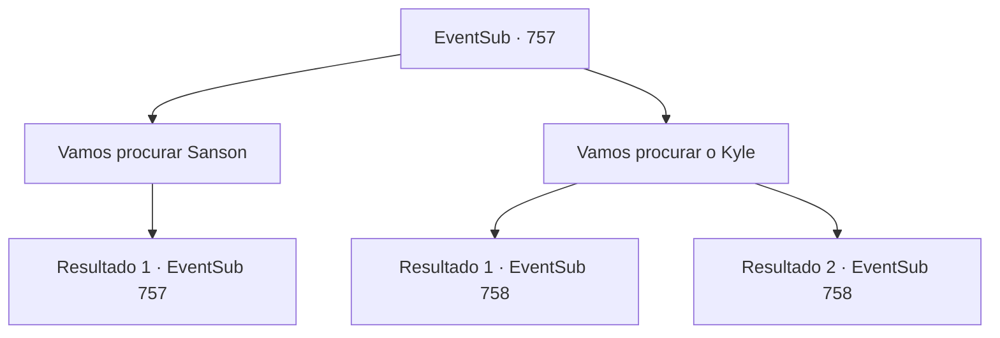

# Eventos secundários · 757

[Índice da tabela](index.md) · [Índice geral](../index.md)

ID: `pt:EventSub:757` · Fonte: `EventSub4` · Versão: 1.2.47.

Mapeamento estático dos arquivos; a disponibilidade e a execução dependem do estado da run.

## Texto do evento

*Sem texto no arquivo.*

## Dados de entrada

```json
{
  "id": 757,
  "grade": 1,
  "subEvent": "",
  "required": ""
}
```

## Mapa das escolhas



## Escolhas e resultados

### Escolha 1

Vamos procurar Sanson

Requisitos e outros campos da escolha:

```json
{
  "required": "5_752_0"
}
```

#### Resultado 1.1

Yangjin diz que Sanson tem o hábito de beber, tanto que ganhou o apelido de 'Baleia de Bebida'. Sendo assim, você facilmente avista o homem em uma taverna próxima. Ele já parece bêbado. Muito bêbado. Yangjin o examina, balança a cabeça e fala. 

 "Estamos atrasados. Os Dragões Vermelhos já estiveram aqui. Ele pode parecer bêbado, mas foi drogado. Se tiver sorte, ele acordará em alguns dias. Se não tiver, bem... Provavelmente nunca o veremos acordado novamente."

 Lei suspira e fala. 

 "Precisamos nos apressar. Vamos procurar Kyle."


Continuação registrada: [Evento 757](0757.md) na mesma tabela.

```json
{
  "required": "",
  "chance": "1",
  "nextEvent": 757,
  "type": 2,
  "reward": "5_752_1"
}
```

### Escolha 2

Vamos procurar o Kyle

Requisitos e outros campos da escolha:

```json
{
  "required": ""
}
```

#### Resultado 2.1

Você questiona a população local sobre Kyle. 

 "Kyle tem uma cicatriz enorme no rosto. Não seria muito difícil encontrar algumas testemunhas, eu suponho."

 Yangjin estava certo - é mais fácil do que você pensava ouvir relatos sobre Kyle. 

 "Ah. Aquele com a cicatriz? Ele foi para lá. O tabernáculo na colina."

 Um vendedor de barraca aponta para um local, para onde você se dirige imediatamente. O tabernáculo é dedicado a Veene, construído no topo de uma colina, com uma boa vista da cidade. Uma luta já começou. Um grupo de assassinos, vestidos com mantos pretos e máscaras pretas para esconder suas identidades, cercou alguém. A pessoa sendo atacada é Kyle, aquele com a enorme cicatriz. Kyle já está coberto de ferimentos e parece visivelmente exausto. Você, Lei e Yangjin correm imediatamente para os assassinos, para defender Kyle.

Continuação registrada: [Evento 758](0758.md) na mesma tabela.

```json
{
  "required": "5_752_1",
  "chance": "1",
  "nextEvent": 758,
  "type": 2,
  "reward": "6_0_179",
  "place": 4
}
```

#### Resultado 2.2

Você questiona a população local sobre Kyle. 

 "Kyle tem uma cicatriz enorme no rosto. Não seria muito difícil encontrar algumas testemunhas, eu suponho."

 Yangjin estava certo - é mais fácil do que você pensava ouvir relatos sobre Kyle. 

 "Ah. Aquele com a cicatriz? Ele foi para lá. O tabernáculo na colina."

 Um vendedor de barraca aponta para um local, para onde você se dirige imediatamente. Lá você encontra Kyle, o caçador de recompensas com a enorme cicatriz. Ele está rezando em frente a uma estátua da deusa Veene. Lei se aproxima e fala com ele, ao que Kyle responde irritado. 

 "Você não vê que estou rezando? O que é...?"

 Lei se desculpa educadamente. 

 "Desculpe - mas estamos aqui para ajudar..."

 Lei para de falar e olha para trás. Lá está Shao, vestindo uma túnica de sacerdotisa de Veene. 

 "*suspiro*... Droga..."

 Ela tira a túnica e a joga fora, gritando. 

 "Nosso plano falhou!"

 Então, um grupo de assassinos em capas pretas e máscaras invade as janelas e portas do tabernáculo. Kyle puxa seu machado do cinto para revidar. Seu grupo se prepara para lutar também, preparando suas armas contra os Dragões Vermelhos.

Continuação registrada: [Evento 758](0758.md) na mesma tabela.

```json
{
  "required": "18_752_1",
  "chance": "1",
  "nextEvent": 758,
  "type": 2,
  "reward": "6_2_179",
  "place": 4
}
```

## Referências que chegam a este evento

- [Evento 756 · escolha 1 · resultado 1](0756.md#escolha-1)
- [Evento 757 · escolha 1 · resultado 1](0757.md#escolha-1)
