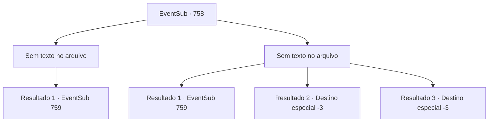

# Eventos secundários · 758

[Índice da tabela](index.md) · [Índice geral](../index.md)

ID: `pt:EventSub:758` · Fonte: `EventSub4` · Versão: 1.2.47.

Mapeamento estático dos arquivos; a disponibilidade e a execução dependem do estado da run.

## Texto do evento

*Sem texto no arquivo.*

## Dados de entrada

```json
{
  "id": 758,
  "grade": 1,
  "subEvent": "",
  "required": ""
}
```

## Mapa das escolhas



## Escolhas e resultados

### Escolha 1

*Sem texto no arquivo; o papel dessa opção depende da interface do jogo.*

Requisitos e outros campos da escolha:

```json
{
  "required": ""
}
```

#### Resultado 1.1

Você consegue frustrar a tentativa de assassinato dos Red Drakes. Kyle está gravemente ferido e exausto, mas ainda vivo. À medida que a luta chega a um impasse, Yangjin aponta sua espada para eles e grita. 

 "Isso é algo tão vulgar e perverso de se fazer! Não têm dignidade para obedecer a tais ordens?! A verdadeira lealdade está em corrigir os caminhos do seu senhor, caso ele faça algo errado!"

 Shao se revela para responder. Ela olha para Yangjin, uma mistura de tristeza e pena em seus olhos. Ela caminha lentamente até ele e fala. 

 "Suas palavras ressoam dentro de mim, Yangjin. Sua ação deve brotar do quanto você se importa comigo."

 Shao abre os braços para abraçar Yangjin. Ele parece tanto honrado quanto desconfortável ao mesmo tempo. Logo, sua expressão muda para surpresa. Ele imediatamente desaba no chão. Cravado em seu peito está uma adaga. 

 "Que tolice sua fazer julgamentos por conta própria. Um guerreiro desleal é um inútil."

 Os olhos de Lei se arregalam de espanto.  

 "S- SHAO! O que você está fazendo?! Yangjin era um dos nossos! Do nosso clã, e seu aliado mais próximo!"

 Shao sorri friamente e responde.  

 "Eu sei, eu sei. Ele 'era'. Agora ele não é nada além de um traidor."

 As mãos de Lei começam a tremer. Você pode sentir sua raiva. Ele aponta sua espada para Shao. <link=shake>

 "Eu estava errado. Você... não merece liderar nosso clã!"

</link> Shao puxa sua espada em resposta. 

 "Você não decide quem merece o quê, plebeu. Posso ter me tornado insensível, mas não sou burra o suficiente para deixar um traidor viver. Red Drakes! Vamos acabar com isso aqui e agora."

 Obedecendo suas ordens, os guerreiros avançam contra você. Enquanto isso, Shao ataca Lei com sua espada.

Continuação registrada: [Evento 759](0759.md) na mesma tabela.

```json
{
  "required": "",
  "chance": "1",
  "nextEvent": 759,
  "type": 2,
  "reward": "6_2_179|5_753_1",
  "place": 4
}
```

### Escolha 2

*Sem texto no arquivo; o papel dessa opção depende da interface do jogo.*

Requisitos e outros campos da escolha:

```json
{
  "required": ""
}
```

#### Resultado 2.1

Você falha em frustrar a tentativa de assassinato dos Dragões Vermelhos. Não só isso, mas você também é ferido no processo. Yangjin aponta sua espada para eles e grita. 

 "Isso é algo tão vulgar e perverso de se fazer! Vocês não têm dignidade para obedecer a tais ordens?! A verdadeira lealdade está em corrigir os caminhos do seu senhor, caso ele faça algo errado!"

 Shao se revela para responder. Ela encara Yangjin, uma mistura de tristeza e pena em seus olhos. Ela caminha lentamente até ele e fala. 

 "Suas palavras ressoam dentro de mim, Yangjin. Sua ação deve brotar do quanto você se importa comigo."

 Shao abre os braços para abraçar Yangjin. Ele parece tanto honrado quanto desconfortável ao mesmo tempo. Logo, sua expressão muda para surpresa. Ele imediatamente cai no chão. Cravado em seu peito está um punhal. 

 "Que tolice sua fazer julgamentos por conta própria. Um guerreiro desleal é um inútil."

 Os olhos de Lei se arregalam de espanto. 

 "S- SHAO! O que você está fazendo?! Yangjin era um dos nossos! Do nosso clã, e seu aliado mais próximo!"

 Shao sorri friamente e responde. 

 "Eu sei, eu sei. Ele 'era'. Agora ele não é nada além de um traidor."

 As mãos de Lei começam a tremer. Você pode sentir sua raiva. Ele aponta sua espada para Shao.  <link=shake>

 "Eu estava errado. Você... não merece liderar nosso clã!"

</link> Shao puxa sua espada em resposta. 

 "Você não pode decidir quem merece o quê, plebeu. Eu posso ter me tornado insensível, mas não sou burra o suficiente para deixar um traidor viver. Dragões Vermelhos! Vamos acabar com isso aqui e agora."

 Obedecendo suas ordens, os guerreiros todos avançam contra você. Enquanto isso, Shao ataca Lei com sua espada.

Continuação registrada: [Evento 759](0759.md) na mesma tabela.

```json
{
  "required": "1_0_2|1_1_2",
  "chance": "1",
  "nextEvent": 759,
  "type": 2,
  "reward": "0_0_-1|0_1_-1|6_2_179",
  "place": 4
}
```

#### Resultado 2.2

Você é jogado ao chão após ser atingido por um Dragão Vermelho. Lei te avista e tenta ajudar, mas é tarde demais. Infelizmente, outra espada corta seu pescoço.

Continuação registrada: [Destino especial `-3`](../destinos-especiais.md).

```json
{
  "required": "2_0_2",
  "chance": "1",
  "nextEvent": -3,
  "type": 2,
  "reward": "0_0_-1|0_1_-1"
}
```

#### Resultado 2.3

Você é jogado ao chão após ser atingido por um Dragão Vermelho. Lei te avista e tenta ajudar, mas é tarde demais. Infelizmente, outra espada corta seu pescoço.

Continuação registrada: [Destino especial `-3`](../destinos-especiais.md).

```json
{
  "required": "2_1_2",
  "chance": "1",
  "nextEvent": -3,
  "type": 2,
  "reward": "0_0_-1|0_1_-1"
}
```

## Referências que chegam a este evento

- [Evento 757 · escolha 2 · resultado 1](0757.md#escolha-2)
- [Evento 757 · escolha 2 · resultado 2](0757.md#escolha-2)
