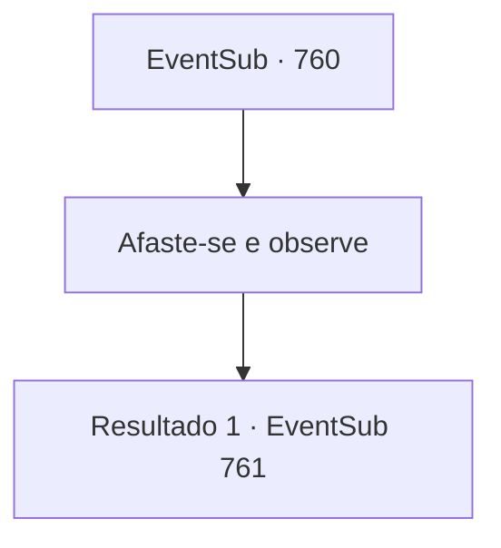

# Eventos secundários · 760

[Índice da tabela](index.md) · [Índice geral](../index.md)

ID: `pt:EventSub:760` · Fonte: `EventSub4` · Versão: 1.2.47.

Mapeamento estático dos arquivos; a disponibilidade e a execução dependem do estado da run.

## Texto do evento

*Sem texto no arquivo.*

## Dados de entrada

```json
{
  "id": 760,
  "grade": 1,
  "subEvent": "",
  "required": ""
}
```

## Mapa das escolhas



## Escolhas e resultados

### Escolha 1

Afaste-se e observe

Requisitos e outros campos da escolha:

```json
{
  "required": ""
}
```

#### Resultado 1.1

Lei cerra o punho com tanta força que sua mão fica vermelha. Então, ele caminha em direção a Shao. Shao se arrasta para longe de Lei, gritando. 

 "R- Dragões Vermelhos! O QUE VOCÊS ESTÃO FAZENDO?! MATEM A LOUCA JÁ!"

 Mas os Dragões Vermelhos não fazem nada. Finalmente, Lei alcança Shao. 

 "Vamos acabar com isso, Shao. Você ainda pode viver sua vida como a filha do Chefe do Clã."

 Uma aura azul começa a se formar ao redor do punho de Lei. Então, ele enfia o punho na barriga de Shao. 

 "ACK...!!"

 Com um som alto, Shao vomita sangue. A aura azul sai de seu corpo e se dissipa no ar. 

 "N- não....."

 Com isso, Shao cai inconsciente. Lei olha para os Dragões Vermelhos, dizendo-lhes para levá-la. Todos fazem a saudação oriental, pegam o corpo de Shao e descem a colina.

Continuação registrada: [Evento 761](0761.md) na mesma tabela.

```json
{
  "required": "",
  "chance": "1",
  "nextEvent": 761,
  "type": 2,
  "reward": "14_11_7"
}
```

## Referências que chegam a este evento

- [Evento 759 · escolha 1 · resultado 1](0759.md#escolha-1)
