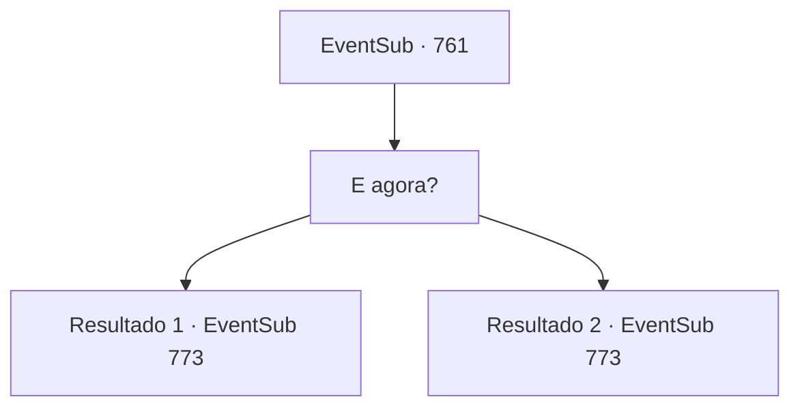

# Eventos secundários · 761

[Índice da tabela](index.md) · [Índice geral](../index.md)

ID: `pt:EventSub:761` · Fonte: `EventSub4` · Versão: 1.2.47.

Mapeamento estático dos arquivos; a disponibilidade e a execução dependem do estado da run.

## Texto do evento

*Sem texto no arquivo.*

## Dados de entrada

```json
{
  "id": 761,
  "grade": 1,
  "subEvent": "",
  "required": ""
}
```

## Mapa das escolhas



## Escolhas e resultados

### Escolha 1

E agora?

Requisitos e outros campos da escolha:

```json
{
  "required": ""
}
```

#### Resultado 1.1

Você estava perguntando para Lei, mas Kyle responde em vez disso, coçando a parte de trás da cabeça. 

 "Bem, acho que preciso me arrumar primeiro por aqui. Competir em uma condição como esta não vai me fazer bem."

 Ele olha para você de forma desajeitada por um breve momento, então puxa uma bolsa cheia de ouro. 

 "Ah, e uh... obrigado por salvar minha vida, eu acho."

 Ele então entra no tabernáculo, em direção ao santuário de Veene. Lei solta um longo suspiro e coloca a mão no rosto. 

 "Ufa... Eu sei o que devo fazer agora, mas... não tenho certeza se realmente posso *fazer* isso."

 Ele balança a cabeça, como se quisesse se livrar das preocupações. Ele faz o melhor para soar confiante. 

 "Bem, eu tenho um torneio para competir. Uma reputação de clã para espalhar. Vamos indo?"


Continuação registrada: [Evento 773](0773.md) na mesma tabela.

```json
{
  "required": "5_753_1",
  "chance": "1",
  "nextEvent": 773,
  "type": 2,
  "reward": "0_4_50"
}
```

#### Resultado 1.2

Lei solta um longo suspiro e coloca a mão no rosto. 

 "Ufa... Eu sei o que devo fazer agora, mas... Não tenho certeza se realmente consigo *fazer* isso."

 Ele balança a cabeça, como se quisesse se livrar das preocupações. Ele faz o melhor para soar confiante. 

 "Bem, eu tenho um torneio para competir. Uma reputação de clã para espalhar. Vamos?"


Continuação registrada: [Evento 773](0773.md) na mesma tabela.

```json
{
  "required": "18_753_1",
  "chance": "1",
  "nextEvent": 773,
  "type": 2,
  "reward": ""
}
```

## Referências que chegam a este evento

- [Evento 760 · escolha 1 · resultado 1](0760.md#escolha-1)
