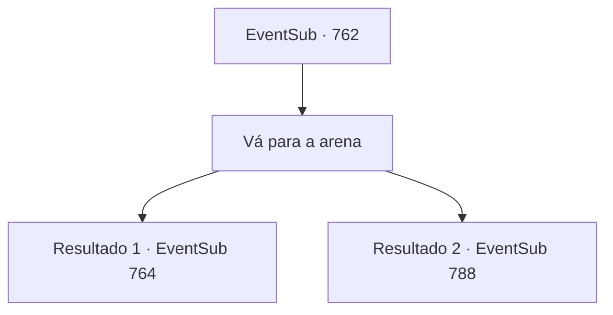

# Eventos secundários · 762

[Índice da tabela](index.md) · [Índice geral](../index.md)

ID: `pt:EventSub:762` · Fonte: `EventSub4` · Versão: 1.2.47.

Mapeamento estático dos arquivos; a disponibilidade e a execução dependem do estado da run.

## Texto do evento

*Sem texto no arquivo.*

## Dados de entrada

```json
{
  "id": 762,
  "grade": 1,
  "subEvent": "",
  "required": ""
}
```

## Mapa das escolhas



## Escolhas e resultados

### Escolha 1

Vá para a arena

Requisitos e outros campos da escolha:

```json
{
  "required": ""
}
```

#### Resultado 1.1

Você se dirige à arena, onde o Torneio Battra está sendo realizado. 

 "Desejo-lhe sorte, Sohyeop. Você vai se sair bem, sem dúvida."

 Lei te anima uma última vez e se dirige às câmaras dos competidores. 

 Após alguns minutos de preparação, você sobe ao palco. Apesar de ser a primeira luta do dia, não há um único assento vazio. Usando o som das torcidas e da empolgação como combustível, você se prepara para a luta. Seu primeiro oponente é um cavaleiro vestido com armadura completa. 

 "O nome é Sparkles, companheiro aventureiro! Venho do grande Reino de Lothar. Vamos ter uma luta honrada e justa."

 Gritos e aplausos enchem a arena enquanto a batalha começa.

Continuação registrada: [Evento 764](0764.md) na mesma tabela.

```json
{
  "required": "18_763_1",
  "chance": "1",
  "nextEvent": 764,
  "type": 2,
  "reward": "6_0_180",
  "place": 11
}
```

#### Resultado 1.2

Você se dirige para a arena, onde está sendo realizado o Torneio de Battra. 

 "Sohyeop. Desejo profundamente vê-lo na plateia."

 Lei se dirige para as câmaras dos competidores. Você sai para tomar seu assento. O lugar está lotado de espectadores ansiosos, que aguardam excitados pela próxima luta. 

 À medida que a noite chega, a maioria das lutas chega ao fim, e a luta final está prestes a começar. 

 "Lei Ryu do Clã Ryu! E Shao Ryu, do mesmo Clã Ryu!"

 Os dois competidores no palco sacam suas espadas e assumem uma postura semelhante. Eles parecem estar conversando sobre algo, mas você não consegue entender nada da conversa deles, principalmente devido ao barulho da multidão. Logo, a luta começa e um elegante e violento confronto de aço se segue.

Continuação registrada: [Evento 788](0788.md) na mesma tabela.

```json
{
  "required": "5_763_1",
  "chance": "1",
  "nextEvent": 788,
  "type": 2,
  "reward": ""
}
```

## Referências que chegam a este evento

- [Evento 754 · escolha 1 · resultado 1](0754.md#escolha-1)
- [Evento 754 · escolha 2 · resultado 1](0754.md#escolha-2)
- [Evento 755 · escolha 1 · resultado 1](0755.md#escolha-1)
