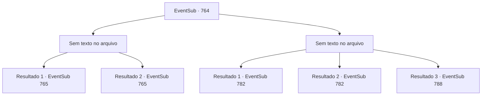

# Eventos secundários · 764

[Índice da tabela](index.md) · [Índice geral](../index.md)

ID: `pt:EventSub:764` · Fonte: `EventSub4` · Versão: 1.2.47.

Mapeamento estático dos arquivos; a disponibilidade e a execução dependem do estado da run.

## Texto do evento

*Sem texto no arquivo.*

## Dados de entrada

```json
{
  "id": 764,
  "grade": 1,
  "subEvent": "",
  "required": ""
}
```

## Mapa das escolhas



## Escolhas e resultados

### Escolha 1

*Sem texto no arquivo; o papel dessa opção depende da interface do jogo.*

Requisitos e outros campos da escolha:

```json
{
  "required": ""
}
```

#### Resultado 1.1

<link=shake>

 "WOOOOOOOOO!!!"

</link> Aplausos enchem a arena enquanto a luta termina. Nessa batalha feroz, você sai vitorioso, mas tem que admitir que foi por pouco. Você levanta o punho no ar para responder aos aplausos enquanto desce do palco. 

 As lutas continuam. Após algumas rodadas, Lei aparece no palco. Sua esgrima brilha intensamente, mesmo entre outros competidores capazes. Enquanto você assiste à luta, Shao aparece diante de você. Você percebe que sua expressão se suavizou bastante. 

 "... Eu serei sua oponente na próxima luta. Esteja preparado."

 Shao então se apressa para sair. Quase parece que ela está fugindo.

Continuação registrada: [Evento 765](0765.md) na mesma tabela.

```json
{
  "required": "5_749_1",
  "chance": "1",
  "nextEvent": 765,
  "type": 2,
  "reward": ""
}
```

#### Resultado 1.2

<link=shake>

 "WOOOOOOOOO!!!"

</link> Aplausos enchem a arena enquanto a luta termina. Nessa batalha feroz, você sai vitorioso, mas tem que admitir que foi por pouco. Você levanta o punho no ar para responder aos aplausos enquanto desce do palco. 

 As lutas continuam. Após algumas rodadas, Lei aparece no palco. Sua esgrima brilha intensamente, mesmo entre outros competidores capazes. Enquanto você assiste à luta, uma mulher familiar se aproxima de você. Shao olha para você e fala. 

 "É melhor você estar preparado. Eu não vou pegar leve com você."

 Depois de terminar o que veio dizer, ela imediatamente se afasta.

Continuação registrada: [Evento 765](0765.md) na mesma tabela.

```json
{
  "required": "18_749_1",
  "chance": "1",
  "nextEvent": 765,
  "type": 2,
  "reward": ""
}
```

### Escolha 2

*Sem texto no arquivo; o papel dessa opção depende da interface do jogo.*

Requisitos e outros campos da escolha:

```json
{
  "required": ""
}
```

#### Resultado 2.1

<link=shake>

 "WOOOOOOOOO!!!"

</link> Aplausos enchem a arena enquanto a luta termina. Sir Sparkles emerge vitorioso. Ele levanta o punho no ar para responder aos aplausos. Você o encara por alguns segundos antes de descer do palco. Lei corre até você e te conforta. 

 "...Você quase conseguiu, Sohyeop. Foi por pouco."

 Você concorda com a cabeça e sobe para os assentos dos espectadores. 

 À medida que a noite chega, a maioria das lutas chega ao fim, e a luta final está prestes a começar. 

 "Lei Ryu do Clã Ryu! E Shao Ryu, do mesmo Clã Ryu!"

 Os dois competidores no palco sacam suas espadas e assumem uma postura semelhante. Eles parecem estar conversando sobre algo, mas você não consegue entender nada da conversa deles, principalmente devido ao barulho da multidão. Logo, a luta começa e um elegante e violento confronto de aço se segue.

Continuação registrada: [Evento 782](0782.md) na mesma tabela.

```json
{
  "required": "18_750_1|5_749_1",
  "chance": "1",
  "nextEvent": 782,
  "type": 2,
  "reward": ""
}
```

#### Resultado 2.2

<link=shake>

 "WOOOOOOOOO!!!"

</link> Aplausos enchem a arena quando a luta termina. Sir Sparkles emerge vitorioso. Ele levanta o punho no ar para responder aos aplausos. Você o encara por alguns segundos antes de descer do palco. Lei corre até você e te conforta. 

 "...Você quase conseguiu, Sohyeop. Foi por pouco. Vou lutar em sua honra também. Por favor, assista."

 Lei cerra o punho apaixonadamente. Você concorda com a cabeça e sobe para os assentos dos espectadores. 

 À medida que a noite chega, a maioria das lutas chega ao fim, e a luta final está prestes a começar. 

 "Lei Ryu do Clã Ryu! E Shao Ryu, do mesmo Clã Ryu!"

 Os dois competidores no palco sacam suas espadas e assumem uma postura semelhante. Eles parecem estar conversando sobre algo, mas você não consegue entender nada da conversa deles, principalmente devido ao barulho da multidão. Logo, a luta começa e um elegante e violento confronto de aço se segue.

Continuação registrada: [Evento 782](0782.md) na mesma tabela.

```json
{
  "required": "5_750_1|5_749_1",
  "chance": "1",
  "nextEvent": 782,
  "type": 2,
  "reward": ""
}
```

#### Resultado 2.3

<link=shake>

 "WOOOOOOOOO!!!"

</link> Aplausos enchem a arena enquanto a luta termina. Sir Sparkles emerge vitorioso. Ele levanta o punho no ar para responder aos aplausos. Você o encara por alguns segundos antes de descer do palco. Lei corre até você e te conforta. 

 "...Você quase conseguiu, Sohyeop. Foi por pouco."

 Você concorda com a cabeça e sobe para os assentos dos espectadores. 

 À medida que a noite chega, a maioria das lutas chega ao fim, e a luta final está prestes a começar. 

 "Lei Ryu do Clã Ryu! E Shao Ryu, do mesmo Clã Ryu!"

 Os dois competidores no palco sacam suas espadas e assumem uma postura semelhante. Eles parecem estar conversando sobre algo, mas você não consegue entender nada da conversa deles, principalmente devido ao barulho da multidão. Logo, a luta começa e um elegante e violento confronto de aço se segue.

Continuação registrada: [Evento 788](0788.md) na mesma tabela.

```json
{
  "required": "18_749_1",
  "chance": "1",
  "nextEvent": 788,
  "type": 2,
  "reward": ""
}
```

## Referências que chegam a este evento

- [Evento 749 · escolha 1 · resultado 1](0749.md#escolha-1)
- [Evento 762 · escolha 1 · resultado 1](0762.md#escolha-1)
- [Evento 763 · escolha 1 · resultado 1](0763.md#escolha-1)
- [Evento 763 · escolha 2 · resultado 1](0763.md#escolha-2)
