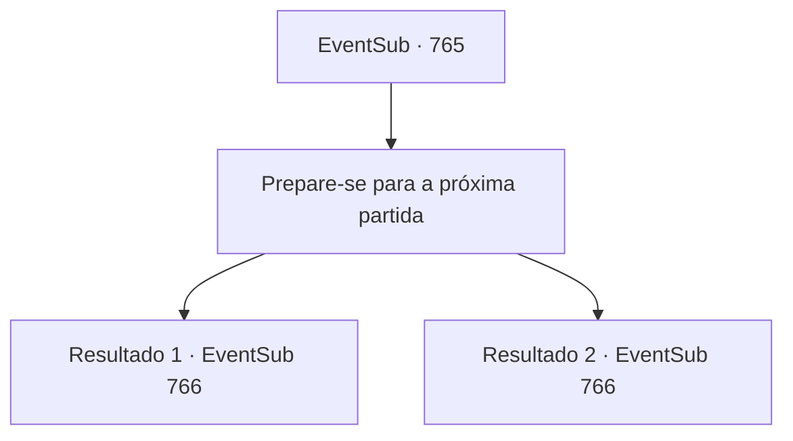

# Eventos secundários · 765

[Índice da tabela](index.md) · [Índice geral](../index.md)

ID: `pt:EventSub:765` · Fonte: `EventSub4` · Versão: 1.2.47.

Mapeamento estático dos arquivos; a disponibilidade e a execução dependem do estado da run.

## Texto do evento

*Sem texto no arquivo.*

## Dados de entrada

```json
{
  "id": 765,
  "grade": 1,
  "subEvent": "",
  "required": ""
}
```

## Mapa das escolhas



## Escolhas e resultados

### Escolha 1

Prepare-se para a próxima partida

Requisitos e outros campos da escolha:

```json
{
  "required": ""
}
```

#### Resultado 1.1

Você recupera o fôlego e se prepara para a próxima luta. Finalmente, você sobe ao palco. Algumas pessoas da plateia estão gritando seu nome. Sua próxima oponente, Shao Ryu, se solta e fala. 

 "Certo... Aqui vamos nós!"

 Shao puxa sua espada e assume uma postura. Sua postura exala graça e elasticidade, mas contém uma rapidez mortal por dentro. Enquanto você se prepara, Shao avança em sua direção como um raio e a luta começa.

Continuação registrada: [Evento 766](0766.md) na mesma tabela.

```json
{
  "required": "5_749_1",
  "chance": "1",
  "nextEvent": 766,
  "type": 2,
  "reward": "6_0_183",
  "place": 11
}
```

#### Resultado 1.2

Você recupera o fôlego e se prepara para a próxima luta. Finalmente, você sobe ao palco. Algumas pessoas da plateia estão gritando seu nome. Sua próxima oponente, Shao Ryu, se solta e fala. 

 "Certo... Aqui vamos nós!"

 Uma aura mortal envolve Shao. Ela avança em sua direção como um raio e a luta começa.

Continuação registrada: [Evento 766](0766.md) na mesma tabela.

```json
{
  "required": "18_749_1",
  "chance": "1",
  "nextEvent": 766,
  "type": 2,
  "reward": "6_3_183",
  "place": 11
}
```

## Referências que chegam a este evento

- [Evento 764 · escolha 1 · resultado 1](0764.md#escolha-1)
- [Evento 764 · escolha 1 · resultado 2](0764.md#escolha-1)
