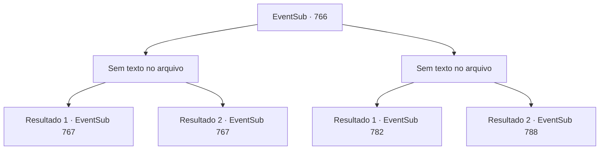

# Eventos secundários · 766

[Índice da tabela](index.md) · [Índice geral](../index.md)

ID: `pt:EventSub:766` · Fonte: `EventSub4` · Versão: 1.2.47.

Mapeamento estático dos arquivos; a disponibilidade e a execução dependem do estado da run.

## Texto do evento

*Sem texto no arquivo.*

## Dados de entrada

```json
{
  "id": 766,
  "grade": 1,
  "subEvent": "",
  "required": ""
}
```

## Mapa das escolhas



## Escolhas e resultados

### Escolha 1

*Sem texto no arquivo; o papel dessa opção depende da interface do jogo.*

Requisitos e outros campos da escolha:

```json
{
  "required": ""
}
```

#### Resultado 1.1

A espada de Shao é arrancada de suas mãos e voa para fora do palco. Depois de olhar para ela por um breve momento, Shao relutantemente admite a derrota. A plateia explode em aplausos animados. <link=shake>

 "WOOOOOOOOO!!!"

</link> Você levanta o punho em resposta aos aplausos, então olha de volta para Shao. Ela já pegou sua espada novamente e está olhando para você sem emoção. 

 "Eu estarei voltando para minha cidade natal... Nossos caminhos se cruzarão novamente, se o destino assim decidir. Adeus, então."

 Shao junta as mãos na frente do peito e se inclina. Depois de mostrar respeito, ela desce da arena.

Continuação registrada: [Evento 767](0767.md) na mesma tabela.

```json
{
  "required": "5_749_1",
  "chance": "1",
  "nextEvent": 767,
  "type": 2,
  "reward": ""
}
```

#### Resultado 1.2

A espada de Shao é arrancada de suas mãos e voa para fora do palco. Depois de olhar para ela por um breve momento, Shao relutantemente admite a derrota. A plateia explode em aplausos animados. <link=shake>

 "WOOOOOOOOO!!!"

</link> Você levanta o punho em resposta aos aplausos, então olha de volta para Shao. Ela já pegou sua espada e saiu da arena.

Continuação registrada: [Evento 767](0767.md) na mesma tabela.

```json
{
  "required": "18_749_1",
  "chance": "1",
  "nextEvent": 767,
  "type": 2,
  "reward": "5_755_1"
}
```

### Escolha 2

*Sem texto no arquivo; o papel dessa opção depende da interface do jogo.*

Requisitos e outros campos da escolha:

```json
{
  "required": ""
}
```

#### Resultado 2.1

A espada de Shao para bem antes do seu pescoço. Você a encara brevemente antes de admitir a derrota. A plateia explode em aplausos animados. <link=shake>

 "WOOOOOOOOO!!!"

</link> Em vez de responder à plateia, é para você que Shao volta seu olhar. 

 "Estarei retornando para minha cidade natal... Nossos caminhos se cruzarão novamente, se o destino assim decidir. Adeus, então."

 Shao junta as mãos em frente ao peito e faz uma reverência. Você também se despede dela, depois sobe para as arquibancadas. 

 Quando a noite chega, a maioria das lutas chega ao fim, e a luta final está prestes a começar. 

 "Lei Ryu do Clã Ryu! E Shao Ryu, do mesmo Clã Ryu!"

 Os dois competidores no palco sacam suas espadas e assumem uma postura semelhante. Eles parecem estar conversando sobre algo, mas você não consegue entender nada da conversa, principalmente devido ao barulho da multidão. Logo, a luta começa e um elegante e violento confronto de aço se segue.

Continuação registrada: [Evento 782](0782.md) na mesma tabela.

```json
{
  "required": "5_749_1",
  "chance": "1",
  "nextEvent": 782,
  "type": 2,
  "reward": ""
}
```

#### Resultado 2.2

A espada de Shao para bem antes do seu pescoço. Você a encara brevemente antes de admitir a derrota. A plateia explode em aplausos animados. <link=shake>

 "WOOOOOOOOO!!!"

</link> Shao sorri brilhantemente de volta para a multidão e então sai do palco. Você logo faz o mesmo. 

 Quando a noite chega, a maioria das lutas chega ao fim, e a luta final está prestes a começar. 

 "Lei Ryu do Clã Ryu! E Shao Ryu, do mesmo Clã Ryu!"

 Os dois competidores no palco sacam suas espadas e assumem uma postura semelhante. Eles parecem estar conversando sobre algo, mas você não consegue entender nada da conversa deles, principalmente devido ao barulho da multidão. Logo, a luta começa e um elegante e violento confronto de aço se segue.

Continuação registrada: [Evento 788](0788.md) na mesma tabela.

```json
{
  "required": "18_749_1",
  "chance": "1",
  "nextEvent": 788,
  "type": 2,
  "reward": ""
}
```

## Referências que chegam a este evento

- [Evento 765 · escolha 1 · resultado 1](0765.md#escolha-1)
- [Evento 765 · escolha 1 · resultado 2](0765.md#escolha-1)
