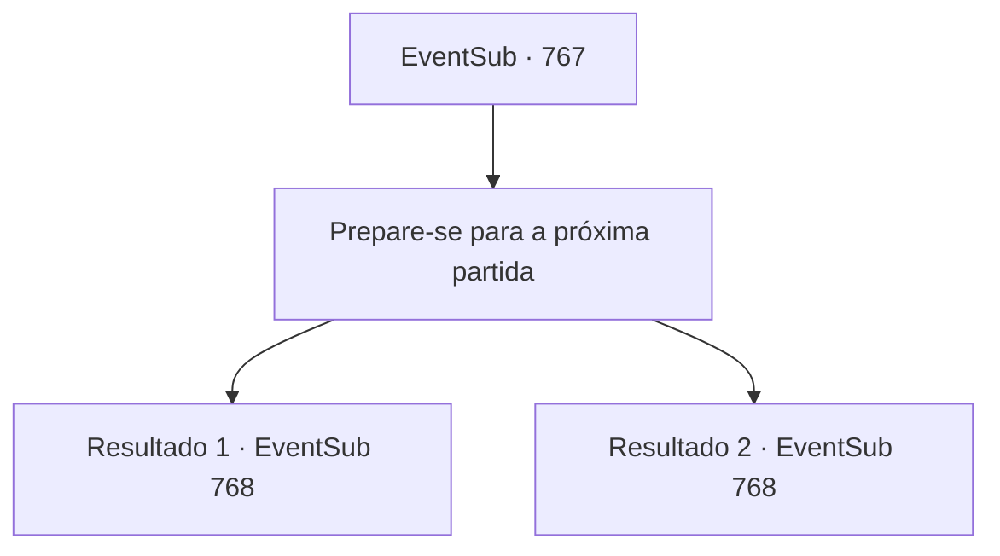

# Eventos secundários · 767

[Índice da tabela](index.md) · [Índice geral](../index.md)

ID: `pt:EventSub:767` · Fonte: `EventSub4` · Versão: 1.2.47.

Mapeamento estático dos arquivos; a disponibilidade e a execução dependem do estado da run.

## Texto do evento

*Sem texto no arquivo.*

## Dados de entrada

```json
{
  "id": 767,
  "grade": 1,
  "subEvent": "",
  "required": ""
}
```

## Mapa das escolhas



## Escolhas e resultados

### Escolha 1

Prepare-se para a próxima partida

Requisitos e outros campos da escolha:

```json
{
  "required": ""
}
```

#### Resultado 1.1

Você desce lentamente do palco e começa os preparativos para a próxima luta. Logo, você se prepara e entra na arena. A excitação do público está no auge. Eles estão gritando seu nome e o do seu oponente repetidamente. Usando a torcida como combustível, você se prepara para lutar. Seu oponente, que estava no palco antes de você, ri e fala. 

 "Sempre quis uma revanche, Sohyeop."

 Lei se aproxima de você confortavelmente e faz a saudação oriental. Então, ele puxa sua espada, seus olhos fixos nos seus.

Continuação registrada: [Evento 768](0768.md) na mesma tabela.

```json
{
  "required": "5_743_1",
  "chance": "1",
  "nextEvent": 768,
  "type": 2,
  "reward": "6_3_182",
  "place": 11
}
```

#### Resultado 1.2

Você desce lentamente do palco e começa os preparativos para a próxima luta. Logo, você se prepara e entra na arena. A excitação do público está no auge. Eles estão gritando seu nome e o do seu oponente repetidamente. Usando a torcida como combustível, você se prepara para lutar. Seu oponente, que estava no palco antes de você, ri e fala. 

 "Sempre quis uma revanche, Sohyeop."

 Lei se aproxima de você confortavelmente e faz a saudação oriental. Então, ele puxa sua espada, seus olhos fixos nos seus.

Continuação registrada: [Evento 768](0768.md) na mesma tabela.

```json
{
  "required": "18_743_1",
  "chance": "1",
  "nextEvent": 768,
  "type": 2,
  "reward": "6_0_182",
  "place": 11
}
```

## Referências que chegam a este evento

- [Evento 766 · escolha 1 · resultado 1](0766.md#escolha-1)
- [Evento 766 · escolha 1 · resultado 2](0766.md#escolha-1)
