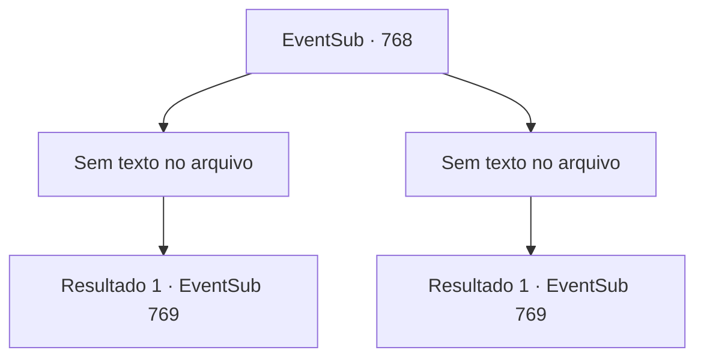

# Eventos secundários · 768

[Índice da tabela](index.md) · [Índice geral](../index.md)

ID: `pt:EventSub:768` · Fonte: `EventSub4` · Versão: 1.2.47.

Mapeamento estático dos arquivos; a disponibilidade e a execução dependem do estado da run.

## Texto do evento

*Sem texto no arquivo.*

## Dados de entrada

```json
{
  "id": 768,
  "grade": 1,
  "subEvent": "",
  "required": ""
}
```

## Mapa das escolhas



## Escolhas e resultados

### Escolha 1

*Sem texto no arquivo; o papel dessa opção depende da interface do jogo.*

Requisitos e outros campos da escolha:

```json
{
  "required": ""
}
```

#### Resultado 1.1

Uma brisa suave enche a arena. Você se aproxima de Lei, que está ajoelhado no chão, estendendo-lhe a mão. Lei a encara por um tempo antes de pegá-la relutantemente. 

 "Você venceu, Sohyeop."

 Seu nome ecoa pela arena. Você é o vencedor do torneio! A cidade inteira parece tremer com a celebração. 

 "O novo Mestre de Batalha é... {1}!!"

 O Sultão de Gladio e o Sumo Sacerdote de Batt levantam seus braços no ar, declarando sua vitória. Junto com o título vem um prêmio em dinheiro considerável, e você é aplaudido e adorado pela multidão. Você acena para responder aos seus favores. Lei sorri feliz, aplaudindo você.

Continuação registrada: [Evento 769](0769.md) na mesma tabela.

```json
{
  "required": "",
  "chance": "1",
  "nextEvent": 769,
  "type": 2,
  "reward": "1_4_300|5_724_2"
}
```

### Escolha 2

*Sem texto no arquivo; o papel dessa opção depende da interface do jogo.*

Requisitos e outros campos da escolha:

```json
{
  "required": ""
}
```

#### Resultado 2.1

Uma brisa suave enche a arena. Você está derrotado, ajoelhado no chão, quando Lei se aproxima de você e lhe estende a mão. Você a segura e se levanta. <link=shake>

 "WOOOOOOOOO!!!"

</link> O nome de Lei ecoa pela arena. A cidade inteira parece tremer com a celebração. 

 "O novo Mestre de Batalha é... Lei do Clã Ryu!"

 O Sultão de Gladio e o Sumo Sacerdote de Batt levantam seus braços no ar, declarando sua vitória. Lei faz sua saudação oriental para responder ao público. Você fica lá por mais alguns minutos aplaudindo, depois desce do palco.

Continuação registrada: [Evento 769](0769.md) na mesma tabela.

```json
{
  "required": "",
  "chance": "1",
  "nextEvent": 769,
  "type": 2,
  "reward": "5_724_1"
}
```

## Referências que chegam a este evento

- [Evento 767 · escolha 1 · resultado 1](0767.md#escolha-1)
- [Evento 767 · escolha 1 · resultado 2](0767.md#escolha-1)
