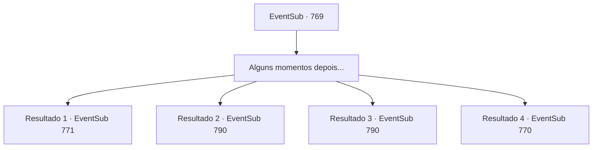

# Eventos secundários · 769

[Índice da tabela](index.md) · [Índice geral](../index.md)

ID: `pt:EventSub:769` · Fonte: `EventSub4` · Versão: 1.2.47.

Mapeamento estático dos arquivos; a disponibilidade e a execução dependem do estado da run.

## Texto do evento

*Sem texto no arquivo.*

## Dados de entrada

```json
{
  "id": 769,
  "grade": 1,
  "subEvent": "",
  "required": ""
}
```

## Mapa das escolhas



## Escolhas e resultados

### Escolha 1

Alguns momentos depois...

Requisitos e outros campos da escolha:

```json
{
  "required": ""
}
```

#### Resultado 1.1

Você está convidado para o jantar naquela noite, tendo a chance de se misturar com outros competidores e os patronos do torneio. Poucos momentos depois, após o banquete estar quase no fim, você finalmente consegue a tão esperada solidão. Você sai para a rua com a barriga cheia. Embora o torneio em si tenha acabado, o clima festivo ainda não morreu. Provavelmente porque é o último dia. Esta seria uma noite longa e animada para a cidade. Então, você vê Lei vindo em sua direção. 

 "Sohyeop. Um momento, por favor."

 Lei te leva a uma colina, com uma ótima vista de toda a cidade. Lei olha para a lua brilhante por um momento, depois se vira para você. 

 "Estou pensando em voltar, Sohyeop. De volta para minha casa no Oriente. Lá, restaurarei a honra e a glória do meu grande clã com Shao e serei reconhecido como um guerreiro oficial. Não posso te agradecer o suficiente por toda a ajuda que você me deu até agora."


Continuação registrada: [Evento 771](0771.md) na mesma tabela.

```json
{
  "required": "5_749_1|18_750_1",
  "chance": "1",
  "nextEvent": 771,
  "type": 2,
  "reward": "0_0_1|0_1_1"
}
```

#### Resultado 1.2

Você está convidado para o jantar naquela noite, tendo a chance de socializar com outros competidores e os patronos do torneio. Poucos momentos depois, após o banquete estar quase no fim, você finalmente consegue a tão esperada solidão. Você sai para a rua com a barriga cheia. Embora o torneio em si tenha acabado, o clima festivo ainda não morreu. Provavelmente porque é o último dia. Esta seria uma noite longa e agitada para a cidade. Então, você vê Lei vindo em sua direção. 

 "Sohyeop. Um momento, por favor."

 Lei o leva a uma colina, com uma ótima vista de toda a cidade. Lei olha para a lua brilhante por um momento, depois se vira para você. 

 "Eu... uh, acho que devo um pedido de desculpas. Desculpe por ter fugido daquele jeito da última vez. Fiquei surpreso, para dizer o mínimo... e, eu só precisava de um tempo para organizar meus pensamentos."

 Lei olha em seus olhos, dizendo que tomou uma decisão. 

 "Estou pensando em voltar, Sohyeop. Voltar para minha casa no Oriente. Sohyeop... O que você acha disso?"


Continuação registrada: [Evento 790](0790.md) na mesma tabela.

```json
{
  "required": "18_749_1|5_750_1",
  "chance": "1",
  "nextEvent": 790,
  "type": 2,
  "reward": "0_0_1|0_1_1"
}
```

#### Resultado 1.3

Você está convidado para o jantar naquela noite, tendo a chance de socializar com outros competidores e os patronos do torneio. Poucos momentos depois, após o banquete estar quase no fim, você finalmente consegue a tão esperada solidão. Você sai para a rua com a barriga cheia. Embora o torneio em si tenha acabado, o clima festivo ainda não morreu. Provavelmente porque é o último dia. Esta seria uma noite longa e animada para a cidade. Então, você vê Lei vindo em sua direção. 

 "Sohyeop. Um momento, por favor."

 Lei te leva a uma colina, com uma ótima vista de toda a cidade. Lei olha para a lua brilhante por um momento, depois se vira para você. 

 "Estou pensando em voltar, Sohyeop. Voltar para minha casa no Oriente. Lá, restaurarei a honra e a glória do meu grande clã e serei reconhecido como um guerreiro oficial. Não posso te agradecer o suficiente por toda a ajuda que você me deu até agora."


Continuação registrada: [Evento 790](0790.md) na mesma tabela.

```json
{
  "required": "18_749_1|18_750_1",
  "chance": "1",
  "nextEvent": 790,
  "type": 2,
  "reward": "0_0_1|0_1_1"
}
```

#### Resultado 1.4

Você está convidado para o jantar naquela noite, tendo a chance de socializar com outros competidores e os patronos do torneio. Poucos momentos depois, após o banquete estar quase no fim, você finalmente consegue a tão esperada solidão. Você sai para a rua com a barriga cheia. Embora o torneio em si tenha acabado, o clima festivo ainda não morreu. Provavelmente porque é o último dia. Esta seria uma noite longa e agitada para a cidade. Então, você vê Lei vindo em sua direção. 

 "Sohyeop. Um momento, por favor."

 Lei o leva a uma colina, com uma ótima vista de toda a cidade. Lei olha para a lua brilhante por um momento, depois se vira para você. 

 "Eu... uh, acho que devo um pedido de desculpas. Desculpe por ter fugido daquele jeito da última vez. Fiquei surpreso, para dizer o mínimo... e, eu só precisava de um tempo para organizar meus pensamentos."

 Lei olha em seus olhos, dizendo que tomou uma decisão. 

 "Estou pensando em voltar, Sohyeop. Voltar para minha casa no Oriente. Sohyeop... O que você acha disso?"


Continuação registrada: [Evento 770](0770.md) na mesma tabela.

```json
{
  "required": "5_749_1|5_750_1",
  "chance": "1",
  "nextEvent": 770,
  "type": 2,
  "reward": ""
}
```

## Referências que chegam a este evento

- [Evento 768 · escolha 1 · resultado 1](0768.md#escolha-1)
- [Evento 768 · escolha 2 · resultado 1](0768.md#escolha-2)
- [Evento 782 · escolha 1 · resultado 1](0782.md#escolha-1)
- [Evento 782 · escolha 1 · resultado 3](0782.md#escolha-1)
- [Evento 782 · escolha 2 · resultado 2](0782.md#escolha-2)
