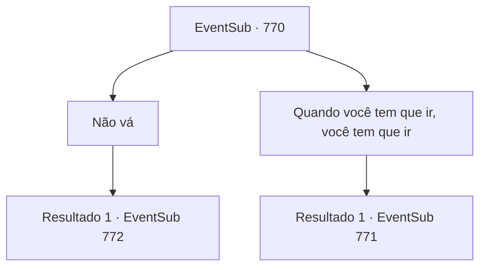

# Eventos secundários · 770

[Índice da tabela](index.md) · [Índice geral](../index.md)

ID: `pt:EventSub:770` · Fonte: `EventSub4` · Versão: 1.2.47.

Mapeamento estático dos arquivos; a disponibilidade e a execução dependem do estado da run.

## Texto do evento

*Sem texto no arquivo.*

## Dados de entrada

```json
{
  "id": 770,
  "grade": 1,
  "subEvent": "",
  "required": ""
}
```

## Mapa das escolhas



## Escolhas e resultados

### Escolha 1

Não vá

Requisitos e outros campos da escolha:

```json
{
  "required": "24_1_1"
}
```

#### Resultado 1.1

Você pergunta a Lei se ele não pode ficar. Em resposta, ele caminha lentamente até você e te abraça. 

 "Estas são... as palavras exatas que eu queria ouvir. Mas, temo que não posso. Vou restaurar a glória do meu clã com Shao e ser reconhecido como um guerreiro. Essa é minha prioridade."

 Um breve silêncio preenche o ar. O brilho da lua ilumina você e Lei. Lei olha nos seus olhos, sorri calorosamente e continua. 

 "Fufu... Por enquanto, pelo menos. Prometo que voltarei, assim que meus assuntos lá estiverem resolvidos. Você vai me esperar?"


Continuação registrada: [Evento 772](0772.md) na mesma tabela.

```json
{
  "required": "",
  "chance": "1",
  "nextEvent": 772,
  "type": 2,
  "reward": ""
}
```

### Escolha 2

Quando você tem que ir, você tem que ir

Requisitos e outros campos da escolha:

```json
{
  "required": ""
}
```

#### Resultado 2.1

Você não impede Lei. Em vez disso, você oferece a ele seu sinal de apoio. Por um momento, ele parece surpreso. Então, ele faz a saudação oriental, suas mãos tremendo. 

 "Oh... uh, Sohyeop... Nós... provavelmente nos cruzaremos novamente no futuro. Agora, se me der licença..."


Continuação registrada: [Evento 771](0771.md) na mesma tabela.

```json
{
  "required": "",
  "chance": "1",
  "nextEvent": 771,
  "type": 2,
  "reward": ""
}
```

## Referências que chegam a este evento

- [Evento 769 · escolha 1 · resultado 4](0769.md#escolha-1)
- [Evento 789 · escolha 1 · resultado 2](0789.md#escolha-1)
- [Evento 789 · escolha 1 · resultado 4](0789.md#escolha-1)
